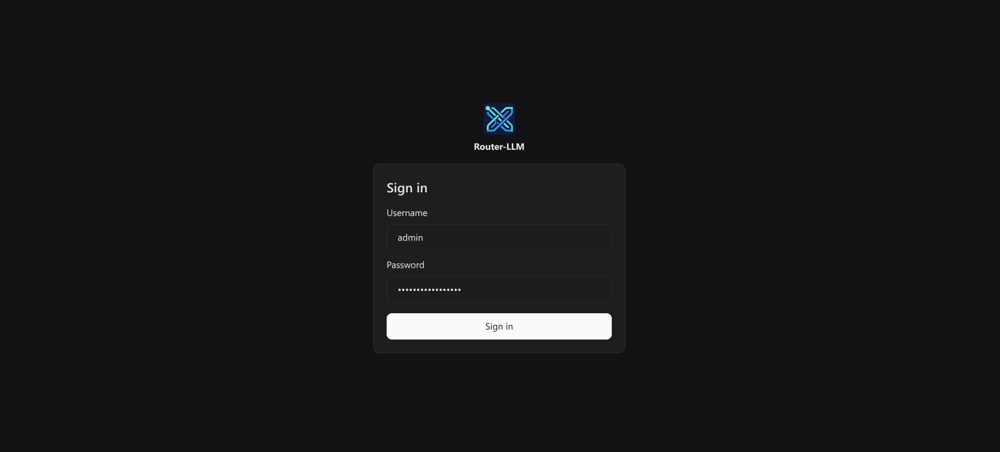
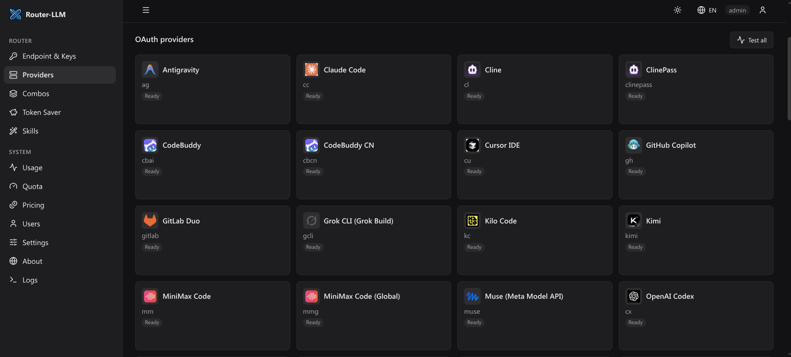
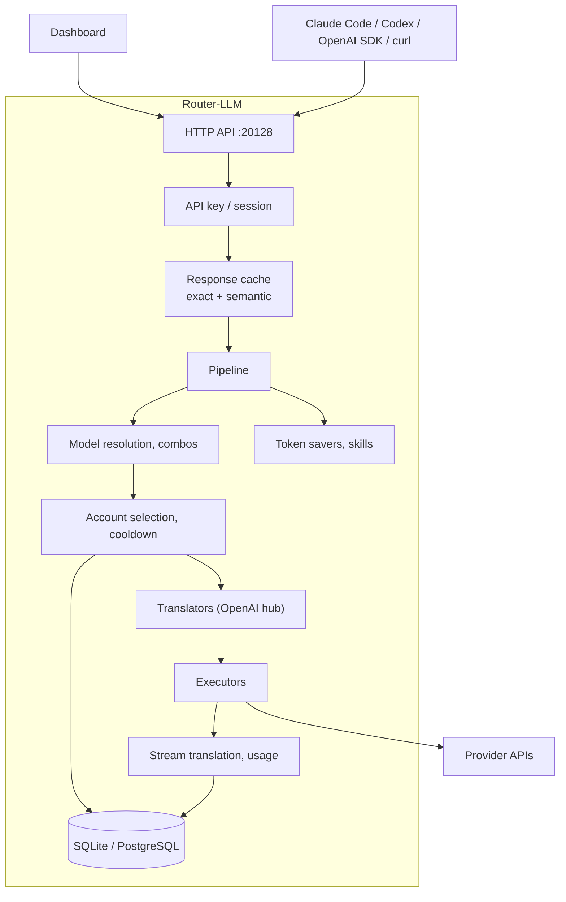

<p align="center"></p>

# 🔀 Router-LLM - Single Endpoint for Every LLM Provider

**Router-LLM** (short name **RLLM**, binary `rllmx`) is an LLM gateway in Go built on the Goravel Lite framework. One base URL routes each request to a configured provider, in the OpenAI, Anthropic, Gemini and Responses shapes, with account and model fallback, OAuth refresh, and usage and cost tracking.

It is a Go rewrite of [9Router](https://github.com/decolua/9router) and follows its extended fork [9Router-Extended](https://github.com/thunderkex/9router-extended), written independently, and opens an existing 9router database as a drop-in replacement. It ships as one static `CGO_ENABLED=0` binary with an embedded dashboard, under the MIT License.

**Scope:** an LLM request router. No MITM interception, tunnels, installers, launchers or cloud sync.

---

## ✨ Why Router-LLM?

*   **🔌 One Endpoint:** `/v1/chat/completions`, `/v1/messages`, `/v1/responses`, Gemini `/v1beta` plus `/v1/models`, embeddings, images and audio on one port. Claude Code, Codex and the OpenAI SDKs work against it unchanged.
*   **🔁 Format Translation:** an OpenAI Chat hub with Claude, Gemini, Responses, Kiro, Cursor and Ollama both ways, streaming.
*   **🧩 Combos:** an ordered member list with fallback, round-robin, a smart router, a judge-merged fusion panel, and a vision and audio adapter for a model that cannot read the turn. Each row reads the smallest context window and output its members promise.
*   **♻️ Account Rotation & Cooldown:** many accounts per provider, fill-first or sticky round-robin, per-model locks, exponential backoff on 429.
*   **🔑 OAuth & Tokens:** Claude Code, Codex, GitHub Copilot, Gemini CLI, Kiro; refresh before expiry, on 401 and in the background; plus token and PAT importers for the providers that take one.
*   **🖼️ Media:** embeddings, image generation, speech, transcription, voice lists, video, web search, page fetch, and the web providers.
*   **✂️ Token Savers & Skills:** RTK tool-output filters, two built-in prompt styles, a custom prompt, an Allow REA safety-paragraph stripper, an optional Headroom sidecar and a watermark remover that also strips invisible characters from answers. A skill registry with memory, commit and design skills, Skills Studio for declarative rules, and a synced catalog. Skills are data, never code.
*   **🩺 Health Aware:** latency and success tracking, a circuit breaker, model probes, ranked combo suggestions, and a quota tracker that reads each provider's limits and, where the provider grants one, resets a window.
*   **🗂️ Drop-In Database:** the 9router SQLite schema for providers, keys, combos and settings; SQLite by default, PostgreSQL optional, credentials sealed.
*   **📈 Usage Analytics:** one metadata-only row per request (key, model, tokens, cost, latency) in a separate store; no bodies, no prompts.
*   **⚡ Cache:** in-process by default, Redis optional, requests survive a Redis loss. An exact response cache plus an optional semantic layer that answers a rephrased request from a stored one.
*   **📊 Dashboard & Binary:** sign-in, endpoint and keys with users and roles, every provider login flow, combos, usage, quota, pricing, console log, settings and single sign-on, skills, token savers, and an About page whose admin action updates the binary. Pure Go, Linux, macOS and Windows, amd64 and arm64.

---

## 📸 Screenshots

<p align="center"></p>
<p align="center"></p>

The sign-in card and the provider list. Every page, from Endpoint & Keys to About: **[docs/SCREENSHOTS.md](docs/SCREENSHOTS.md)**.

---

## 🏗️ Architecture at a Glance



See **[docs/ARCHITECTURE.md](docs/ARCHITECTURE.md)** for the module map, the design decisions and the Go conventions.

---

## 📚 Documentation

| Doc | Covers |
|---|---|
| [docs/ARCHITECTURE.md](docs/ARCHITECTURE.md) | Module map, design decisions, approved modules, Go conventions |
| [docs/WORKFLOWS.md](docs/WORKFLOWS.md) | Pipeline, startup order and operator procedures |
| [docs/MIGRATING.md](docs/MIGRATING.md) | Moving from 9Router to Router-LLM and back, step by step |
| [docs/SCREENSHOTS.md](docs/SCREENSHOTS.md) | Every dashboard page, from sign-in to About |
| [docs/PARITY.md](docs/PARITY.md) | The reference version and the status vocabulary |
| [docs/DIVERGENCES.md](docs/DIVERGENCES.md) | Every deliberate difference from the reference, indexed |
| [docs/design/](docs/design/) | One design document per area: status, design, parity rows, divergences, findings |
| [ROADMAP.md](ROADMAP.md) | What is built, partial and planned |
| [docs/ENVIRONMENT.md](docs/ENVIRONMENT.md) | Every environment variable, in `.env.example` order |
| [docs/METRICS.md](docs/METRICS.md) | The `GET /metrics` export for Prometheus and Grafana, with every metric and its queries |
| [.env.example](.env.example) | The same variables as a file to copy |

---

## ⚠️ Upgrading

**Back up `DATA_DIR` before an upgrade.** It holds the database and the sealed credentials, and `DB_ENCRYPTION_SECRET` is the only key to them.

```sh
rllmx artisan upgrade --check   # is there a newer release?
rllmx artisan upgrade           # download, verify the checksum, replace this binary, restart
```

`--yes` skips the confirmation. An administrator can run the same upgrade from the dashboard's About page. The archive is checked against the release's `checksums.txt` before the running binary is replaced, and the process re-executes itself with no shell and no child command.

Container deployments pull the new tag instead (`docker pull dimaskiddo/rllmx:latest`) and are recreated with the same volume, because the binary inside the image is root-owned and cannot replace itself. The image is distroless: no shell, no package manager, and it runs as uid 65532.

> **Credentials are sealed on first start.** A database opened with `DB_ENCRYPTION_SECRET` set is sealed in place after a full backup is written; 9router cannot open it afterwards. Going back is `rllmx artisan db:export-plain`. Keep the secret: losing it loses every stored credential.

---

## 🚀 Getting Started

### 📋 Prerequisites

*   **Go** 1.26+ (the Makefile and Dockerfile build with `GOTOOLCHAIN=local`)
*   **Make** (for builds)
*   **Docker** (optional, for the container)

---

## 🛠️ Deployment

### 🐳 **Using Container**

```sh
docker run -d \
  -p 20128:20128 \
  -p 127.0.0.1:1455:1455 \
  -e OAUTH_CALLBACK_HOST=0.0.0.0 \
  -e APP_KEY=$(openssl rand -hex 16) \
  -e JWT_SECRET=change-me-to-a-long-random-secret \
  -e AUTH_INITIAL_PASSWORD=change-me \
  -e DB_ENCRYPTION_SECRET=$(openssl rand -hex 32) \
  -v rllmx-storage:/usr/local/rllmx/storage:rw \
  --name rllmx \
  dimaskiddo/rllmx:latest
```

`DB_ENCRYPTION_SECRET` is required and seals every stored credential; generate it once, because losing it is unrecoverable. Open `http://localhost:20128`, sign in with `AUTH_INITIAL_PASSWORD`, add a provider, create an API key.

The image runs as uid 65532 and ships no shell. Use a named volume as above; a bind mount must be owned by that user first (`chown -R 65532:65532 /path/to/storage`). Codex login only is on port 1455 and `OAUTH_CALLBACK_HOST`: Codex returns the browser to `http://localhost:1455/auth/callback`, so the login self-completes only on the machine that publishes that port; elsewhere, paste the address it landed on. Claude needs no extra port: the login returns to the router's port, or takes the same paste step.

### 📦 **Using Pre-Built Binaries**

Download the archive for your platform from the [Releases Page](https://github.com/dimaskiddo/rllmx/releases) and unpack it; it holds the binary, `README.md`, `LICENSE` and `.env.example`.

#### 🐧 **Linux / 🍎 macOS**

```sh
chmod +x rllmx
cp .env.example .env        # set APP_KEY, DB_ENCRYPTION_SECRET, JWT_SECRET and AUTH_INITIAL_PASSWORD
./rllmx                     # ./rllmx artisan key:generate writes APP_KEY
```

#### 🪟 **Windows**

```powershell
.\rllmx.exe artisan key:generate
.\rllmx.exe
```

Run it from the folder that holds `.env`.

### 🔐 Verifying Releases

Every release publishes `checksums.txt`. `rllmx artisan upgrade` verifies the archive automatically; to verify a manual download:

```sh
sha256sum -c checksums.txt --ignore-missing
```

### 🏗️ **Build From Source**

```sh
git clone https://github.com/dimaskiddo/rllmx.git
cd rllmx
make build            # binary in dist/rllmx
go run .              # start from source
./artisan             # list the commands
```

---

## 🕹️ Usage & Commands

`rllmx artisan <name>` from a binary, `./artisan <name>` from the source tree.

| Command | What it does |
|---|---|
| `rllmx` | Start the HTTP server (the default with no command). One server per data directory; a second server, or `db:vacuum` while serving, is refused. Ctrl+C or SIGTERM drains the server within the grace period. |
| `rllmx artisan version` | Version and commit hash. |
| `rllmx artisan upgrade [--check --yes]` | Replace this binary with the newest release for the platform, checksum verified, and restart it. |
| `rllmx artisan health` | Check `/api/health` of the local server; the exit code reflects the result. Used by the container health check. |
| `rllmx artisan keys:create\|list\|revoke` | Create, list (masked, with the checksum class) or deactivate a client key. Asks for the dashboard password. |
| `rllmx artisan password:reset` | Replace the dashboard password and end every session. Asks the current one, then the new one twice. |
| `rllmx artisan auth:mode` | Choose how the dashboard is signed into (`password`, `oidc`, `saml`, `sso` or `both`) and, in the same run, set the OIDC issuer and client id; the client secret is a hidden prompt. The password form stays until the chosen SSO is configured. |
| `rllmx artisan skills:sync --source <folder\|https-url> [--tag main] [--force]` | Import a skill catalog, local or cloned from an allowlisted https source; with no source, the official catalog. |
| `rllmx artisan db:backup\|check\|vacuum` | Back up SQLite, verify integrity and schema, run an explicit full vacuum (asks y/N). |
| `rllmx artisan db:migrate` | Create or update the database schema without starting the server; stop the server first, and run the import once this succeeds. |
| `rllmx artisan db:import-config --from <path>` | Seed an empty SQLite or PostgreSQL database from a 9router database: providers, keys, nodes, combos, aliases and the settings a new deployment needs, in one transaction. `--dry-run` shows the plan and writes nothing; `--yes` skips the prompt; `--with-sso` also copies the login policy. Usage, the dashboard password and the old deployment's proxy, tunnel and observability settings stay behind. |
| `rllmx artisan db:import-analytics --from <file> [--drop-old]` | Move usage history from a 9router database into the analytics store; the source defaults to this data directory's database, a rerun adds nothing, and totals are verified against the source. `--drop-old` then removes `usageHistory`, `usageDaily` and `requestDetails`: it needs a terminal and a typed `DROP`, refuses while any row is unreadable, and writes `db/backups/before-drop-*` first. |
| `rllmx artisan db:export-plain [--out <dir>]` | A database copy with every credential in plain text, for going back to 9router; SQLite only. Asks for the dashboard password. |

Local database only. `keys` and `password` take hidden input, never flags or environment variables. No password for `db` commands except `db:export-plain` (plain-text credentials); the data-changing ones confirm. Providers and remote administration live in the dashboard.

### Connecting a client

Point the client's base URL at the router and use a key created in the dashboard. Chat, messages, responses, models, embeddings, image generation, speech and transcription are served.

```sh
# OpenAI SDKs and compatible tools
export OPENAI_BASE_URL="http://localhost:20128/v1"
export OPENAI_API_KEY="sk-..."

# Claude Code
export ANTHROPIC_BASE_URL="http://localhost:20128/v1"
export ANTHROPIC_AUTH_TOKEN="sk-..."
```

Model addressing: `provider/model` (`openai/gpt-5`), a combo name, or an alias. Remote requests always need an API key; local requests follow `requireApiKey`, which is on by default.

### Migrating from 9router

Import into a store this build owns instead of opening 9router's file: the source is only read, the new install gets its own encryption secret, and the backend may be **SQLite or PostgreSQL**. The `.env` each step needs, the container commands, the way back and every error it can raise are in **[docs/MIGRATING.md](docs/MIGRATING.md)**.

---

## ⚙️ Configuration

Environment variables or `.env` through `config/`; the process environment wins. Every variable, its default and its accepted values: **[docs/ENVIRONMENT.md](docs/ENVIRONMENT.md)**, in the same order as [`.env.example`](.env.example), which you can copy and edit.

| Variable | Required | Purpose |
|---|---|---|
| `APP_KEY` | yes | 32 characters, `./artisan key:generate`. The framework's key, separate from `DB_ENCRYPTION_SECRET` |
| `DB_ENCRYPTION_SECRET` | yes | 64 hex characters, `openssl rand -hex 32`. Seals every stored credential; losing it loses them |
| `AUTH_INITIAL_PASSWORD` | yes | The first dashboard password |
| `DATA_DIR` | no | `storage/app`: databases, backups, skills, secret files; logs in `storage/logs` |
| `DB_CONNECTION` | no | `sqlite` (default, 9router's format) or `postgres` |

Routing strategies, token savers, the response cache and its semantic layer are runtime database settings, edited in the dashboard. A key is never shown again after saving, and a connection test reports a fixed message, never the provider's error text.

---

## 🧪 Testing

```sh
make test        # go test ./... (CGO off)
make test-race   # with the race detector (needs a C toolchain, tests only)
make test-pg     # the PostgreSQL suite
```

PostgreSQL tests read `TEST_PG_DSN` (a database where the user may create and drop schemas) and skip when it is unset.

---

## ✍️ Authors

*   **Dimas Restu Hidayanto** - *Initial Work & Architecture* - [DimasKiddo](https://github.com/dimaskiddo)

See also the list of [contributors](https://github.com/dimaskiddo/rllmx/contributors) who participated in this project.

---

## 🙏 Acknowledgements

**9Router** by [decolua](https://github.com/decolua) and contributors (MIT) sets the behaviour this router follows: the database format, the client-facing APIs and the translation rules. **9Router-Extended** by [thunderkex](https://github.com/thunderkex) (MIT) is the fork whose additions — the pluggable skill registry and Skills Studio, routing health and auto plan — Router-LLM also follows. Both were read as behaviour references; the Go code is written independently, with no shared source.

---

## 🏗️ Dependencies

Pure Go, no CGO. Approved modules and the rules for adding one: [`docs/ARCHITECTURE.md`](docs/ARCHITECTURE.md) and [`AGENTS.md`](AGENTS.md).

*   **[Go](https://go.dev/)** — the language and standard library
*   **[Goravel](https://github.com/goravel/framework)** — framework, with its official SQLite, PostgreSQL and Redis drivers
*   **[tidwall/gjson](https://github.com/tidwall/gjson)**, **[tidwall/sjson](https://github.com/tidwall/sjson)** — in-place JSON edits that keep a stored row byte-identical
*   **[gofrs/flock](https://github.com/gofrs/flock)** — the data-directory lock
*   **[subosito/gotenv](https://github.com/subosito/gotenv)** — `.env` key and size checks
*   **[go-jose/go-jose](https://github.com/go-jose/go-jose)** — OIDC token key selection
*   **[russellhaering/goxmldsig](https://github.com/russellhaering/goxmldsig)** — SAML signature verification
*   **[golang.org/x/net](https://pkg.go.dev/golang.org/x/net)**, **[golang.org/x/text](https://pkg.go.dev/golang.org/x/text)**, **[golang.org/x/sync](https://pkg.go.dev/golang.org/x/sync)**, **[golang.org/x/term](https://pkg.go.dev/golang.org/x/term)** — HTML parsing and charset decoding, Unicode folding, `singleflight`, the hidden prompt
*   **[google.golang.org/protobuf](https://pkg.go.dev/google.golang.org/protobuf)** — Cursor's wire format
*   **[andybalholm/brotli](https://github.com/andybalholm/brotli)** — the Brotli encoder
*   **[google/uuid](https://github.com/google/uuid)** — stored row ids

The dashboard vendors Alpine.js (CSP build), Tabler CSS, Lucide, Chart.js and Sortable.js, each pinned and hash-checked in `web/static/lib/VERSIONS.json`.

---

## ⚠️ Disclaimer

**Do with your own risk (DWYOR).** Provided "as is", without warranty of any kind, express or implied.

- Protect `DATA_DIR`; it holds provider credentials and OAuth tokens.
- Do not expose the port to untrusted networks without API keys and a strong dashboard password.
- Routing subscription-based accounts may conflict with a provider's terms of service. That is your responsibility.
- The authors are not responsible for any damage caused by use of this application.

---

## 🔐 Security

Report a vulnerability through GitHub Security Advisories (the **Security** tab), not in a public issue.

- Credentials and OAuth tokens are sealed with `DB_ENCRYPTION_SECRET`.
- No token, key, cookie or prompt text is ever logged.
- Every outbound request goes through an SSRF-guarded dialer, with TLS always verified.
- Protect `DATA_DIR`, set `AUTH_SSO_ADMIN` deliberately, and use a strong dashboard password on any reachable deployment.

More in [`docs/design/`](docs/design/).

---

## 🤝 Contributing

Open an issue to discuss a change before a large pull request; small fixes are welcome directly. [`AGENTS.md`](AGENTS.md) holds the engineering rules every change follows, and [`docs/ARCHITECTURE.md`](docs/ARCHITECTURE.md) the design. Run `make test` and `staticcheck ./...` before opening a PR.

---

## 🧩 Compatibility

Router-LLM opens an existing 9router database (schema version 2 and later, migrated by 9router itself) as a drop-in replacement: providers, keys, nodes, combos, aliases and settings read unchanged, and unmodified rows stay byte-identical. The client APIs are OpenAI, Anthropic (Messages), Gemini (`/v1beta`), OpenAI Responses and Ollama. Builds for Linux, macOS and Windows on amd64 and arm64; no CGO.

An API key limited to a list of models may call only that list; every other chat and media route answers 403.

---

## ⚖️ License

**MIT License**. See [LICENSE](LICENSE).

---
**Router-LLM** — *Single endpoint for every model.* 🔀
