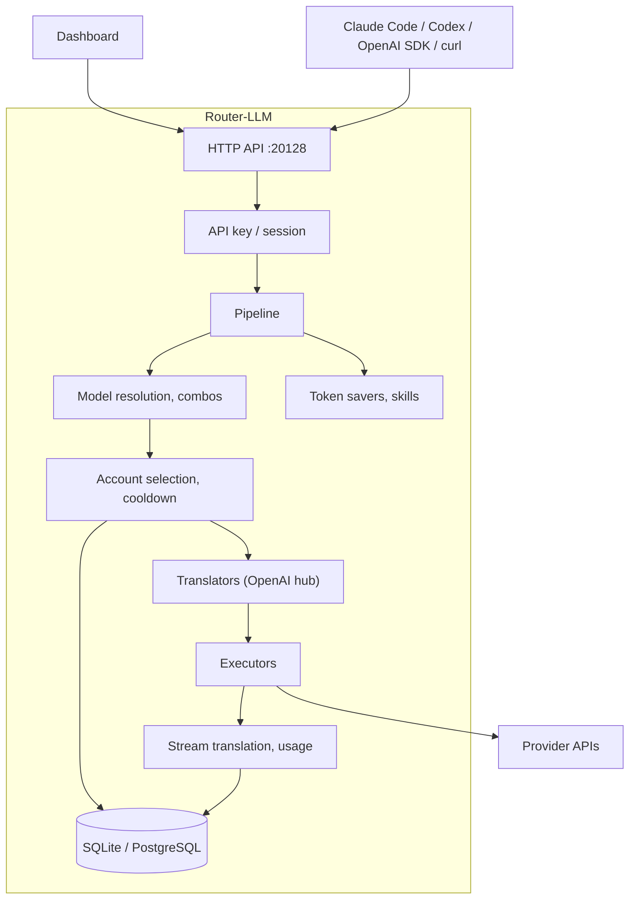

# 🔀 Router-LLM - Single Endpoint for Every LLM Provider

**Router-LLM** (short name **RLLM**, binary `rllmx`): LLM gateway in Go on the Goravel Lite framework. One base URL routes each request to a configured provider: OpenAI, Anthropic, Gemini and Responses translation, account and model fallback, OAuth refresh, usage and cost tracking.

Go rewrite of [9router](https://github.com/decolua/9router); opens an existing 9router database as a drop-in replacement. Single static binary, embedded dashboard, MIT License.

**Scope:** an LLM request router. No MITM interception, tunnels, installers, launchers.

---

## 🚧 Project Status

In development, early, and usable today for chat, models and media. The table is a summary; [`ROADMAP.md`](ROADMAP.md) says what each area includes.

| Area | Status |
|---|---|
| HTTP server, guard, configuration, logging, storage (SQLite and PostgreSQL), sealing, legacy imports, cache, SSE writer, maintenance and `db:*`/`keys:*`/`password:reset` commands | Built |
| Password login with dashboard sessions, API keys, OIDC and SAML sign-in, SSRF-guarded outbound client | Built |
| Request pipeline, model resolution, account selection and cooldown, format translation, executors, OAuth login and token refresh | Built |
| Embeddings, image generation, speech, transcription and voice lists | Built |
| Combos, token savers, skills, the full dashboard | Planned |

Design and parity: [`docs/ARCHITECTURE.md`](docs/ARCHITECTURE.md), [`docs/PARITY.md`](docs/PARITY.md), [`docs/DIVERGENCES.md`](docs/DIVERGENCES.md), and one design document per area in [`docs/design/`](docs/design/).

---

## ✨ Why Router-LLM?

*   **🔌 One Endpoint:** `/v1/chat/completions`, `/v1/messages`, `/v1/responses`, Gemini `/v1beta` plus `/v1/models`, embeddings, images and audio on one port; Claude Code, Codex and OpenAI SDKs work as-is. ✅
*   **🔁 Format Translation:** OpenAI Chat hub; Claude, Gemini, Responses, Kiro, Cursor and Ollama both ways, streaming. ✅
*   **🧩 Combos:** Ordered list, rotation, router-model pick, judge-merged panel. ⏳
*   **♻️ Account Rotation & Cooldown:** Many accounts per provider, fill-first or sticky round-robin, per-model locks, exponential backoff on 429.
*   **🔑 OAuth & Tokens:** Claude Code, Codex, GitHub Copilot, Gemini CLI, Kiro; refresh before expiry, on 401, in background.
*   **🖼️ Media:** Embeddings, images, speech, transcription, voice lists, video, web search, page fetch, and the web providers chatgpt-web, uc-web and veoaifree-web. ✅
*   **✂️ Token Savers & Skills:** RTK tool-output filters, two built-in prompt styles, custom prompt, optional Headroom sidecar, Skills Studio declarative rules (no code). ⏳
*   **🩺 Health Aware:** Latency and success tracking, circuit breaker, model probes, ranked combo suggestions. ⏳
*   **🗂️ Drop-In Database:** 9router SQLite schema for providers, keys, combos; SQLite default, PostgreSQL optional, credentials sealed.
*   **📈 Usage Analytics:** Metadata-only row per request (key, model, tokens, cost, latency) in a separate store; no bodies, no prompts.
*   **⚡ Cache:** In-process default, Redis optional; requests survive Redis loss.
*   **📊 Dashboard & Binary:** Login and callback pages today, the rest planned. Pure Go, `CGO_ENABLED=0`, Linux, macOS, Windows, amd64, arm64.

---

## 🏗️ Architecture at a Glance



---

## 🚀 Getting Started

**Prerequisites:** Go 1.26+ (Makefile and Dockerfile build with `GOTOOLCHAIN=local`), Make, Docker (optional).

### 🐳 Using Container

```sh
docker run -d \
  -p 20128:20128 \
  -p 127.0.0.1:1455:1455 \
  -e OAUTH_CALLBACK_HOST=0.0.0.0 \
  -e APP_KEY=$(openssl rand -hex 16) \
  -e JWT_SECRET=change-me-to-a-long-random-secret \
  -e AUTH_INITIAL_PASSWORD=change-me \
  -e DB_ENCRYPTION_SECRET=$(openssl rand -hex 32) \
  -v /path/to/storage:/usr/local/rllmx/storage:rw \
  --name rllmx \
  dimaskiddo/rllmx:latest
```

`DB_ENCRYPTION_SECRET` required, seals every stored credential; generate once, loss is unrecoverable. Open `http://localhost:20128`, sign in with `AUTH_INITIAL_PASSWORD`, add a provider, create an API key.

Port 1455 and `OAUTH_CALLBACK_HOST`: Codex login only. Codex returns the browser to `http://localhost:1455/auth/callback`; login self-completes only on the machine publishing that port, otherwise paste the landed address. Claude needs no extra port: login returns to the router's port, or the same paste step.

### 📦 Using Pre-Built Binaries

Download from the [Releases Page](https://github.com/dimaskiddo/rllmx/releases), then:

```sh
chmod +x rllmx
cp .env.example .env   # set APP_KEY (`./rllmx artisan key:generate`), DB_ENCRYPTION_SECRET and the auth values
./rllmx
```

Windows: `rllmx.exe` from the folder holding `.env`. Verify: `sha256sum -c checksums.txt --ignore-missing`.

### 🏗️ Build From Source

```sh
git clone https://github.com/dimaskiddo/rllmx.git
cd rllmx
make build   # binary in dist/rllmx; go run . starts it from source, ./artisan lists the commands
```

---

## 🕹️ Commands

`rllmx artisan <name>` from a binary, `./artisan <name>` from the source tree.

| Command | What it does |
|---|---|
| `rllmx` | Start the HTTP server (default with no command). One server per data directory; a second server, or `db:vacuum` while serving, refused. Ctrl+C or SIGTERM drains the server within the grace period (streams finish once the pipeline exists). |
| `rllmx artisan version` | Version and commit hash. |
| `rllmx artisan health` | Check `/api/health` of the local server; exit code reflects the result. Used by the container health check. |
| `rllmx artisan keys:create\|list\|revoke` | Create, list (masked, with the checksum class) or deactivate a client key. Asks for the dashboard password. |
| `rllmx artisan password:reset` | Replace the dashboard password and end every session. Asks the current one, then the new one twice. |
| `rllmx artisan auth:mode` | Choose how the dashboard is signed into (`password`, `oidc`, `saml`, `sso` or `both`) and, in the same run, set the OIDC issuer and client id; the client secret is a hidden prompt. The password form stays on until the chosen SSO is configured. |
| `rllmx artisan db:backup\|check\|vacuum` | Back up SQLite, verify integrity and schema, explicit full vacuum (asks y/N). |
| `rllmx artisan db:migrate` | Create or update the database schema without starting the server; stop the server first, and run the import once this succeeds. |
| `rllmx artisan db:import-analytics [--from <file>] [--drop-old]` | Move usage history from a 9router database into the analytics store; source defaults to this data directory's database, rerun adds nothing, totals verified against the source. `--drop-old` then removes `usageHistory`, `usageDaily`, `requestDetails`: needs a terminal and a typed `DROP`, refuses while any row is unreadable, writes `db/backups/before-drop-*` first. |
| `rllmx artisan db:import-config --from <path>` | Seed an empty SQLite or PostgreSQL database from a 9router database: providers, keys, nodes, combos, aliases and the settings a new deployment needs, one transaction. `--dry-run` shows the plan, writes nothing; `--yes` skips the prompt; `--with-sso` also copies the login policy. Usage, the dashboard password and the old deployment's proxy, tunnel, observability settings stay behind. |
| `rllmx artisan db:export-plain` | Database copy with every credential in plain text, for going back to 9router. Asks for the dashboard password. |

Local database only. `keys` and `password`: hidden input, never flags or environment variables. No password for `db` commands except `db:export-plain` (plain-text credentials); data-changing ones confirm. Providers and remote administration: dashboard.

### Connecting a client

Point the client's base URL at the router and use a key created in the dashboard. Chat, messages, responses, models, embeddings, image generation, speech and transcription are served.

```sh
# OpenAI SDKs and compatible tools
export OPENAI_BASE_URL="http://localhost:20128/v1"
export OPENAI_API_KEY="sk-..."

# Claude Code
export ANTHROPIC_BASE_URL="http://localhost:20128/v1"
export ANTHROPIC_AUTH_TOKEN="sk-..."
```

Model addressing: `provider/model` (`openai/gpt-5`), combo name, alias. Remote requests always need an API key; local requests follow `requireApiKey`, on by default.

### Migrating from 9router

1. Stop 9router. Never run both against one database. Back up `~/.9router/db/data.sqlite`.
2. Start Router-LLM with `DATA_DIR=~/.9router` (default `storage/app`).
3. 9router variable names are not read. Copy the **values**     of `API_KEY_SECRET`, `MACHINE_ID_SALT`, `JWT_SECRET` into `AUTH_API_KEY_SECRET`, `AUTH_MACHINE_ID_SALT`, `JWT_SECRET`, or existing keys and logins stop working. All renames: [`docs/design/17-Configuration.md`](docs/design/17-Configuration.md).
4. Set `DB_ENCRYPTION_SECRET`. First start seals credentials after a full backup; 9router then cannot open the file (undo with `rllmx artisan db:export-plain`).
5. Usage history stays in the old tables until `rllmx artisan db:import-analytics` runs.

Legacy `db.json` and `usage.json` import unsupported; open a database 9router already migrated.

**New deployment on an empty database:** seed from the old one with `rllmx artisan db:import-config --from ~/.9router` and `--dry-run` first.

- **Copied:** API keys, providers, custom nodes, combos, aliases, custom and disabled models, pricing overrides, and the settings that record active skills and savers. `--with-sso` also copies the login policy.
- **Skipped:** usage, analytics, request details, the dashboard password and the rest of the login policy.
- **Then:** set `AUTH_API_KEY_SECRET` and `AUTH_MACHINE_ID_SALT` to the old install's values so imported keys still work, and stop the old install, because rotating refresh tokens would otherwise invalidate each other.

---

## ⚙️ Configuration

Environment variables or `.env` through `config/`; the process environment wins. `.env.example`: every variable with its default. `APP_KEY` (32 characters, `./artisan key:generate`) required at start, separate from `DB_ENCRYPTION_SECRET`. Main ones:

| Variable | Default | Purpose |
|---|---|---|
| `APP_PORT` / `APP_HOST` | `20128` / `127.0.0.1` | Listen port, address (container: `0.0.0.0`) |
| `HTTP_SERVER_SHUTDOWN_GRACE` | `30s` | Shutdown grace for running requests; second signal exits at once |
| `HTTP_SERVER_READ_HEADER_TIMEOUT` / `HTTP_SERVER_IDLE_TIMEOUT` | `10s` / `120s` | Request-header deadline; idle connection lifetime |
| `HTTP_COMPRESSION` | `true` | Brotli or gzip for answers worth compressing; never for streams, audio, video or images. `false` behind a proxy that compresses |
| `HTTP_H2C` | `false` | HTTP/2 on the plain listener, for a reverse proxy that multiplexes to the router |
| `SERVER_MAX_BODY_MB` | `128` | Largest client API request body |
| `SERVER_TRUST_LOOPBACK` | `true` | Local = this machine. `false` behind a same-machine tunnel or reverse proxy (cloudflared, ngrok, `tailscale serve`, nginx): traffic arrives from 127.0.0.1 |
| `SERVER_TRUSTED_PROXIES` | empty (loopback only) | Reverse proxies whose `X-Forwarded-For` and `X-Forwarded-Proto` are believed |
| `APP_URL` | empty | Public gateway address (`https://gw.example.com`); needed for OIDC and SAML from another machine, and it builds the SAML entity id |
| `OAUTH_CALLBACK_HOST` | `127.0.0.1` | Codex login listener bind address (port 1455); `0.0.0.0` in a container |
| `OAUTH_BACKGROUND_REFRESH` | `true` | Background OAuth token renewal before expiry |
| `DATA_DIR` | `storage/app` | Database, secrets, skills, caches; logs in `storage/logs` |
| `JWT_SECRET` | generated into `DATA_DIR/jwt-secret` | Dashboard session signing |
| `AUTH_INITIAL_PASSWORD` | none (set it) | First dashboard password |
| `AUTH_API_KEY_SECRET` / `AUTH_MACHINE_ID_SALT` | 9router's defaults | API key, machine id derivation; your 9router values |
| `AUTH_SSO_ALLOW` | empty | Exact emails or `@domain` entries for OIDC sign-in. **Empty admits any account the provider accepts.**     |
| `DB_CONNECTION` / `DB_DATABASE` | `sqlite` / empty | SQLite default, 9router's own format; `postgres` also needs `DB_HOST`, `DB_USERNAME`, `DB_PASSWORD`. Empty `DB_DATABASE` with SQLite = `DATA_DIR/db/data.sqlite`; point at a 9router `data.sqlite` to reuse it |
| `DB_ENCRYPTION_SECRET` | none, **required**     | 64 hex characters sealing every stored credential with AES-256-GCM |
| `DB_DATABASE_ANALYTICS` / `ANALYTICS_RETENTION_DAYS` | empty / `90` | Usage-row destination (empty: beside the main database); per-request row retention |
| `REDIS_HOST` / `REDIS_PORT` | empty / `6379` | In-process memory store default; `REDIS_HOST` also uses Redis or Valkey for shared cache groups |
| `LOG_CHANNEL`, `LOG_LEVEL`, `LOG_OUTPUT` | `single`, `info`, `both` | Goravel log channel (`single`, `daily`, `stack`), level, and whether an entry goes to the file, the standard output or both (`storage/logs/rllmx.log`) |
| `OAUTH_CLIENT_ID_<PROVIDER>` / `OAUTH_CLIENT_SECRET_<PROVIDER>` | empty in code; `.env.example` holds the vendors' published installed-app values | OAuth app credentials per provider. Empty: that login off. Replace any value with your own app when you register one |
| `UPSTREAM_ALLOW_PRIVATE` | empty | Hosts, addresses, CIDRs reachable on a private network or this machine (`localhost` node, LAN host, private IdP). Link-local and cloud metadata always refused. Only this variable widens the list, never a dashboard session |
| `UPSTREAM_CONNECT_TIMEOUT` | `60s` | Upstream response-header deadline |
| `MEDIA_SEARXNG_URL` | empty | The SearXNG instance `/v1/search` sends to, e.g. `http://localhost:8888/search`. Empty serves no SearXNG. Its host is permitted for these calls, so a local instance needs no `UPSTREAM_ALLOW_PRIVATE` entry |

Routing strategies, token savers and similar behavior: runtime database settings, dashboard-edited.

**Providers and private addresses.** Connect-time permission check on the address actually used, redirects included. A `http://localhost:11434/v1` node or a LAN host needs an entry (`localhost`, `192.168.1.0/24`), as does `ollama-local` on its default port. Ollama clients: `POST /v1/api/chat`. A key is never shown again after saving, and a connection test reports a fixed message, never the provider's error text.

**Single sign-on.** OIDC and SAML are both built. Password login keeps working unless SSO-only mode is chosen **and** that SSO is fully set up.

- **OIDC:** issuer URL, client id and client secret in the settings row; register `https://<your address>/api/auth/oidc/callback` at the provider and set `APP_URL`.
- **SAML:** sign-on URL, the IdP's signing certificate and the issuer from its responses; register `https://<your address>/api/auth/saml/acs`, and offer `https://<your address>/api/auth/saml/metadata` as its metadata. Its entity id is that same address unless `samlIssuer` overrides it; a 9router import carries `urn:9router:sp` for you.
- **Allow list:** `AUTH_SSO_ALLOW` is optional. Empty admits every account the provider accepts, so set exact addresses or `@domain` entries unless you trust the provider to decide who belongs. An OIDC token without an `email` claim may fall back to `preferred_username`; only an exact entry admits that, never a whole `@domain`.
- **Sessions:** a password change, a narrowed allow list or switching the mode off ends a provider session at the next request.

---

## 🧪 Testing

```sh
make test        # go test ./... (CGO off)
make test-race   # with the race detector (needs a C toolchain, tests only)
```

PostgreSQL tests read `TEST_PG_DSN` (a database where the user may create and drop schemas) and skip when it is unset. The Redis store has no test that reads an environment variable yet.

---

## ✍️ Authors

*   **Dimas Restu Hidayanto** - *Initial Work & Architecture*     - [DimasKiddo](https://github.com/dimaskiddo)

## 🙏 Acknowledgements

Follows the behavior of [9router](https://github.com/decolua/9router) by decolua and contributors (MIT) and the extended fork built on it. Go code written independently; shared database format and client-facing API, no shared source.

## 🏗️ Dependencies

Approved modules and the rules for adding one: [`docs/ARCHITECTURE.md`](docs/ARCHITECTURE.md) and [`AGENTS.md`](AGENTS.md). Pure Go, no CGO.

---

## ⚠️ Disclaimer

**Use at your own risk.** Provided "as is", without warranty of any kind, express or implied.

- Protect `DATA_DIR`; it holds provider credentials and OAuth tokens.
- Do not expose the port to untrusted networks without API keys and a strong dashboard password.
- Routing subscription-based accounts may conflict with a provider's terms of service. That is your responsibility.
- The authors are not responsible for any damage from use of this application.

## 🔐 Security

Report a vulnerability through GitHub Security Advisories (the **Security** tab), not in a public issue.

- Credentials and OAuth tokens are sealed with `DB_ENCRYPTION_SECRET`.
- No token, key, cookie or prompt text is ever logged.
- Every outbound request goes through an SSRF-guarded dialer.
- Protect `DATA_DIR`, keep `AUTH_SSO_ALLOW` narrow, and use a strong dashboard password on any reachable deployment.

More in [`docs/design/`](docs/design/).

## 🤝 Contributing

Open an issue to discuss a change before a large pull request; small fixes are welcome directly. [`AGENTS.md`](AGENTS.md) holds the engineering rules every change follows, and [`docs/ARCHITECTURE.md`](docs/ARCHITECTURE.md) the design. Run `make test` and `staticcheck ./...` before opening a PR.

## 🧩 Compatibility

Router-LLM opens an existing 9router database (schema version 2 and later, migrated by 9router itself) as a drop-in replacement: providers, keys, nodes, combos, aliases and settings read unchanged, and unmodified rows stay byte-identical. The client APIs are OpenAI, Anthropic (Messages), Gemini (`/v1beta`), OpenAI Responses and Ollama. Builds for Linux, macOS and Windows on amd64 and arm64; no CGO.

A key limited to a list of models in 9router is refused with 403 on every chat and media route until the per-key check is built. It still lists its models.

## ⚖️ License

**MIT License**. See `LICENSE`.

---
**Router-LLM** - *Single endpoint for every model.* 🔀
