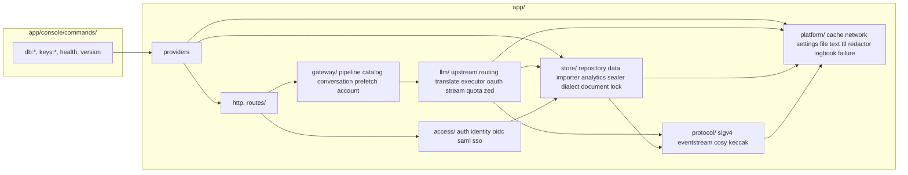

# Router-LLM - Architecture

Router-LLM is an LLM gateway in Go on Goravel Lite v1.18.0. A client sends a request in the OpenAI, Anthropic, Gemini or Responses format. The router picks an account for the model, translates the request to the provider's format, streams the answer back in the client's format and records usage.

It is one static binary. Once `app/git` lands, the only process it ever starts is `git`, for the skill update. Configuration defaults live in `.env.example`; never guess a value.

This file holds what cuts across every area:

- the module map
- the decisions behind the whole design
- the approved modules
- the Go conventions and terminal commands

Per-area design and status live in `docs/design/`. `AGENTS.md` holds scope, build and security constraints and the compatibility contract. `ROADMAP.md` says what is built.

---

## Module Map

Every node in the diagram is built. The table says what each package holds and who calls it.

| Package | Holds | Called by |
|---|---|---|
| `providers` | The framework boot, the bindings and the lazy sources | `bootstrap` |
| `http`, `routes/` | The guard, the URL rewrite, the middleware stack, the controllers and the route table | `providers` |
| `gateway/pipeline` | Parse, resolve, translate, the account loop, the answer and the usage row | `providers` (lazy) |
| `gateway/catalog` | The models a caller may call, for `/v1/models` and its relatives | the models controller (lazy) |
| `gateway/conversation` | The session a request belongs to | `pipeline` |
| `gateway/prefetch` | Remote image URLs turned into inline data, on a guarded client | `pipeline` |
| `gateway/account` | Account selection, error rules, backoff and locks | `pipeline` |
| `llm/upstream` | The provider registry, the price table, the capability tables and the synced catalog overlay | the router |
| `llm/routing` | A model name turned into a provider, model or combo | `pipeline` |
| `llm/translate` | The typed hub and the format codecs, one package per client format | `pipeline` |
| `llm/executor` | One request to one account; the answer is returned unread | `pipeline` |
| `llm/oauth` | Account logins and token renewal, one package per provider | the OAuth controller, `pipeline` |
| `llm/stream` | The SSE and NDJSON writers, the upstream readers, the pump and its timers | `pipeline` |
| `llm/media` | The media adapters, one package per family | `gateway/media` |
| `access/*` | Callers, API keys, dashboard sessions and OIDC, SAML and SSO | `http` |
| `store/*` | The repositories, the analytics store, the importer, the sealer, the document and dialect formats, and the data lock | `llm`, `gateway` |
| `protocol/*` | `sigv4`, `eventstream`, `cosy`, `keccak`, `websocket`: wire code that imports nothing in `app/` | `llm`, `store` |
| `platform/*` | `cache`, `network`, `settings`, `file`, `text`, `ttl`, `redactor`, `logbook`, `failure` | every domain |
| `web/` | The embedded login and callback pages | `http` |

| Source | Why it is built lazily |
|---|---|
| `providers.PipelineSource` | The stores open in a runner after the routes are declared |
| `providers.CatalogSource` | Same reason: it reads the stores |
| the media source | Same reason |
| the registry and capability tables | Read once at start, before any request |

| Test package | Holds |
|---|---|
| `tests` | Connections, the fake upstream, route, config, log and cache doubles, `Settings`, `Box` |
| `tests/store` | A migrated `repository.Store` |
| `tests/usage` | A sink that collects usage rows |
| `tests/login` | The OAuth fakes and rigs |

The root `tests` package may import only packages whose own tests do not import it back, and `tests/imports_test.go` fails when it does. A helper that needs `repository` or `analytics` lives in a sub-package.

Planned, not built: `saver`, `skill` and `plan`. `combo`, `health` and `probe` are built. See `ROADMAP.md`.

---

## Key Design Decisions

1. **Pure Go, no CGO.** Static binary, simple cross-compile, Windows included.
2. **Behavioral parity, independent code.** The references define behavior; the code is written fresh and tracked in `docs/PARITY.md`.
3. **Drop-in database.** Same schema and stored formats for the configuration tables; additive changes only; unknown JSON fields preserved.
4. **OpenAI hub translation.** One shape to translate through; every codec goes to or from the hub only, never direct.
5. **Registry-driven providers.** A provider is a data file; code exists only for real protocol differences.
6. **Classification is data.** Error rules are a table that locks, backoff and combo advancement all read.
7. **Locks are JSON fields in the shared row**, as in the reference, so a migrated database keeps its cooldowns.
8. **Single-flight token refresh.** One in-flight refresh per provider and token protects rotating tokens.
9. **Fail open for enhancements, fail closed for access.** Savers, skills and plan injection never fail a request; key checks, SSRF guards and local-only routes always do.
10. **Declarative skill logic.** Rules instead of scripts: no code execution, bounded regex, header denylist, access re-checked.
11. **The socket peer decides, and the dialer proves the address.** Inbound, forwarding headers count only from a trusted proxy peer. `app/http/trust.go` is the one reader of `SERVER_TRUSTED_PROXIES`, and it decides HSTS, the limiter key and the cookie's `Secure` flag. Outbound, the guard resolves a name, classifies the addresses and dials the one it checked, so a check and a dial cannot disagree. Link-local and metadata addresses are always refused.
12. **Read only what was verified.** The SAML verifier returns the assertion it proved, and every claim is read from that value rather than from the document it arrived in. The same rule guards the signature-wrapping attack that XML-DSig is famous for.
13. **Plain-web dashboard.** Embedded static files and the reference's API contract.
14. **Env-only configuration.** Process environment and `.env`; runtime behavior in the settings row.
15. **SQLite and PostgreSQL** through the Goravel `DB` and `Schema` facades (`goravel/sqlite` and `goravel/postgres`), one test suite on both. No `database/sql` handle, pool, `sqlx` wrapper or migration runner of ours; `dialect.Rebind` is the only gap filler.
16. **`os/exec` behind one filter gate.** `app/git` does not exist yet. When it lands it is deny-by-default and the only code that builds an `exec.Cmd`: `git`, only as `clone`, with a fixed flag set, a validated ref, an `https` URL from the admin's list that passes the guard, a directory inside the data area, a minimal environment, a 60 s timeout and size caps. A test fails if any other file imports `os/exec`. Any other spawned process is out.
17. **Usage is metadata only.** One structured row per request in a separate store; no prompt, body or header is ever persisted.
18. **The cache never breaks a request.** Every cache failure is a miss; credentials stay in process memory.
19. **The server decides OAuth redirects.** The browser never supplies a `redirect_uri`, and every login has a single-use server-side session.
20. **The circuit breaker is used.** A provider that failed five times in a row is tried last by a combo, instead of only appearing in the UI (`design doc 12`).

---

## Approved Modules

Every module here is CGO-free, on the approved-module list above and named at the site that uses it. Anything not listed is the framework's own dependency or not approved.

| Module | Why it exists, and why not our code |
|---|---|
| `tidwall/gjson`, `tidwall/sjson` | Edit a JSON `data` column in place. A map round trip reorders keys, reformats numbers and drops unknown fields, which breaks the byte-for-byte round trip the compatibility contract requires. `design doc 15` |
| `gofrs/flock` | The data-directory lock. It is released when the process dies and works on Windows, which an advisory `flock` syscall does not. `design doc 15` |
| `subosito/gotenv` | Read key names, the size cap and the BOM check the framework's loader does not expose, so a misspelled variable is refused rather than ignored. `design doc 17` |
| `go-jose/go-jose/v4` | Parse an OIDC ID token and select its key from the provider's JWKS by `kid`, algorithm and use. JWS verification itself is unambiguous — the signed bytes are the raw string — but key selection is where a lenient check accepts a token signed by the provider's **encryption** key, and that is the piece worth a reviewed implementation. Every claim rule stays ours. `design doc 2` |
| `russellhaering/goxmldsig` | Verify a SAML signature. Canonical XML has namespace-propagation and attribute-ordering rules that a hand-written implementation gets wrong in the *accepting* direction, which is a signature bypass rather than a rejection. The parsing, the claim checks and the reuse defence stay ours. `design doc 2` |
| `golang.org/x/sync`, `golang.org/x/term` | Framework requirements used directly: `singleflight` for one cache load, and the hidden terminal prompt. |
| `golang.org/x/net` (`html`, `html/charset`), `golang.org/x/text` (`unicode/norm`) | The built-in web fetch reads a page and a client's search query: `html.Parse` is an HTML5 tree builder, where a hand-written parser accepts markup a browser rejects and feeds the converter something the page never meant; `charset` turns a declared encoding into UTF-8, and `norm.NFKC` folds a query the way the reference does. Both are the framework's own requirements, so they add nothing to the build. The markdown writer stays ours, in `app/llm/media/fetch`. `design doc 13` |
| `google.golang.org/protobuf` | Record and read the fields of Cursor's agent protocol, which is protobuf on the wire. The library is the framework's own requirement (through gRPC), and only its `encoding/protowire` field reader and writer are used: the messages, their numbers and their meaning stay ours, in `app/llm/executor/cursor`. A generated binding would need the vendor's `.proto` files, which the reference does not ship |
| `andybalholm/brotli` | Encode an answer with Brotli, which no standard-library package does. It is pure Go and CGO-free, so the static binary and every cross-build are unchanged. Only its encoder is used, gzip stays the standard library's, and the negotiation, the type and size rules and the wrapper are ours, in `app/http/compress.go`. `design doc 1` |
| `google/uuid` | Version 4 ids for connections, nodes and rows (`app/store/dialect.NewID`, the node id in the nodes controller). The framework already requires it, so it adds nothing to the build; the stored id format is the 9router one, a lower-case v4 UUID. |

The session cookie's HS256 is our own `crypto/hmac`, not a JWT module.

---

## Go Conventions

`AGENTS.md` states each rule in one line. This section holds the reason and the shape, so a rule is written once.

| Topic | Rule and reason |
|---|---|
| Context | Pass `ctx` first. A request path derives from the request context, so a client that leaves cancels the work it started. `context.Background()` is for start-up and shutdown only. A runner may keep its lifetime context in a field; a handler never does. |
| Goroutines | One owner starts it, one `ctx` stops it, and a test proves it exits. Bounded fan-out uses `errgroup` with `SetLimit`. The two on the hot path are the stream reader and the Codex peek; each ends when its body closes or the context ends. |
| Timers | `time.After` lives until it fires, so a loop uses `time.NewTimer` and `Stop`. A single bounded wait may use `time.After`. |
| Locks | Hold one around memory only, never around a network call, a channel send or a callback. Read-mostly state is built whole and swapped with `atomic.Pointer`. `platform/ttl` is that pattern for a cached read: no lock to serve, one shared load, no failed load kept. |
| Memory | The cheapest allocation is the one not made. Stream rather than buffer. Bound anything that grows from input. Preallocate when the size is known. Reuse a hot buffer with `sync.Pool`, and never pool a secret. |
| Bodies | Read and patch with `gjson`/`sjson`: a map round trip copies, reorders and loses precision. Read an outside body with `file.ReadCapped`. Compile a regexp once, and always drain and close a response body. |
| Security | Validate at a trust boundary: client input, an upstream answer, a data file. Size, count, depth and charset are checked there and nowhere deeper. Randomness is `crypto/rand`, comparison is constant time, and nothing secret reaches a log. |
| Errors | Wrap with `%w` and a lower-case message naming the operation. A sentinel belongs to a package's contract and is tested with `errors.Is`. `panic` is for a start-up mistake, never for input. |
| Interfaces | Define one where it is used, with the methods that caller needs. Never for a single implementation, except a fake for a facade. |
| Commands | A new Artisan command goes on `bootstrap.CommandsAllowlist` or it does not exist. Destructive framework commands stay unreachable behind that list and the `Artisan` wrapper (`design doc 15`, `design doc 23`). |

### Package Layout

`app/` holds six domain folders. Imports run down only, and a test fails an upward edge.

| Folder | Holds |
|---|---|
| `platform` | Infrastructure every other domain uses |
| `protocol` | Wire-protocol code that imports nothing in `app/` |
| `store` | Persistence and its formats |
| `access` | Who may call in |
| `llm` | Talking to a model provider |
| `gateway` | Request handling that joins them |

A package that outgrows about 25 files into a shared framework plus independent provider families splits into sub-packages. A sub-package imports its parent's framework and never a sibling. One wiring package per domain (`executor/mux`, `oauth/dialects`, `media/mux`) builds the provider table by explicit construction.

| Split | Shape |
|---|---|
| `translate` | One package per client format; the root holds the hub and the concerns |
| `executor` | One package per provider family |
| `media` | One package per family (openai, google, github, ollama, selfhosted, imaging, codex, antigravity, tts, stt, video) |
| `oauth` | One package per provider, with its table in `oauth/dialects` |

Goravel owns `app/http`, `app/console`, `app/providers`, `app/facades`, `app/models`, `bootstrap`, `config`, `routes`, `database`, `tests`, `storage` and `resources`. None is reused for another purpose.

A package in `pkg/` imports no `app/` package, takes no product type in its API and has an outside consumer. A package that encodes a persisted or wire format documents it beside the code, and a change to it is breaking.

### Facades

Product code may use `Route`, `Http` (Gin), `Schedule`, `Cache`, `Log`, `DB`, `Schema`, `Hash`, `App`, `Artisan` and `Config`.

| Group | Facades |
|---|---|
| Installed as a dependency only | `Orm`, `RateLimiter`, `Session`, `Storage`, `Validation`, `View` |
| Not installed | `Auth`, `Crypt` (the sealed format is ours), `Queue`, `Mail`, `Event`, `Telemetry` |
| Installed, unused | `Process` |

Install a facade only for a use listed here.

---

## Terminal Commands

Artisan commands live in `app/console/commands` and run against the local store.

| Built | `db:backup`, `db:check`, `db:vacuum`, `db:import-config`, `db:import-analytics`, `db:export-plain`, `keys:create`, `keys:list`, `keys:revoke`, `password:reset`, `health`, `version` |
|---|---|
| Tracked in | `design doc 23` |

| Rule | Detail |
|---|---|
| Store | The read-only connection (`sqlite_ro`, `mode=ro`; `sqlite_backup` for `db:backup`) for the command, or the writer connection for the two that change data (`db:vacuum`, `db:import-config`). A command never creates a table and never runs a migration. `db:import-analytics` is the one that refuses up front: `Store.Verify` fails with `ErrNeedsMigration` when the plan is not empty or plain secrets are still unsealed, so the import never runs against a database the server has not opened yet. `db:check` reports the same plan problems instead of refusing. `db:backup` and `db:vacuum` look at no schema at all. A command can still leave an empty `data.sqlite` under `DATA_DIR` behind, because Goravel's boot ping opens the default connection read-write (`design doc 1`, Framework Choices) |
| Terminal | Refuse without one. Passwords come from the console context's `Secret` prompt only, never flags or environment, never echoed or logged |
| Verification | Dashboard password against the bcrypt hash, or `AUTH_INITIAL_PASSWORD` while no hash exists. Three attempts per run, 2 s pause after a wrong one, an empty answer never passes |
| `keys:create [--name]` | Prints the key once (name up to 64 characters, no control characters). Needs the `machine-id` file the server wrote |
| `keys:list` | Id, name, masked key, checksum class (`ok`, `mismatch`, `legacy`), `active` or `revoked` |
| `keys:revoke <id>` | Deactivates; a running server stops accepting it within 10 s |
| `password:reset` | Current password, then the new one twice, same rules as the dashboard. Stores the hash and bumps the epoch |
| `db:backup\|check\|vacuum\|import-analytics\|import-config` | Ask no password (they never reveal or change credentials). Confirmations: `docs/WORKFLOWS.md` |
| `db:export-plain` | Asks the dashboard password, then y/N unless `--yes`, then writes the copy under the backups folder. SQLite only |

The dashboard limiter lives in server memory and is not shared with the terminal. Anyone who can run a command can already read the files.

---
