# Router-LLM - Screenshots

The dashboard, page by page. The captures below come from the dark theme at a desktop width; every page has the same layout in the light theme. Settings that live in a dialog open over the page they belong to.

---

## Sign in

### Login

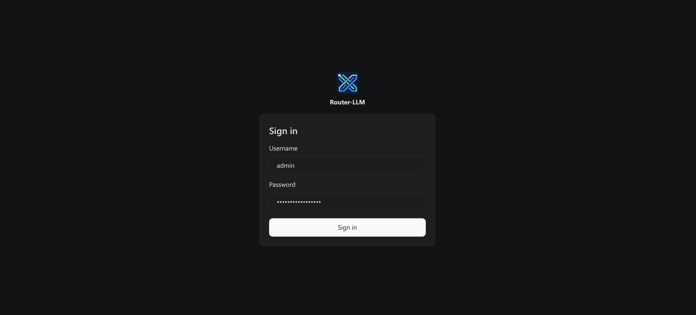

The password form. When single sign-on is configured, its button appears beside it.

---

## Routing

### Endpoint & Keys

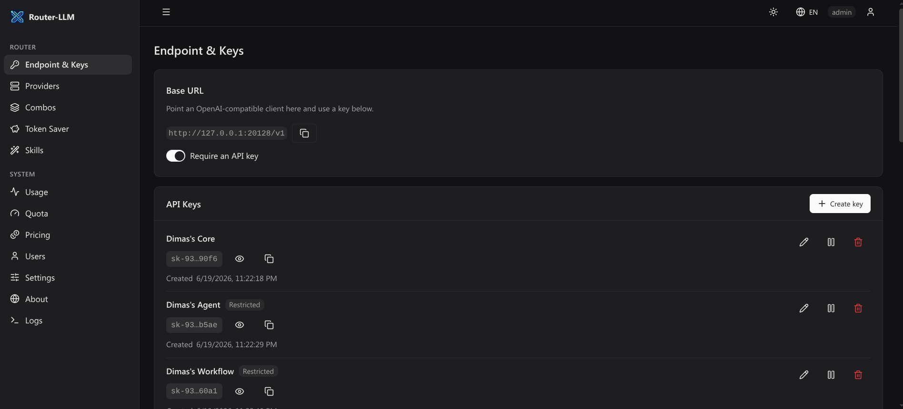

The one base URL clients point at, the key guard, and the keys with their access lists and budgets.

### Providers

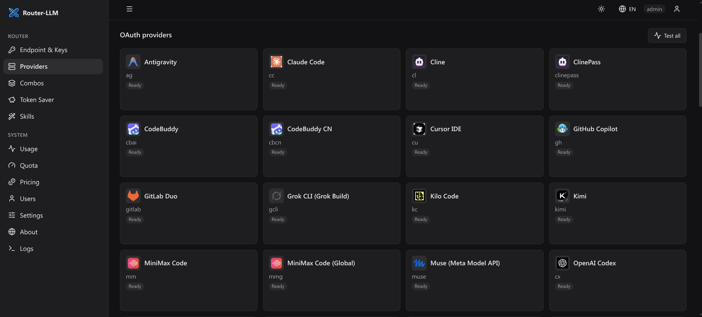

Every provider, OAuth or custom node, with its connections, readiness and a single test action.

### Combos

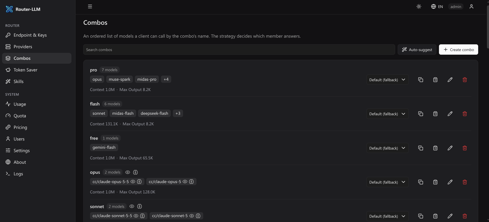

Combos: an ordered member list with fallback, round robin or the smart router, and the smallest context and max output across the members.

### Token Saver

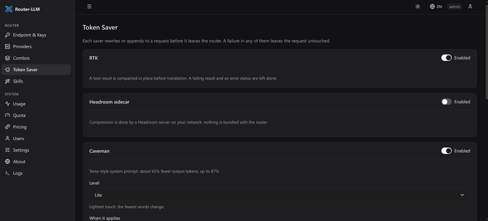

RTK tool-output filters, the built-in prompt styles, Allow REA and the watermark remover.

### Skills

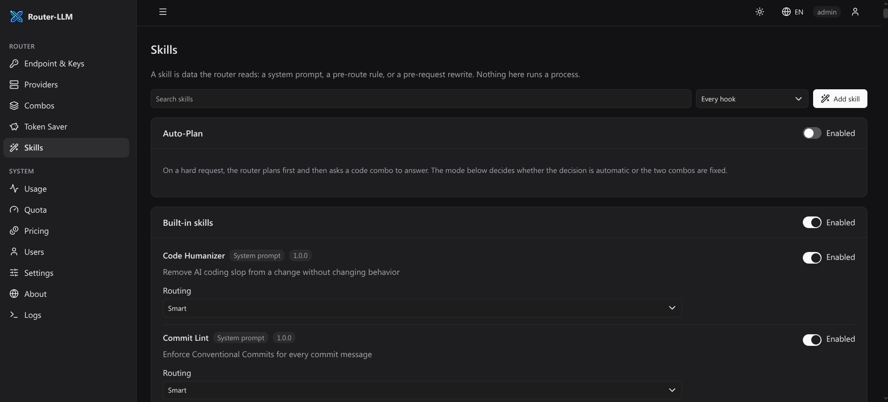

The skill registry, Skills Studio rules and the synced catalog. Skills are data, never code.

### API key settings

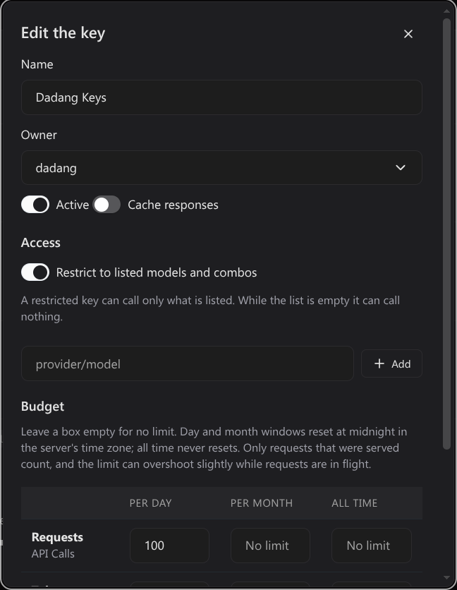

A key's owner, response-cache switch, model restriction and day, month and lifetime budgets.

### Combo settings

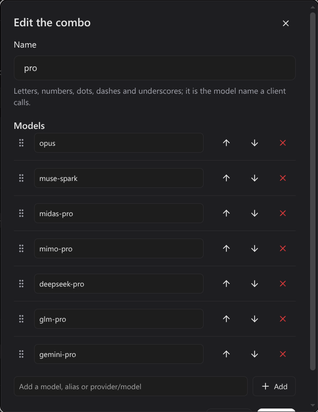

A combo's members, reordered by dragging or with the arrows. The name is the model a client calls.

---

## Monitoring

### Usage

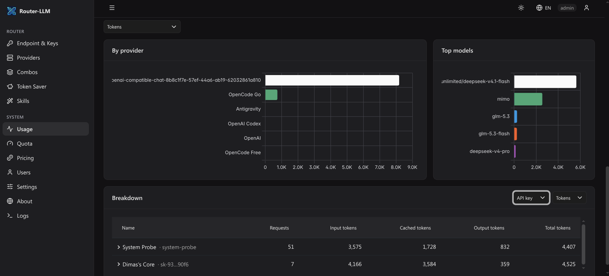

One metadata-only row per request: key, provider, model, tokens, cost and latency. No prompts, no bodies.

### Quota tracker

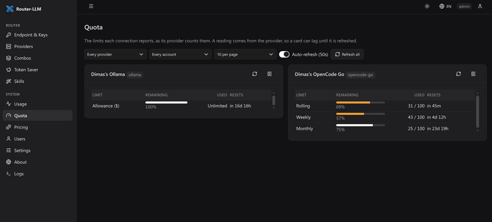

Each provider's quota windows, and a reset where the provider grants one.

### Logs

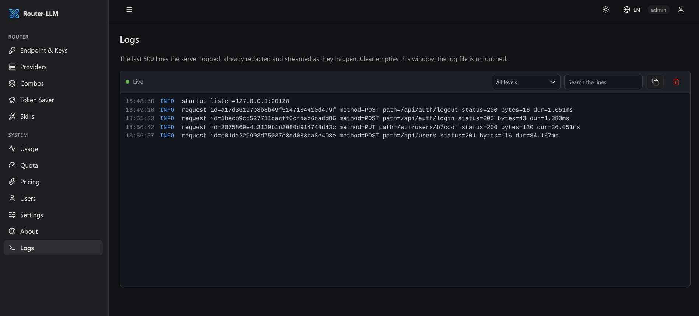

The last 500 log lines, already redacted and streamed as they happen. Clearing empties the window and leaves the log file untouched.

---

## Administration

### Users

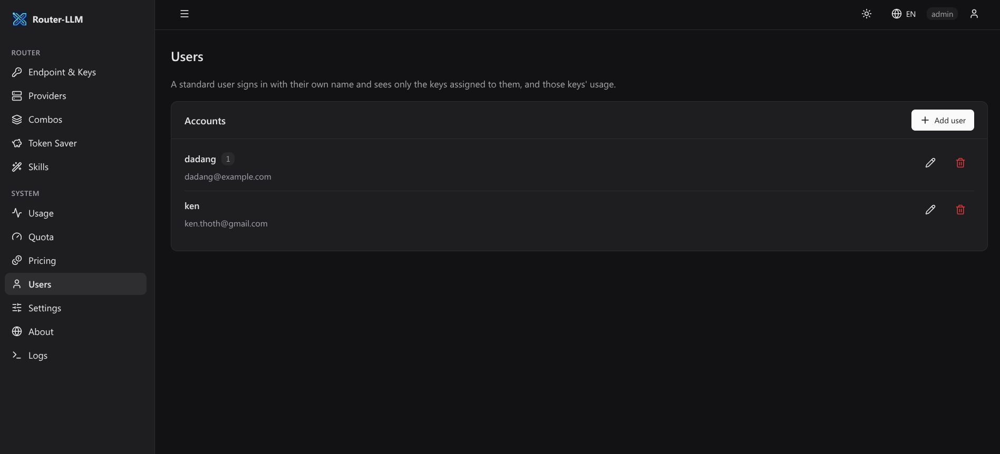

Dashboard accounts and their roles. A standard user sees only the keys assigned to them and those keys' usage.

### Settings

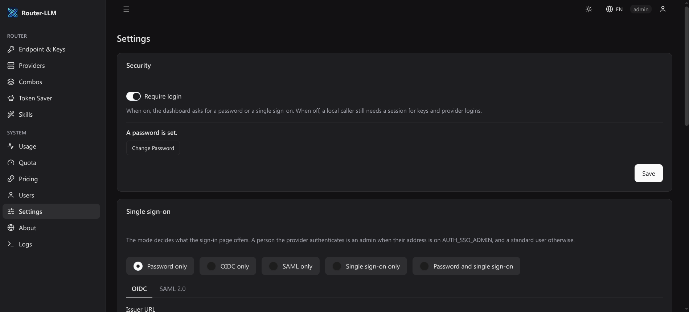

Runtime settings: the account strategy, the combo strategy, and the security and sign-in pages (password, OIDC and SAML).

### About

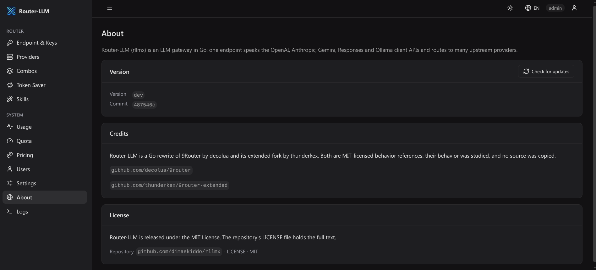

The version and commit, the release check, the admin update action, the credits and the license.
