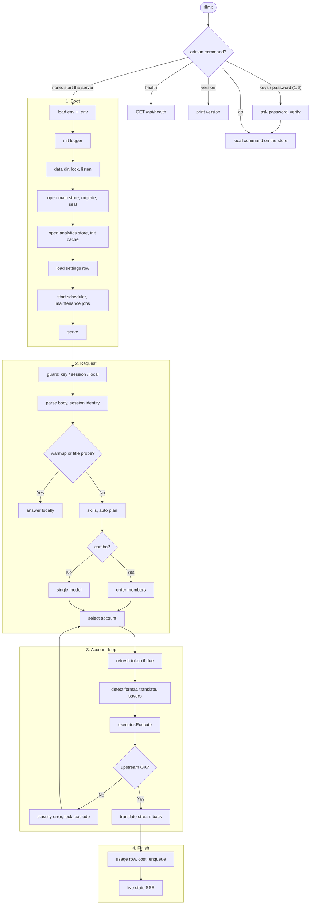
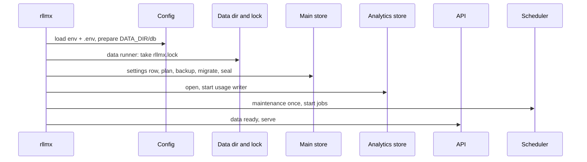
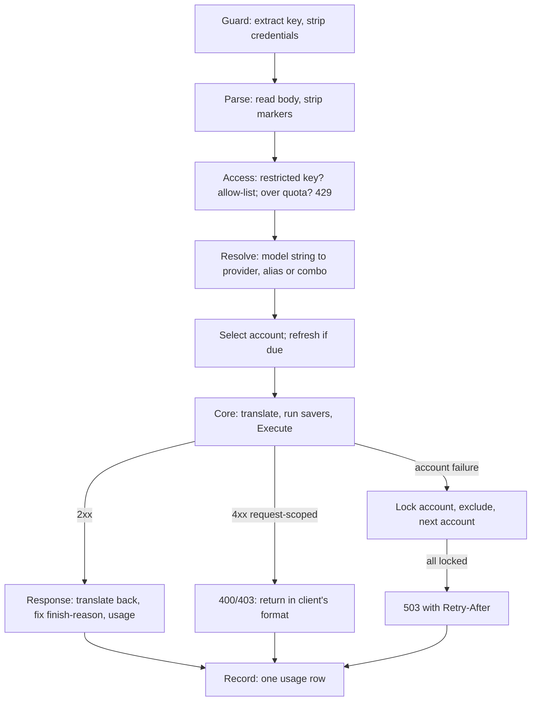
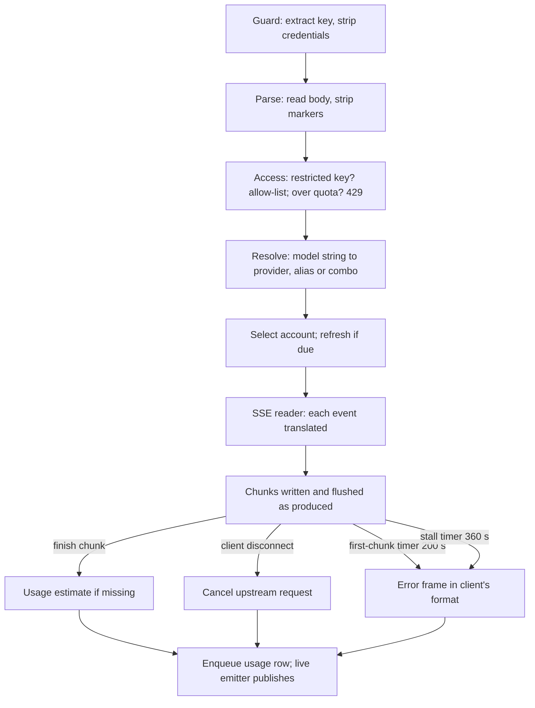
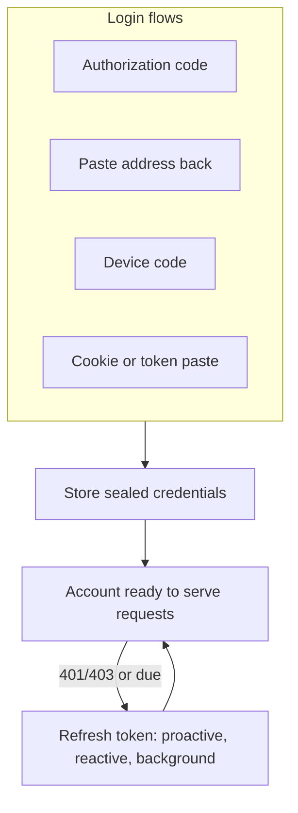
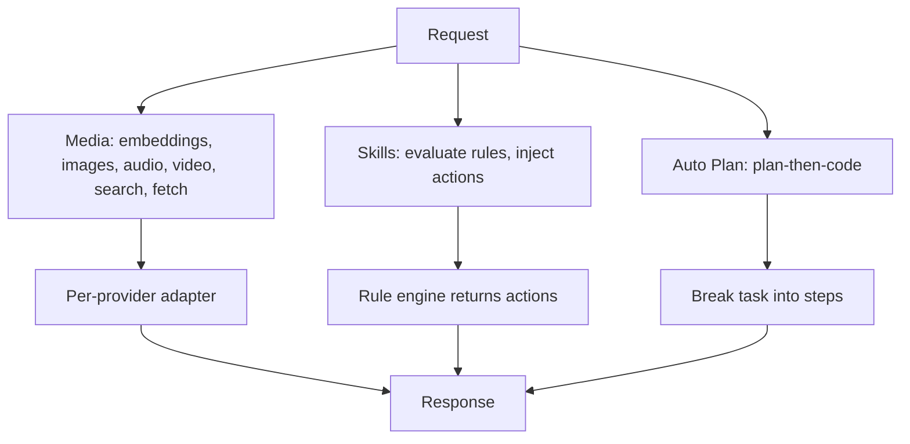
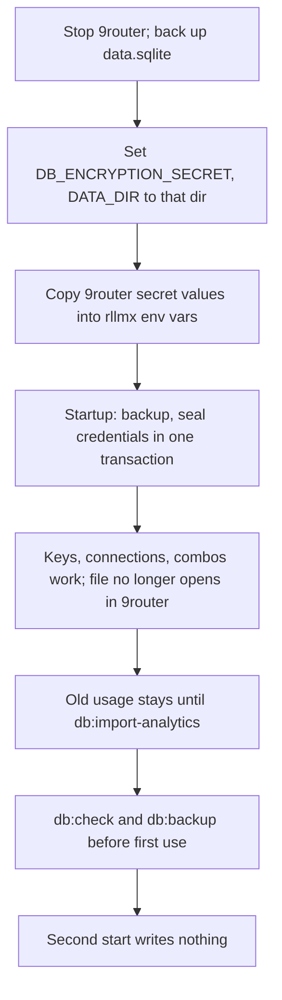

# Router-LLM — Workflows

Flow: env load, store open, authenticate, resolve, select account, translate, execute, stream, record usage. Owns startup order and operator procedures (migration, imports). Component detail: the design document for that area in [`docs/design/`](design/). Reference tracking: [`PARITY.md`](PARITY.md).

**Built today:** the whole flow below, from boot through the request stages to the usage row. Combinations, token savers and skills are planned and appear where the flow would use them.

---

## Pipeline Overview

---

## Stage Details

### 1. Startup (`bootstrap/providers.go`)

| # | Behavior |
|---|---|
| 1 | `.env` from working directory, process environment over it; set-but-empty = unset. Our checks (unknown name, size cap, bad value) fail startup naming the variable. `.env` syntax error or bad `APP_KEY` stops the framework first, in its own words (design doc 17) |
| 2 | `LOG_CHANNEL` (`single`, `daily`, `stack`) writes `storage/logs/rllmx.log`, text or JSON per its `formatter`, behind redacting `custom` channel |
| 3 | `config.Boot` already made `DATA_DIR/db` (`0700`) and empty `data.sqlite` (`0600`) for every process. Data runner checks `DB_ENCRYPTION_SECRET` (64 hex; `version`, `health` work without it), takes `rllmx.lock`, holds until exit. Second server, `db:vacuum`, either import on the directory: refuses |
| 4 | HTTP runner opens socket first (busy port fails before any database touched), serves only when data runner ready. Port silent until then, so `health` times out during a long migration. All runners start at once; this wait orders them |
| 5 | Load or create `jwt-secret` and `machine-id` (`0600`) in `DATA_DIR`, through `file.WritePrivate`. A short existing `jwt-secret` is an error, never replaced |
| 6 | Connect, `SELECT 1`, plan. Nothing missing plus check row: no write, no backup. Otherwise one backup (failure aborts), migrator, sealing (design doc 15) |
| 7 | Default when stored hash matches `123456`, or no hash and `AUTH_INITIAL_PASSWORD` unset, `123456` or `change-me`. Stored hash decides alone. Warn; `AUTH_REFUSE_DEFAULT_PASSWORD=true` exits before serving, releasing lock and port |
| 8 | Open `db/analytics.sqlite` or schema `rllmx_analytics` (or `DB_DATABASE_ANALYTICS`), create what is missing, start usage writer |
| 9 | `PRAGMA optimize` and WAL checkpoint on both SQLite files, incremental vacuum on analytics, `ANALYZE` on PostgreSQL analytics |
| 10 | Memory, or Redis when configured. Unreachable Redis logs once; every lookup misses |
| 11 | Load and validate embedded provider data (unique ids, known executors); read settings row, merge defaults, keep unknown keys. `ServerServiceProvider` loads the registry (`upstream.Default`) when it binds, so a bad data file stops the start with the file and field named; a test also fails the build on bad data |
| 12 | Today only the maintenance jobs (`app/store/data`). Planned: token refresh (, `OAUTH_BACKGROUND_REFRESH`), quota auto-ping, catalog sync (, `CATALOG_SYNC`) |
| 13 | Route table checked first: route outside guarded group fails the start |
| 14 | `GET /api/health` on configured host (wildcard dialled as loopback): 3 s, no proxy, at most three redirects inside those 3 s, exit 0 only for `200` with `{"ok":true}` |

Our own providers live in `bootstrap/providers.go`, after the framework's.

| Provider | Runs |
|---|---|
| `CommandsServiceProvider` | The command allowlist |
| `CacheServiceProvider` | The cache wrapper |
| `DataServiceProvider` | Lock, listeners, stores and jobs (steps 3 to 12) |
| `ServerServiceProvider` | The server runner (step 4) |

- `Register` binds only; `Boot` wires cheap things only, because the framework boots every provider for every Artisan command.
- The steps that listen, lock and serve run in a runner's `Run`, which no command starts. `rllmx artisan health` therefore takes no lock and opens no port.
- A part-way start-up undoes earlier steps in reverse through the same runners. Shutdown order is in design doc 1.

### 2. Terminal Commands

Rules: ARCHITECTURE.md (Terminal Commands). `keys:*`, `password:*` need a terminal and the dashboard password; `db:*` ask no password except `db:export-plain`. Confirmation is typed and read with `Ask`, never the framework's `Confirm`; without a terminal a command refuses unless `--yes`:

| Command | Confirmation | Lock |
|---|---|---|
| `db:backup`, `db:check` | None | No |
| `db:vacuum` | y/N, or `--yes` | Yes |
| `db:import-analytics` | None (`--drop-old`: typed `DROP`, terminal required) | Yes |
| `db:import-config` | Prints the plan, y/N, or `--yes` | Yes |
| `db:export-plain` | Dashboard password | No |

### 3. First Run & Login

1. `/` redirects to `/login`, or `/setup` when no password exists.
2. `POST /api/auth/login {"password"}`. Check order: SSO-only refuses; remote login on well-known password: 403 `mustChangePassword`, uncounted; locked address: 429 with `Retry-After`; otherwise count, compare.
3. Success sets `auth_token` cookie, answers `{"success":true,"mustChangePassword":...}`.
4. `POST /api/auth/change-password {"currentPassword","newPassword"}` stores hash, ends other sessions, re-issues cookie.
5. With SSO usable the login page shows the SSO button (`GET /api/auth/status` says which):

| OIDC | SAML |
|---|---|
| `/api/auth/oidc/start` sets `oidc_bind`, redirects with PKCE, `state`, `nonce` | `/api/auth/saml/start` redirects with a request and single-use relay state, sets `saml_bind` |
| `/api/auth/oidc/callback` | IdP POSTs to `/api/auth/saml/acs` (the one CSRF-exempt path) |
| Pending sign-in taken once, bind cookie, code exchange, token verification | Relay state taken once, bind cookie, signature, issuer, audience, times, request id, replay set |
| Allow-list, normal session cookie, redirect to `/`. Failure: `/login?error=<code>` | Same |

Details: ARCHITECTURE.md (Terminal Commands). Password change, allow-list change, SSO off, "logout everywhere": ends either session.

### 4. Chat Completion, Non-Streaming

**Refusals and retries.**

- A body that is not one JSON object, a repeated top-level key or a missing model is a 400.
- A restricted key is a 403; no connection is a 404.
- A locked account is skipped; a rate-limited one is locked and the next is tried; all-locked is a 503 with `Retry-After`.
- The upstream request comes from the registry and the connection only.
- Every request ends in exactly one usage row, refusals and aborted streams included. Unreported counts are estimated and the row is marked `estimated`.

### 5. Chat Completion, Streaming

### 6. Messages, Responses, Compact

| Endpoint | Behavior |
|---|---|
| `/v1/messages` | Source format Claude. `count_tokens` local estimate from character counts |
| `/v1/responses` | Source format Responses. Responses upstream gets body as is; others go Responses to OpenAI and back (design doc 7) |
| `/v1/responses/compact` | Same handler and path; compaction flag never written to body (divergence 120) |

### 7. Gemini and Ollama Endpoints

| Endpoint | Behavior |
|---|---|
| `/v1beta/models/{model}:generateContent`, `:streamGenerateContent` | Path split at last `:`; any other action Gemini 404. Model may carry `models/` prefix or be `provider/model`. Action decides streaming. Key from `x-goog-api-key` or `?key=`, never forwarded. Gemini client to Gemini provider forwarded as is (`responseModalities`, `speechConfig`, audio `inlineData` reach upstream and return); to any other provider an audio request is 400 (divergence 137). SSE `data:` lines only |
| `/v1/api/chat` | Ollama request through Ollama codec; NDJSON back (one JSON body when `"stream": false`; streaming default). One final `done` line carries counts. Errors in Ollama shape (divergence 136) |
| `/v1beta/models`, `/v1/models` | Model list from active connections, combos, custom models, aliases. Gemini form adds `inputTokenLimit`, `outputTokenLimit`. Restricted key sees only its list. Some providers fetch a live list (cached) |

### 8. Combo Expansion & Failover

Member loop, empty-answer rule: design doc 4. Each member runs the account loop; fallback-class or request-scoped error moves to next member; empty answer counts as failure except on the last member; all members failing: 503 with `retryAfter`.

### 9. Account Error, Lock & Recovery

1. Upstream fails with status `S`, text `T`.
2. Classification: text rules, then status rules, else transient 30 s. First 4096 bytes of text scanned; text never logged.
3. Account-class error: in one transaction read `backoffLevel`, compute cooldown, write `modelLock_<model>` (or `modelLock___all`), `testStatus`, `lastError`, `errorCode`, `backoffLevel`. Exclude connection for this request, next account.
4. Request-scoped 4xx: no lock; return error (combo moves on).
5. All accounts locked: 503 with `retryAfter`.
6. Later success clears that model's lock, the account lock, expired locks; resets `backoffLevel`. Successful dashboard test (`testStatus: active`) clears every lock.
7. Planned (step): health records every attempt; open breaker steers selection elsewhere.

Rules and numbers: design doc 5.

### 10. OAuth Connect & Refresh

### 11. Media, Skills, Auto Plan

Skills and Auto Plan are planned. Detail: design doc 11.

### 12. Usage Save & Live Stats

1. On stream completion (or end of non-stream response) compute cost from pricing.
2. One row, structured values only: key id and name, connection, provider, model, endpoint, status, error class code, token counts, cost, latency.
3. `Enqueue`. Full queue drops and counts the row; request never delayed.
4. Writer flushes at 500 rows or 1 s: insert plus hourly and daily rollups in one transaction, in key order.
5. Push row to in-memory ring; `/api/usage/stream` (SSE) emits it. Quota deltas update in memory simultaneously.

### 13. Settings Update

1. `PATCH /api/settings` validates, merges into settings row, keeps unknown keys.
2. Password change needs the current password.
3. Settings-dependent caches (saver config, combo strategy) invalidated in-process.
4. Settings for excluded features (tunnels, MITM) stored and ignored.

### 14. Migrating a 9router Database

- Never run both against one database.
- 9router variable names are not read. Copy the **values** of `API_KEY_SECRET`, `MACHINE_ID_SALT`, `JWT_SECRET` into `AUTH_API_KEY_SECRET`, `AUTH_MACHINE_ID_SALT`, `JWT_SECRET` (names differ: design doc 17).
- To go back: stop rllmx, then either restore `pre-encryption-*` (untouched original) or run `rllmx artisan db:export-plain` and use the copy under `db/exports/`. That copy holds plain credentials: delete after use.

**New deployment on an empty database.** Seed with `db:import-config` (stage 17), do not share a directory. Stop the old deployment afterwards: providers with rotating refresh tokens (Codex, xAI, MiniMax) would otherwise invalidate each other's tokens.

### 15. Keeping up with the reference

Router-LLM follows the behavior of 9router, pinned in [`PARITY.md`](PARITY.md). The code is written independently (Clean-Room, [`AGENTS.md`](../AGENTS.md)).

When the reference moves: read its changelog, classify each change, update the parity rows, then bump the pin in the same change.

- **Adopt** it and update the parity row.
- **Deliberate difference:** a row in that area's design document, indexed in [`DIVERGENCES.md`](DIVERGENCES.md).
- **Out of scope:** record it and move on.

### 16. `db:import-analytics`

`rllmx artisan db:import-analytics [--from <file>] [--drop-old]`. Source defaults to this data directory's main database.

1. Copy source with `-wal` and `-shm` into a private directory under `DATA_DIR/db/import-tmp`, open the copy read-only. Original never opened. Copy deleted whatever the outcome.
2. Read `usageHistory` by `id` in batches of 5,000.
3. Map each row:
 - Raw `apiKey` looked up in `apiKeys`; only key id and name kept (unknown gives empty fields; raw key never copied).
 - `ok` becomes 200; numeric status maps to `errorClass`, anything else to `unknown`.
 - Five token counts from the `tokens` JSON (`cached_tokens`, else `cache_read_input_tokens`).
 - Timestamp becomes unix ms; unreadable one skipped and counted.
 - `importId` is `<source fingerprint>:<old id>` (fingerprint a short hash of the source's first row), so two sources reusing row ids both import, totals verified per source (divergence 133). Endpoints, duplicates, out-of-order ids kept as stored.
4. Insert with conflict rule on `importId`: rerun or resume adds nothing twice.
5. Rebuild hourly and daily rollups for the imported range.
6. Verify against independent SQL sums over the source: row count, the five token sums exactly, cost within 1e-6. Mismatch exits 1. `usageDaily` totals not compared (local dates).
7. Seed analytics lifetime counter once from `_meta.totalRequestsLifetime`, never below imported row count.
8. Takes `rllmx.lock` (refuses while a server holds it). `--drop-old` needs a terminal and typed `DROP`, runs only after a verified import with **no unreadable rows**: a row already imported by an earlier run is not a reason to refuse, so a resumed or repeated run can still drop. Writes `db/backups/before-drop-...`, drops `usageHistory`, `usageDaily`, `requestDetails`. Extended fork's `proxyPoolFitness` and a `proxyPools` table left alone (divergences 202, 214). 9router can still open the file (its additive sync recreates the tables) but loses all usage history. Run `rllmx artisan db:vacuum` afterwards.

### 17. `db:import-config`

Seeds an empty SQLite file or PostgreSQL database for a new deployment: `rllmx artisan db:import-config --from <file or data dir> [--dry-run] [--yes] [--with-sso]`. Code: `app/store/importer`.

1. `--from` names a 9router `data.sqlite` or its data directory (`db/data.sqlite` tried first). Source copied with any `-wal` and `-shm` into `DATA_DIR/db/import-tmp`, opened read-only (`repository.OpenSnapshot`). Copy and any directory the command created removed whatever the outcome.
2. Plan: counts, settings keys skipped as login policy, keys this version does not know. Counts and key names only, never a value.
3. `--dry-run` also checks destination, then stops. Writes nothing to destination, creates no temporary directory beyond the source copy, which is removed. (Every command may leave an empty `data.sqlite` under `DATA_DIR`; design doc 1, Framework Choices.) Like the real run it takes `rllmx.lock`.
4. Destination must be empty (`HasConfiguration`): no connections, keys, nodes, combos or `kv` rows, no settings other than a password hash. Otherwise exit 1 with "only seeds an empty one".
5. Without `--yes` ask y/N (only `y` or `yes` is yes); without a terminal and without `--yes`, refuse.
6. Apply in one transaction with original ids, timestamps, column values:

| Copied | Notes |
|---|---|
| API keys | With restriction flag and allow list |
| Connections | `modelLock_*` and error state (`testStatus`, `lastError`, `errorCode`, `lastErrorAt`, `backoffLevel`, `rateLimitedUntil`) removed; sticky counters, every other byte, key order kept |
| Provider nodes, combos | As stored |
| `kv` scopes | `modelAliases`, `customModels`, `disabledModels`, `pricing` |
| Settings | Allow-listed keys, including every `<skill>Enabled`, `<skill>RoutingMode`, `ecc_auto_skill_router*` flag |

Source row whose JSON does not parse: skipped and counted.

7. Never copied: usage and analytics, `requestDetails`, `mitmAlias`, Gemini signature cache, dashboard password, `requireLogin`, `requireApiKey`, the `outboundProxy*` settings, tunnel, cloud, MITM, observability settings. Login policy (`authMode`, `ssoType`, `oidc*`, `saml*`) only with `--with-sso`. Settings key neither copied nor deliberately skipped: reported by name; a test fails when a default setting is unclassified. Skill definitions are folders on disk, not rows; their import arrives with the skills registry.
8. Verify rows written equal the plan; mismatch exits 1.
9. New deployment keeps its own dashboard password (`AUTH_INITIAL_PASSWORD`). Set `AUTH_API_KEY_SECRET`, `AUTH_MACHINE_ID_SALT` to the old install's values so imported keys validate.

---

## File Naming Conventions

| Item | Name / Pattern |
|---|---|
| Config | `.env` (template `.env.example`) |
| Binary | `rllmx` (`dist/rllmx` via Makefile; `.exe` on Windows) |
| Database | `DATA_DIR/db/data.sqlite` (plus `-wal`, `-shm` while running); backups in `db/backups/` |
| Analytics | `DATA_DIR/db/analytics.sqlite`, or PostgreSQL schema `rllmx_analytics`; backups in `db/analytics-backups/` |
| Lock | `DATA_DIR/rllmx.lock` |
| Secrets | `DATA_DIR/jwt-secret`, `DATA_DIR/machine-id` (`0600`) |
| Skills (planned,) | `DATA_DIR/skills/<id>/manifest.json`, `prompt.txt` or `prompt.md`, `rules.json`; ECC catalog in `skills/ecc-imported/` |
| Catalog cache (planned,) | `DATA_DIR/model-catalog.json` |
| Provider data | `app/llm/upstream/data/<providerId>.json`; capabilities in `data/capabilities/`, prices in `data/pricing/` |
| Translators (planned) | `app/llm/translate/<format>_*.go`, one file group per format (request, response, stream) |
| Executors (planned) | `app/llm/executor/default.go`; specialized ones in `app/llm/executor/<provider_id>.go` |
| Dashboard (planned) | `web/static/<page>.html`, `web/static/js/<module>.js`, `web/static/i18n/<locale>.json` |
| API key | `sk-{machineId}-{keyId}-{crc8}` |
| Model lock field | `modelLock_<model>` and `modelLock___all` in `providerConnections.data` |

---

## Error Recovery

| Scenario | Recovery |
|---|---|
| Missing or invalid env value | Fail startup, naming the variable |
| `DATA_DIR` unwritable | Fail startup with the path |
| Database newer than the binary | Start, touch only known tables and columns, log a warning |
| Backup fails before a schema change | Abort the change; database left as it was |
| Database busy | Wait up to `busy_timeout`, then 503; background jobs retry |
| Corrupt JSON in a `data` column | Keep raw text, skip row for logic needing fields, report on dashboard, never overwrite |
| Unknown provider or model | 400 or 404 in client's error shape |
| Missing or invalid API key | 401 in client's error shape |
| Key not allowed for the model | 403 in client's error shape |
| Key over quota | 429 `insufficient_quota` with remaining-quota headers |
| Redis unreachable or slow | Lookups miss, writes no-ops, logged once per interval; requests continue |
| Analytics queue full | Row dropped and counted; request unaffected |
| Analytics database unavailable | Batch dropped and logged; retried next flush |
| OAuth callback with unknown, expired or reused state | Rejected, session deleted; user starts again |
| `db:import-config` destination not empty | Stop before writing; name the tables holding data |
| Upstream 401 or 403 | Refresh credentials (up to three tries), persist, retry once; then account error |
| Refresh `invalid_grant` or token reuse | Mark connection `testStatus` failed, stop retrying, surface on dashboard |
| Upstream 429 or quota text | Lock model on that account with backoff; next account |
| Upstream request-scoped 4xx | Return it; combo moves on; no lock |
| Upstream 5xx or network error | Retry in place per status table, then 30 s transient lock, next account |
| Every account locked | 503 with `retryAfter` |
| Upstream HTML error page | Clean JSON error with page title |
| Upstream 2xx with HTML page, or non-stream type on a streaming call | 502 in client's shape with page title; no lock written, none cleared |
| Stream stalls or first chunk late | Error frame in client's format; counts as failure |
| Client disconnects mid-stream | Cancel upstream request; record usage as far as known |
| Empty generation in a combo | Fail over to next member (not on the last) |
| Saver, skill or Auto Plan error | Skip it; send request unchanged |
| Rule hook sets a forbidden header | Drop the action, log it |
| Headroom unreachable | Skip compression |
| SSRF guard denies a target | 400 for fetch, image prefetch skipped, validation error on node save |
| Login failures | Limiter locks the client address in growing steps |
| Config reload | Not supported: restart to change env; runtime settings apply live |
| Shutdown during streams | Stop accepting, drain up to grace period, close |
