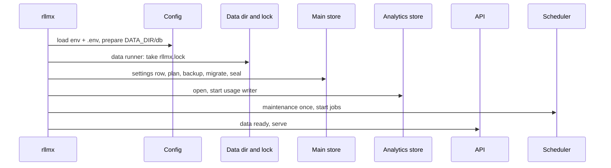

# Router-LLM - Workflows

Flow: env load, store open, authenticate, resolve, select account, translate, execute, stream, record usage. Owns startup order and operator procedures (migration, imports, Parity Sync). Component detail: the PRD for that area (`docs/prds/`). Reference tracking: `docs/PARITY.md`.

**Built today:** boot, the data lock, both stores, cache, the guard, `/api/health`, the CLI and the maintenance jobs. The request stages from the guard onward are the target for 1.6 to 1.11 and are drawn here as the whole flow, not as current code.

---

## Pipeline Overview

---

## Stage Details

### 1. Startup (`bootstrap/providers.go`)

| # | Step | Behavior |
|---|---|---|
| 1 | Config | `.env` from working directory, process environment over it; set-but-empty = unset. Our checks (unknown name, size cap, bad value) fail startup naming the variable. `.env` syntax error or bad `APP_KEY` stops the framework first, in its own words (PRD 17) |
| 2 | Logger | `LOG_CHANNEL` (`single`, `daily`, `stack`) writes `storage/logs/rllmx.log`, text or JSON per its `formatter`, behind redacting `custom` channel |
| 3 | Data dir and lock | `config.Boot` already made `DATA_DIR/db` (`0700`) and empty `data.sqlite` (`0600`) for every process. Data runner checks `DB_ENCRYPTION_SECRET` (64 hex; `version`, `health` work without it), takes `rllmx.lock`, holds until exit. Second server, `db:vacuum`, either import on the directory: refuses |
| 4 | Listen | HTTP runner opens socket first (busy port fails before any database touched), serves only when data runner ready. Port silent until then, so `health` times out during a long migration. All runners start at once; this wait orders them |
| 5 | Identity files | Load or create `jwt-secret` and `machine-id` (`0600`) in `DATA_DIR`, through `file.WritePrivate`. A short existing `jwt-secret` is an error, never replaced |
| 6 | Main store | Connect, `SELECT 1`, plan. Nothing missing plus check row: no write, no backup. Otherwise one backup (failure aborts), migrator, sealing (PRD 15) |
| 7 | Default password guard | Default when stored hash matches `123456`, or no hash and `AUTH_INITIAL_PASSWORD` unset, `123456` or `change-me`. Stored hash decides alone. Warn; `AUTH_REFUSE_DEFAULT_PASSWORD=true` exits before serving, releasing lock and port |
| 8 | Analytics store | Open `db/analytics.sqlite` or schema `rllmx_analytics` (or `DB_DATABASE_ANALYTICS`), create what is missing, start usage writer |
| 9 | Maintenance once | `PRAGMA optimize` and WAL checkpoint on both SQLite files, incremental vacuum on analytics, `ANALYZE` on PostgreSQL analytics |
| 10 | Cache | Memory, or Redis when configured. Unreachable Redis logs once; every lookup misses |
| 11 | Registry, settings (**1.7**) | Load and validate embedded provider data (unique ids, known executors); read settings row, merge defaults, keep unknown keys. `ServerServiceProvider` loads the registry (`upstream.Default`) when it binds, so a bad data file stops the start with the file and field named; a test also fails the build on bad data |
| 12 | Background | Today only the maintenance jobs (`app/data`). Planned: token refresh (1.9, `OAUTH_BACKGROUND_REFRESH`), quota auto-ping, catalog sync (2.6, `CATALOG_SYNC`) |
| 13 | Serve | Route table checked first: route outside guarded group fails the start |
| 14 | `rllmx artisan health` | `GET /api/health` on configured host (wildcard dialled as loopback): 3 s, no proxy, at most three redirects inside those 3 s, exit 0 only for `200` with `{"ok":true}` |

Our own providers in `bootstrap/providers.go` are `CommandsServiceProvider`, `CacheServiceProvider`, `DataServiceProvider` and `ServerServiceProvider`, after the framework's; `data` runs steps 3 and 6 to 12 and `server` runs step 4. Steps 5, 7 and 11 have no provider yet. `Register` binds only; `Boot` wires cheap things only (framework boots every provider for every Artisan command). Steps 3 to 13 (lock, listen, stores, jobs, serving) run in provider runners' `Run`, which commands never start, so `rllmx artisan health` takes no lock, opens no port. Data runner does steps 3, 5 to 10 and 12 in order (11 skipped until its step lands), marks ready; HTTP runner waits. Shutdown order: PRD 1. A part-way start-up undoes earlier steps in reverse through the same runners.

### 2. Terminal Commands

Rules: ARCHITECTURE.md (Terminal Commands). `keys:*`, `password:*` need a terminal and the dashboard password; `db:*` ask no password except `db:export-plain` (1.6). Confirmation is typed and read with `Ask`, never the framework's `Confirm`; without a terminal a command refuses unless `--yes`:

| Command | Confirmation | Lock |
|---|---|---|
| `db:backup`, `db:check` | None | No |
| `db:vacuum` | y/N, or `--yes` | Yes |
| `db:import-analytics` | None (`--drop-old`: typed `DROP`, terminal required) | Yes |
| `db:import-config` | Prints the plan, y/N, or `--yes` | Yes |
| `db:export-plain` | Dashboard password | No |

### 3. First Run & Login

1. `/` redirects to `/login`, or `/setup` when no password exists.
2. `POST /api/auth/login {"password"}`. Check order: SSO-only refuses; remote login on well-known password: 403 `mustChangePassword`, uncounted; locked address: 429 with `Retry-After`; otherwise count, compare.
3. Success sets `auth_token` cookie, answers `{"success":true,"mustChangePassword":...}`.
4. `POST /api/auth/change-password {"currentPassword","newPassword"}` stores hash, ends other sessions, re-issues cookie.
5. With SSO usable the login page shows the SSO button (`GET /api/auth/status` says which):

| Step | OIDC | SAML |
|---|---|---|
| Start | `/api/auth/oidc/start` sets `oidc_bind`, redirects with PKCE, `state`, `nonce` | `/api/auth/saml/start` redirects with a request and single-use relay state, sets `saml_bind` |
| Return | `/api/auth/oidc/callback` | IdP POSTs to `/api/auth/saml/acs` (the one CSRF-exempt path) |
| Check | Pending sign-in taken once, bind cookie, code exchange, token verification | Relay state taken once, bind cookie, signature, issuer, audience, times, request id, replay set |
| Finish | Allow-list, normal session cookie, redirect to `/`. Failure: `/login?error=<code>` | Same |

Details: ARCHITECTURE.md (Terminal Commands). Password change, allow-list change, SSO off, "logout everywhere": ends either session.

### 4. Chat Completion, Non-Streaming

1. **Guard.** Extract, look up key; local request passes without one only while `requireApiKey` off. Pipeline strips credential headers and `?key=` before anything goes upstream.
2. **Parse.** Read body to limit; strip `[1m]`; derive session identity.
3. **Access.** Restricted key: allow list only. Over quota: 429 `insufficient_quota` (PRD 21).
4. **Resolve.** Model string to combo, alias, node or provider (PRD 4).
5. **Select account**, refresh token if due (PRD 5).
6. **Core.** Detect source format, pick target, translate, run savers, `Execute` (PRD 3).
7. **Response.** Non-stream body translated back with finish-reason fixes, `object`, `created`, usage.
8. **Record.** Enqueue one usage row (stage 12).

**Not built.** `app/pipeline` arrives in 1.8. Then: body not one JSON object, repeated top-level key, missing model: 400; restricted key 403; combo or non-OpenAI format 400 until 2.2, 2.4 and the 1.8 API work; locked account skipped, rate-limited one locked and next tried, all-locked 503 with `Retry-After` and `retryAfter`, no connection 404; upstream request from registry and connection only; every request ends in exactly one usage row (refusals, aborted streams included), unreported counts estimated, row marked `estimated`.

### 5. Chat Completion, Streaming

1. Stages 4.1 to 4.6 with `stream: true` (or provider-forced).
2. Upstream body through SSE reader; each event translated by per-stream state machine.
3. Chunks written and flushed as produced. Client disconnect cancels upstream request.
4. First-chunk timer (200 s), stall timer (360 s); timeout ends the stream with an error frame in the client's format.
5. Finish chunk without usage gets an estimate.
6. On completion the usage row is enqueued; live emitter publishes it.

### 6. Messages, Responses, Compact

| Endpoint | Behavior |
|---|---|
| `/v1/messages` | Source format Claude. `count_tokens` local estimate from character counts |
| `/v1/responses` | Source format Responses. Responses upstream gets body as is; others go Responses to OpenAI and back (PRD 7) |
| `/v1/responses/compact` | Same handler and path; compaction flag never written to body (divergence 120) |

### 7. Gemini and Ollama Endpoints

| Endpoint | Behavior |
|---|---|
| `/v1beta/models/{model}:generateContent`, `:streamGenerateContent` | Path split at last `:`; any other action Gemini 404. Model may carry `models/` prefix or be `provider/model`. Action decides streaming. Key from `x-goog-api-key` or `?key=`, never forwarded. Gemini client to Gemini provider forwarded as is (`responseModalities`, `speechConfig`, audio `inlineData` reach upstream and return); to any other provider an audio request is 400 (divergence 137). SSE `data:` lines only |
| `/v1/api/chat` | Ollama request through Ollama codec; NDJSON back (one JSON body when `"stream": false`; streaming default). One final `done` line carries counts. Errors in Ollama shape (divergence 136) |
| `/v1beta/models`, `/v1/models` | Model list from active connections, combos, custom models, aliases. Gemini form adds `inputTokenLimit`, `outputTokenLimit`. Restricted key sees only its list. Some providers fetch a live list (cached) |

### 8. Combo Expansion & Failover

Member loop, empty-answer rule: PRD 4. Each member runs the account loop; fallback-class or request-scoped error moves to next member; empty answer counts as failure except on the last member; all members failing: 503 with `retryAfter`.

### 9. Account Error, Lock & Recovery

1. Upstream fails with status `S`, text `T`.
2. Classification: text rules, then status rules, else transient 30 s. First 4096 bytes of text scanned; text never logged.
3. Account-class error: in one transaction read `backoffLevel`, compute cooldown, write `modelLock_<model>` (or `modelLock___all`), `testStatus`, `lastError`, `errorCode`, `backoffLevel`. Exclude connection for this request, next account.
4. Request-scoped 4xx: no lock; return error (combo moves on).
5. All accounts locked: 503 with `retryAfter`.
6. Later success clears that model's lock, the account lock, expired locks; resets `backoffLevel`. Successful dashboard test (`testStatus: active`) clears every lock.
7. Planned (step 2.5): health records every attempt; open breaker steers selection elsewhere.

Rules and numbers: PRD 5.

### 10. OAuth Connect & Refresh

| Flow | Steps |
|---|---|
| Authorization code | Dashboard calls `GET /api/oauth/{provider}/authorize`. No browser redirect: server picks it from provider policy (PRD 6), stores single-use session (10 minutes, tied to dashboard session), returns `{state, authUrl, redirectUri, paste}`. User signs in at provider. Redirect lands on router's `/callback` page, which posts code and state to `POST /api/oauth/callback`, or on a fixed-port listener (Codex) that completes the login itself. Unknown, expired, reused or foreign state: one answer. Server trades code for tokens, stores connection, ends session; dashboard reads result once via `GET /api/oauth/status` |
| Paste | `paste` true (remote dashboard, busy fixed port): user copies the landing address, or a bare code or `code#state`, into `POST /api/oauth/exchange`. Same session and state checks |
| Device code | `GET /api/oauth/{provider}/device-code` returns user code and verification URL; device code stays on server. Dashboard polls `POST /api/oauth/poll`; router waits out provider interval, widens on `slow_down`, ends login on denial or expiry. Provider post-steps (GitHub: Copilot token, user info) arrive with their providers in 1.10 |
| Cookie or token paste | Form posts the value; one test call validates; stored (step 1.10) |
| Refresh | Proactive per request, reactive on 401 or 403, background every 5 minutes, and on a connection test, all through one call per provider and refresh token. Stored before retry, only while stored refresh token still the one used. `invalid_grant` or `refresh_token_reused` marks connection `expired`; selection skips it until reconnected |

### 11. Media, Skills, Auto Plan

| Flow | Steps |
|---|---|
| Media | Same guard, resolve, account steps. (provider, modality) adapter builds the upstream call; uploads bounded. Video: `POST` returns job id, `GET /v1/videos/{id}` polls. Search, fetch normalize results, pass SSRF guard first. Usage per modality |
| Skills | Collect enabled skills (built-in, Studio, ECC, local router matches). Run `pre-route` rules (may reroute, access re-checked). Resolve, select. After translation run `pre-request` rules, apply session cache, inject prompts and permitted headers. Any error skips the stage |
| Auto Plan | If enabled and not bypassed: classify; complex request runs the plan combo non-streaming under the timeout; insert `<PLAN>` before the last user turn; optionally switch to the code combo. Timeout or error continues unchanged |

Skills and Auto Plan planned (steps 3.2 to 3.4). Detail: PRD 11.

### 12. Usage Save & Live Stats

1. On stream completion (or end of non-stream response) compute cost from pricing.
2. One row, structured values only: key id and name, connection, provider, model, endpoint, status, error class code, token counts, cost, latency.
3. `Enqueue`. Full queue drops and counts the row; request never delayed.
4. Writer flushes at 500 rows or 1 s: insert plus hourly and daily rollups in one transaction, in key order.
5. Push row to in-memory ring; `/api/usage/stream` (SSE) emits it. Quota deltas update in memory simultaneously.

### 13. Settings Update

1. `PATCH /api/settings` validates, merges into settings row, keeps unknown keys.
2. Password change needs the current password.
3. Settings-dependent caches (saver config, combo strategy) invalidated in-process.
4. Settings for excluded features (tunnels, MITM) stored and ignored.

### 14. Migrating a 9router Database

1. Stop 9router, back up its `db/data.sqlite`.
2. Choose a 64-hex secret (32 random bytes), keep it safe: without it sealed credentials stay closed. Start Router-LLM with `DB_ENCRYPTION_SECRET` set to it and `DATA_DIR` at that directory. Set `AUTH_API_KEY_SECRET`, `AUTH_MACHINE_ID_SALT`, `JWT_SECRET` to the **values** of 9router's `API_KEY_SECRET`, `MACHINE_ID_SALT`, `JWT_SECRET` (names differ: PRD 17).
3. Startup sees `backupSchemaVersion` 2 and plain secrets, copies database to `db/backups/pre-encryption-*` (never pruned; failed copy stops the start), adds what is missing (nothing, for a current 9router file), seals client keys, provider credentials, SSO secret in one transaction. Second start writes nothing.
4. API keys, connections, combos, aliases work unchanged for clients. File no longer opens in 9router.
5. Old usage stays in `usageHistory`, `usageDaily`, `requestDetails`, which rllmx does not read. Move with `db:import-analytics` (stage 16).
6. Before first use run `rllmx artisan db:check` (integrity and schema comparison, no write) and `rllmx artisan db:backup`. On an already sealed, current database (second start): opening writes nothing, no backup.
7. To go back, stop rllmx, then either restore `pre-encryption-*` (untouched original) or run `rllmx artisan db:export-plain` (asks dashboard password) and use the copy under `db/exports/`. That copy holds every credential in plain text: delete after use. Usage recorded by rllmx lives in the analytics store; 9router's lifetime counter stays where it was.

**New deployment on an empty database.** Seed with `db:import-config` (stage 17), do not share a directory. Stop the old deployment afterwards: providers with rotating refresh tokens (Codex, xAI, MiniMax) would otherwise invalidate each other's tokens.

### 15. Parity Sync (when a reference updates)

Run after `references/` changes, before touching code.

1. **Pin check.** Reference version (`package.json`) and latest commit against pins in `docs/PARITY.md`.
2. **Read the delta.** Reference `CHANGELOG.md` and `git -C references/9router log <pinned>..HEAD`.
3. **Classify** each change: **adopt** (parity row and task), **diverge** (row in the area PRD's `Divergences` section, indexed in `DIVERGENCES.md`), **out** (excluded feature). A change to the core of cloaking, translation or execution is **adopt** when the baseline is plain: `AGENTS.md` (Clean-Room) settles it in the reference's favor, so no question is raised. It is **diverge** only where a router improvement or a security rule requires it, and the row says which.
4. **Contract checks.** Reference `schema.js` against PRD 15; `DEFAULT_SETTINGS` against Go defaults and PRD 17; its `.env.example` against ours.
5. **Provider diff.** Registry directory for added or removed ids; update provider data and PRD 8.
6. **Route inventory.** List `references/9router/src/app/api/**/route.js` and the extended equivalent. Every route needs a row in PRD 3, every provider file a row in PRD 8; add missing rows with a status and a phase.
7. **Update parity rows** in the topic file and add a row to the sync log (date, step, change, divergences, not copied, new unverified values; see `TASKS.md`, Sync log); a pin that moves is recorded in the same place.
8. **Fixture refresh.** If schema or settings changed, regenerate the fixture database from a real run of the new reference, rerun compatibility tests.
9. **Bump the pins** last, same change.
10. 9router-extended: repeat with its own pin; compare its fork base too, so upstream features it lacks are not read as removals.

### 16. `db:import-analytics`

`rllmx artisan db:import-analytics [--from <file>] [--drop-old]`. Source defaults to this data directory's main database.

1. Copy source with `-wal` and `-shm` into a private directory under `DATA_DIR/db/import-tmp`, open the copy read-only. Original never opened. Copy deleted whatever the outcome.
2. Read `usageHistory` by `id` in batches of 5,000.
3. Map each row:
   - Raw `apiKey` looked up in `apiKeys`; only key id and name kept (unknown gives empty fields; raw key never copied).
   - `ok` becomes 200; numeric status maps to `errorClass`, anything else to `unknown`.
   - Five token counts from the `tokens` JSON (`cached_tokens`, else `cache_read_input_tokens`).
   - Timestamp becomes unix ms; unreadable one skipped and counted.
   - `importId` is `<source fingerprint>:<old id>` (fingerprint a short hash of the source's first row), so two sources reusing row ids both import, totals verified per source (divergence 133). Endpoints, duplicates, out-of-order ids kept as stored.
4. Insert with conflict rule on `importId`: rerun or resume adds nothing twice.
5. Rebuild hourly and daily rollups for the imported range.
6. Verify against independent SQL sums over the source: row count, the five token sums exactly, cost within 1e-6. Mismatch exits 1. `usageDaily` totals not compared (local dates).
7. Seed analytics lifetime counter once from `_meta.totalRequestsLifetime`, never below imported row count.
8. Takes `rllmx.lock` (refuses while a server holds it). `--drop-old` needs a terminal and typed `DROP`, runs only after a verified import with **no unreadable rows**: a row already imported by an earlier run is not a reason to refuse, so a resumed or repeated run can still drop. Writes `db/backups/before-drop-...`, drops `usageHistory`, `usageDaily`, `requestDetails`. Extended fork's `proxyPoolFitness` and a `proxyPools` table left alone (divergences 202, 214). 9router can still open the file (its additive sync recreates the tables) but loses all usage history. Run `rllmx artisan db:vacuum` afterwards.

### 17. `db:import-config`

Seeds an empty SQLite file or PostgreSQL database for a new deployment: `rllmx artisan db:import-config --from <file or data dir> [--dry-run] [--yes] [--with-sso]`. Code: `app/importer`.

1. `--from` names a 9router `data.sqlite` or its data directory (`db/data.sqlite` tried first). Source copied with any `-wal` and `-shm` into `DATA_DIR/db/import-tmp`, opened read-only (`repository.OpenSnapshot`). Copy and any directory the command created removed whatever the outcome.
2. Plan: counts, settings keys skipped as login policy, keys this version does not know. Counts and key names only, never a value.
3. `--dry-run` also checks destination, then stops. Writes nothing to destination, creates no temporary directory beyond the source copy, which is removed. (Every command may leave an empty `data.sqlite` under `DATA_DIR`; PRD 1, Framework Choices.) Like the real run it takes `rllmx.lock`.
4. Destination must be empty (`HasConfiguration`): no connections, keys, nodes, combos or `kv` rows, no settings other than a password hash. Otherwise exit 1 with "only seeds an empty one".
5. Without `--yes` ask y/N (only `y` or `yes` is yes); without a terminal and without `--yes`, refuse.
6. Apply in one transaction with original ids, timestamps, column values:

| Copied | Notes |
|---|---|
| API keys | With restriction flag and allow list |
| Connections | `modelLock_*` and error state (`testStatus`, `lastError`, `errorCode`, `lastErrorAt`, `backoffLevel`, `rateLimitedUntil`) removed; sticky counters, every other byte, key order kept |
| Provider nodes, combos | As stored |
| `kv` scopes | `modelAliases`, `customModels`, `disabledModels`, `pricing` |
| Settings | Allow-listed keys, including every `<skill>Enabled`, `<skill>RoutingMode`, `ecc_auto_skill_router*` flag |

Source row whose JSON does not parse: skipped and counted.

7. Never copied: usage and analytics, `requestDetails`, `mitmAlias`, Gemini signature cache, dashboard password, `requireLogin`, `requireApiKey`, the `outboundProxy*` settings, tunnel, cloud, MITM, observability settings. Login policy (`authMode`, `ssoType`, `oidc*`, `saml*`) only with `--with-sso`. Settings key neither copied nor deliberately skipped: reported by name; a test fails when a default setting is unclassified. Skill definitions are folders on disk, not rows; their import arrives with the skills registry.
8. Verify rows written equal the plan; mismatch exits 1.
9. New deployment keeps its own dashboard password (`AUTH_INITIAL_PASSWORD`). Set `AUTH_API_KEY_SECRET`, `AUTH_MACHINE_ID_SALT` to the old install's values so imported keys validate.

---

## File Naming Conventions

| Item | Name / Pattern |
|---|---|
| Config | `.env` (template `.env.example`) |
| Binary | `rllmx` (`dist/rllmx` via Makefile; `.exe` on Windows) |
| Database | `DATA_DIR/db/data.sqlite` (plus `-wal`, `-shm` while running); backups in `db/backups/` |
| Analytics | `DATA_DIR/db/analytics.sqlite`, or PostgreSQL schema `rllmx_analytics`; backups in `db/analytics-backups/` |
| Lock | `DATA_DIR/rllmx.lock` |
| Secrets (planned, 1.6) | `DATA_DIR/jwt-secret`, `DATA_DIR/machine-id` (`0600`) |
| Skills (planned, 3.2) | `DATA_DIR/skills/<id>/manifest.json`, `prompt.txt` or `prompt.md`, `rules.json`; ECC catalog in `skills/ecc-imported/` |
| Catalog cache (planned, 2.6) | `DATA_DIR/model-catalog.json` |
| Provider data | `app/upstream/data/<providerId>.json`; capabilities in `data/capabilities/`, prices in `data/pricing/` |
| Translators (planned) | `app/translate/<format>_*.go`, one file group per format (request, response, stream) |
| Executors (planned) | `app/executor/default.go`; specialized ones in `app/executor/<provider_id>.go` |
| Dashboard (planned) | `web/static/<page>.html`, `web/static/js/<module>.js`, `web/static/i18n/<locale>.json` |
| API key | `sk-{machineId}-{keyId}-{crc8}` |
| Model lock field | `modelLock_<model>` and `modelLock___all` in `providerConnections.data` |

---

## Error Recovery

| Scenario | Recovery |
|---|---|
| Missing or invalid env value | Fail startup, naming the variable |
| `DATA_DIR` unwritable | Fail startup with the path |
| Database newer than the binary | Start, touch only known tables and columns, log a warning |
| Backup fails before a schema change | Abort the change; database left as it was |
| Database busy | Wait up to `busy_timeout`, then 503; background jobs retry |
| Corrupt JSON in a `data` column | Keep raw text, skip row for logic needing fields, report on dashboard, never overwrite |
| Unknown provider or model | 400 or 404 in client's error shape |
| Missing or invalid API key | 401 in client's error shape |
| Key not allowed for the model | 403 in client's error shape |
| Key over quota | 429 `insufficient_quota` with remaining-quota headers |
| Redis unreachable or slow | Lookups miss, writes no-ops, logged once per interval; requests continue |
| Analytics queue full | Row dropped and counted; request unaffected |
| Analytics database unavailable | Batch dropped and logged; retried next flush |
| OAuth callback with unknown, expired or reused state | Rejected, session deleted; user starts again |
| `db:import-config` destination not empty | Stop before writing; name the tables holding data |
| Upstream 401 or 403 | Refresh credentials (up to three tries), persist, retry once; then account error |
| Refresh `invalid_grant` or token reuse | Mark connection `testStatus` failed, stop retrying, surface on dashboard |
| Upstream 429 or quota text | Lock model on that account with backoff; next account |
| Upstream request-scoped 4xx | Return it; combo moves on; no lock |
| Upstream 5xx or network error | Retry in place per status table, then 30 s transient lock, next account |
| Every account locked | 503 with `retryAfter` |
| Upstream HTML error page | Clean JSON error with page title |
| Upstream 2xx with HTML page, or non-stream type on a streaming call | 502 in client's shape with page title; no lock written, none cleared |
| Stream stalls or first chunk late | Error frame in client's format; counts as failure |
| Client disconnects mid-stream | Cancel upstream request; record usage as far as known |
| Empty generation in a combo | Fail over to next member (not on the last) |
| Saver, skill or Auto Plan error | Skip it; send request unchanged |
| Rule hook sets a forbidden header | Drop the action, log it |
| Headroom unreachable | Skip compression |
| SSRF guard denies a target | 400 for fetch, image prefetch skipped, validation error on node save |
| Login failures | Limiter locks the client address in growing steps |
| Config reload | Not supported: restart to change env; runtime settings apply live |
| Shutdown during streams | Stop accepting, drain up to grace period, close |
