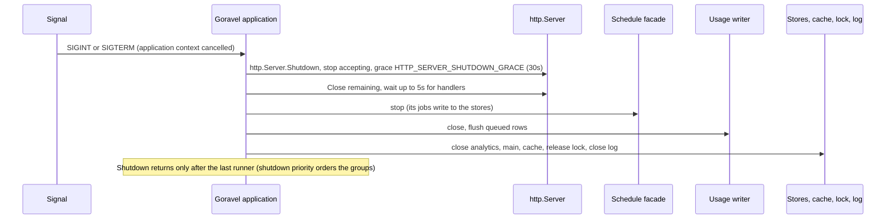

# Design 01 — HTTP Server & Routing (`app/http/`, `routes/`)

**Status:** partial

One listener on `APP_HOST` (default `127.0.0.1`; the container sets `0.0.0.0`) and `APP_PORT` (`20128`), through a provider runner around `Route`.

| Part | Lives in |
|---|---|
| Route tables | `routes/` |
| Guard, URL rewrite, locality check, trusted-proxy view, server runner | `app/http` |
| The global middleware stack | `app/http/middleware` |
| `HealthController`, `VersionController`, `InitController` | `app/http/controllers` |
| Client API, dashboard JSON and embedded pages | planned |

### Stack

| Part | Setting |
|---|---|
| Router | Gin v1.12.0 through `goravel/gin`, pinned, built `-tags nomsgpack` (drops MessagePack: 14.1 MB to 7.2 MB on a hello program). Release mode, driver defaults; the engine is private, so we neither configure nor fork it. Selected by `http.default` in `config/http.go` |
| Trusted proxies | `SERVER_TRUSTED_PROXIES`, empty meaning loopback only. `app/http/trust.go` reads it: `ClientAddr` is the caller address for logs and the login limiter, `SecureRequest` decides HSTS and the dashboard cookie's `Secure` flag. `X-Forwarded-For` and `X-Forwarded-Proto` count only from a peer on that list. Gin's `Request.Ip` trusts any `X-Forwarded-For` and is never an access decision |
| Server | A runner (`rllmx:http`) owns a stdlib `http.Server` whose handler wraps `Route.ServeHTTP` with the URL rewrite: `ReadHeaderTimeout` (`HTTP_SERVER_READ_HEADER_TIMEOUT`, 10 s), `IdleTimeout` (`HTTP_SERVER_IDLE_TIMEOUT`, 120 s), headers capped at 64 KiB (`http.drivers.gin.header_limit`), **no** `ReadTimeout` or `WriteTimeout` — a stream runs for minutes. `APP_HOST`/`APP_PORT`; TLS when the four `http.tls.*` keys are set. `http.request_timeout` is `0`, because the framework's timeout middleware buffers and cuts a stream. `app.disabled_runners` lists `goravel:http`, which builds its server without these settings |
| Unmatched requests | `Route.Fallback` answers all of them: an unknown `/api` path is 401 anonymous, 404 authenticated; a known path under another method is 405 (no `Allow` anonymous); an unknown client path is a 404 in the client's format |

### Middleware Order

Outermost first: path check and rewrite, recover, request id, access log, security headers, CORS, deadlines, body limit, cross-site guard, access guard (design doc 2), handler.

- The first stage wraps the engine (`Route.ServeHTTP`) because Gin routes before its own middleware.
- The rest are global middleware in `bootstrap/app.go` and the guarded group in `routes/`.
- The framework's timeout and CORS middleware are replaced by ours.

| Middleware | Behavior |
|---|---|
| `SecurityHeaders` | `X-Content-Type-Options: nosniff` everywhere; `Cache-Control: no-store` on `/api`; a page gets `Content-Security-Policy: default-src 'self'; base-uri 'none'; form-action 'self'; object-src 'none'; frame-ancestors 'none'` and `Referrer-Policy: no-referrer`; a page and `/api` get `Permissions-Policy` (every capability the dashboard does not use), `Cross-Origin-Opener-Policy: same-origin`, `Cross-Origin-Resource-Policy: same-origin` and `X-Frame-Options: DENY`. The client API gets none of the isolation headers, because its CORS is open on purpose. HSTS once TLS reached this process or a trusted proxy said it did |
| `CORS` | Fixed policy, no config block: `/v1` and `/v1beta` get `*` origin and the expose list, `/api` gets nothing, credentials are never allowed. An `OPTIONS` naming `Access-Control-Request-Method` is answered 204 here; any other `OPTIONS` goes on to the guard |
| `Deadlines` | Through `http.NewResponseController(stream.WriterOf(ctx))`, which is the only way past the driver's `*gin.BodyWriter`. `/api` read 30 s and write 60 s; the client API a 10 min read deadline when it carries a body, no write deadline. A writer that cannot take one is tolerated |
| `BodyLimit` | `SERVER_MAX_BODY_MB` for the client API, 16 MiB elsewhere. A declared length over the cap is refused 413 in the path's error format; a body with no declared length stops at the cap on the first oversized read |
| `SameOrigin` | A `POST`/`PUT`/`PATCH`/`DELETE` under `/api` needs `Sec-Fetch-Site` `same-origin` or `none`, or `Origin` equal to `Host`, or neither header. `same-site` is refused. One exact exemption, the SAML ACS (design doc 2) |

### Routes

| Path | Purpose |
|---|---|
| `POST /v1/chat/completions` | OpenAI Chat. A body with `input[]` is still OpenAI |
| `POST /v1/messages`, `/v1/messages/count_tokens` | Anthropic Messages; the count is a local estimate |
| `POST /v1/responses`, `/v1/responses/compact` | OpenAI Responses and its compaction variant |
| `POST /v1beta/models/{model}:generateContent`, `:streamGenerateContent` | Gemini. `{model}` is one or two `/`-separated segments, each matching `^[A-Za-z0-9_.-]+$` and free of `..`, split at the last `:`. Any other action is 404 (D224) |
| `GET /v1/models`, `/v1/models/info?id=`, `/v1/models/{provider}/{model}`, `GET /v1beta/models` | The models the caller can call: connections, custom models and alias targets, minus disabled ones; a restricted key sees its own list. `/v1/models/*path` is a catch-all because the id holds a slash (D225, D226) |
| `POST /v1/api/chat` | Ollama chat |
| `POST /v1/embeddings`, `/v1/images/generations`, `/v1/audio/*`, `/v1/videos/*`, `/v1/search`, `/v1/web/fetch` | Media (design doc 13) |
| `POST /v1/systemone` | Smart router entry |
| `/api/*` | Dashboard JSON API (design doc 18) |
| `GET /api/health` | Unauthenticated liveness |
| `GET /api/init` | `{"initialized":true,"needsSetup":<no connection configured>}`. An unreadable count answers `needsSetup:false`, so a broken store never becomes a setup prompt |
| `GET /api/version` | `{"currentVersion","commit","latestVersion":null,"hasUpdate":false}`. No registry lookup: the updater is out (design doc 22) |
| `/`, `/dashboard/*`, `/login`, `/setup` | Static dashboard |

### Path Rules & Rewrites

Gin matches `URL.Path` without cleaning it, so the first stage refuses a non-canonical path with a 400 in the endpoint's error format.

- Refused: dot segments, `//`, a trailing slash, a backslash, control characters, and an encoded `/`, `.`, `\` or NUL in the raw form.
- A rewrite matches whole segments (`/codexfoo` is not `/codex`), runs once and clears `RawPath`.
- The guard and the router therefore read the same path.

| Rewrite | Why |
|---|---|
| `/v1/v1/*` to `/v1/*` | SDKs append `/v1/...` to a base URL that already ends in `/v1` |
| `/codex/*`, `/responses` to `/v1/responses` | Codex client paths |
| `/systemone` to `/v1/systemone` | Short alias |

Gin cannot express `{model}:generateContent`, so `POST /v1beta/models/*path` is a catch-all route in `routes/` split at the last `:`. The five chat routes share `ChatController.Serve`; the format comes from the path alone (D190). `count_tokens` is answered by `ChatController.CountTokens` with no pipeline.

### Limits & Deadlines

| Item | Behavior |
|---|---|
| Client body | `http.MaxBytesReader`, `SERVER_MAX_BODY_MB` (128; media uploads need it). `/api` bodies: 16 MiB |
| Oversize | Declared length over the cap is refused before the handler runs; a chunked body stops at the cap. 413, a read timeout is 408, both in the endpoint's error format |
| Upstream error body | Read up to 1 MiB |
| `/api` deadlines | Read 30 s, write 60 s, except the long calls: the latency feed, `providers/test-batch` and `providers/{id}/test-models` get no write deadline and bound their own work |
| Client API deadlines | Read 10 minutes, no server write deadline |
| Stream write | The SSE and NDJSON writers set their own deadline before each write: a client that stopped reading is cut after 60 s, a quiet stream is untouched |

Deadlines are set once, at the start of the request, through `http.ResponseController` over `stream.WriterOf`, which is the only writer that carries one. A handler never sets a read deadline after reading the body: net/http's background read would fail and cancel the request context and the upstream call with it.

### Streams

`app/llm/stream/sse.go` and `app/llm/stream/ndjson.go` are the only stream writers: `NewSSE` for every client, `NewNDJSON` for an Ollama client (divergence 219). They share one core (`sink`), so the rules below hold for both.
- It builds its `ResponseController` on the innermost writer. The framework's `ctx.Response.Writer` is a `*gin.BodyWriter` that has no `Unwrap`, hides Gin's flush error and copies every written byte into an in-memory buffer; `StreamWriter` wraps the same writer. A controller built on either never reports a departed client, and the buffer grows with the stream (a test fails when the unwrapping is removed). Stream handlers take the Gin context from `Context.Instance` (the Route has no `Instance`), write to `BodyWriter.ResponseWriter` (Gin's own writer, which has `Unwrap`), and never call `ctx.Response.Stream(...)`.
- Each event is flushed. The first error is remembered and fails every later call, so a caller stops spending upstream tokens.
- A panic after the response started re-panics `http.ErrAbortHandler`, so the client sees a broken stream, not a complete-looking one.

### CORS

`/v1` and `/v1beta` send `Access-Control-Allow-Origin: *` and `Access-Control-Expose-Headers: X-Request-Id, Retry-After`, also on errors. `/api/*` sends no CORS headers.

| Item | Behavior |
|---|---|
| Preflight | An `OPTIONS` that names `Access-Control-Request-Method` is answered 204 **before** the guard (browsers send no credentials with it). Any other `OPTIONS` goes through the guard |
| Allow-Headers | Echoes the requested names after a character check (`*` does not cover `Authorization`); a list with any other character is replaced by the fixed default list |
| Max-Age | 86400. Credentials are never allowed |

### Cross-Site Guard

A state-changing method under `/api` is refused 403 unless the origin matches.

- Accepted: `Sec-Fetch-Site` of `same-origin` or `none`, or no `Sec-Fetch-Site` with `Origin` equal to `Host`, or no headers at all (a script, not a browser).
- Refused: `same-site`, because another port of this machine is same-site but not same-origin, and repeated headers are never trusted.
- The client API is not covered: a browser app calls it cross-origin by design.
- The exemption list is exact paths, and holds only `/api/auth/saml/acs` (design doc 2).

### Shutdown

A second signal exits at once with code 1. Each stage after the server is a provider runner with a shutdown priority, which fixes the order above. Divergence 30 lists what the reference does instead.

### No Remote Stop

There is no `/api/shutdown` and no update route. Anonymous callers get 401 for any unknown `/api` path, so the absence is not an oracle.

### Framework Choices

How the program is built on Goravel. None of this changes behavior toward a client, so none is a divergence (`DIVERGENCES.md` compares behavior only). Each row names its cost.

| Area | Choice | Cost or risk |
|---|---|---|
| HTTP server | A runner owns the `http.Server`, because the driver builds one with no header or idle timeout and no key sets them; `goravel:http` disabled | We own listen, TLS, shutdown and the second-signal exit. `Route.Run` is unused |
| Gin engine | Driver defaults: `RedirectTrailingSlash` on, `HandleMethodNotAllowed` off, every proxy trusted. v1.18.0 exposes no engine accessor, and the engine is rebuilt whenever global middleware or the recover handler is set | The rewrite wrapper refuses non-canonical paths first, `Fallback` answers 401/404/405, and the guard reads only `Request.Origin.RemoteAddr`. A driver release exposing the engine would allow `HandleMethodNotAllowed` and a trusted-proxy list; a wrong-method test catches the change |
| Debug logger | `APP_DEBUG=true` makes the driver add Gin's logger, which writes the query string | `APP_DEBUG` stays `false` outside local development; the access log (path only) is ours |
| Runner order | Every runner starts at once; only shutdown is ordered. `rllmx:data` takes the lock, opens the stores and the writer, then marks data ready. `rllmx:http` opens its socket first (a busy port is the first error) and waits for that mark. Shutdown priority: HTTP -100, schedule and the framework at 0, data +100 | The socket accepts connections slightly before the server answers; `rllmx artisan health` times out during a long migration |
| Scheduler | `Schedule` with `SkipIfStillRunning`; the framework always recovers a job panic. Start offsets and the clock are passed per job; a job gets no context and watches the application context | No jitter or clock injection; shutdown waits for a running job with no limit, so jobs stay short |
| Database layer | `DB`'s manual interface (`Select`, `Insert`, `Update`, `Delete`, `Statement`, `Transaction`) with `goravel/sqlite` and `goravel/postgres`; `Schema` for checks, exact DDL and migrations. No ORM model; rows are structs with `db` tags and string timestamps. Sealing, `kv` scopes, unknown JSON keys, NUL stripping, timestamps and `Rebind` are thin wrappers | The drivers are GORM-based, so `gorm.io` stays in `go list -deps` (a test keeps it out of our imports). One pool limit set serves every connection, `Connection(name)` caches in an unlocked map (stores are built once, in order), and a failed connection build panics |
| Default connection | `database.default` is the writer, and Goravel boots `DB` for every command, pinging it read-write. `config.Boot` therefore creates `DATA_DIR/db` (`0700`) and an empty `data.sqlite` (`0600`) when the connection is inside `DATA_DIR`, so the ping neither warns nor leaves a `0644` file | Any command, even `version` and `health`, can leave an empty database file. A `DB_DATABASE` elsewhere (a 9router file) is never created |
| Framework commands | Two gates over one list in `bootstrap/commands_filter.go`. `WithCommandsFilter` covers only the foundation and console batches; v1.18.0's database provider registers `migrate*`, `db:wipe`, `db:seed`, `db:show`, `db:table` and the `make:*` generators with a bare `artisan.Register`, and `Artisan` cannot unregister. `providers.CommandsServiceProvider` wraps the bound `Artisan` and filters every `Register` through `FilterCommandsByAllowlist` | The wrapper needs the framework to finish every `Register` before any `Boot`, which `Build` does; a release registering from `Register` would slip past. The exit is a version bump — `master` already routes through the filtered `app.Commands(...)`. The generators are listed one by one, not as `make:*`: the four ORM ones (`make:model`, `make:observer`, `make:seeder`, `make:factory`) are left out, and a generator a later release adds stays dropped until it is listed |
| Cache | The `Cache` facade with memory and Redis stores; `app/platform/cache` adds keys, a generation counter for purges and fail-open | The memory store has no size cap and returns values without copying, and `Remember` does not collapse concurrent loads; `app/platform/cache.Load` adds single-flight |
| Logging | The `Log` facade and `config/logging.go` (channel, path, level, formatter, retention). A `custom` channel redacts an entry before the file channel writes it, and hands the clean copy to `app/platform/logbook`, a 200-line in-memory ring the dashboard reads and streams; a line over 4 KiB is cut and control characters are stripped. `config.ConsoleLog` is the wiring's only handle on the ring, because the channel is built at init | The file channels have no size-based rotation or compression (`daily` keeps `days` files). Redaction and the ring are proven by tests on the channel |

---

## Parity: Server, Guard and Routes

| Item | Package | Status |
|---|---|---|
| Request guard (ref `src/dashboardGuard.js`: public, protected, always protected, local only) | `app/http` (policy, locality, route table, fallback), `app/http/middleware`, `routes/` | done |
| Graceful shutdown, server timeouts, SSE writer, start (`rllmx`), `rllmx artisan health` (ref `custom-server.js`) | `app/http` (server runner), `app/providers`, `app/llm/stream`, `app/console/commands` | partial (; the store-closing runners are `app/store/data`'s, which are built, but the sequence is only proven once the server is exercised live; D30, D48) |
| `/api/health` | `app/http/controllers` | unverified |
| `/api/init`, `/api/version` | `app/http/controllers` | done. `version` answers the build and never contacts a package registry |
| `/api/version/update`, `/api/version/shutdown`, `/api/shutdown` | none | out (no route; signal stop) |

---

## Remaining work

The guard, the server and the middleware stack are built. The design doc stays `partial` because three rows above are paid by later steps:

- [x] The request guard runs on a real authenticator, with sessions, API keys, OIDC and SAML
- [x] The data runner closes the stores, the writer and the cache in shutdown-priority order
- [ ] `/v1`, `/v1beta` and `/api/*` client and dashboard routes, and the pages

Nothing in the listener, the middleware order, the path rules, CORS, the body cap, the deadlines or the two base routes is outstanding.

---

## Divergences

Deliberate differences from the references in this area. Numbers are stable and cited from other docs.

| # | What we do differently | Why it is better |
|---|---|---|
| 30 | Header and idle timeouts (`HTTP_SERVER_READ_HEADER_TIMEOUT`, `HTTP_SERVER_IDLE_TIMEOUT`), no write timeout on streams, bounded graceful drain (`HTTP_SERVER_SHUTDOWN_GRACE`) (reference: `server.js`) | Slow clients, exits stop hurting |
| 196 | Retired: scheduling uses the `Schedule` facade, a framework choice, not client behavior | Recorded so the number stays citable (framework choice) |
| 197 | Retired: the HTTP server, its timeouts and the Gin options come from the framework | Recorded so the number stays citable (framework choice) |
| 46, 47 | Rewrite first, non-canonical paths refused; preflight echoes requested names after character check | One path for guard and router; browsers can send `Authorization` |
| 224 | The Gemini model is one or two plain segments (`gemini-2.5-pro` or `provider/model`) split at the last colon; `countTokens`, `embedContent` and any other action are 404; the whole Gemini body is read, not only text parts. The reference runs every action as generate with the suffix left in the model name and keeps text parts only | A crafted segment cannot change the upstream path, a wrong action fails loudly, tools, images and function calls survive |
| 203 | Security headers on every response: `nosniff` everywhere, `no-store` on `/api`, CSP and `Referrer-Policy` on pages, HSTS once TLS reached this process or a trusted proxy said it did | The reference sets none; a dashboard behind a reverse proxy, or loaded over a LAN address, would otherwise be framable and cacheable (the rest are 328) |
| 204 | `Access-Control-Expose-Headers: X-Request-Id, Retry-After, X-Rllm-Cache` and `Max-Age: 86400` | A browser client can read the request id, the backoff delay and whether the response cache answered; a preflight is not repeated on every call. Reference exposes nothing and caches no preflight |
| 205 | One body cap before the handler, 413 in the endpoint's error format, and a streaming stop for a body with no declared length | Reference bounds only the Next rewrite buffer, so a direct route has no cap at all |
| 206 | `/api/version` answers the build and never contacts a package registry | The reference's public route calls npm on every cold start and needs an outbound request to describe itself |
| 327 | An answer worth it leaves compressed with gzip, or Brotli once its module is approved: JSON, XML, text, JavaScript, SVG, 1 KiB or larger, never a stream, audio, video or a raster image, never on a response that already carries an encoding, and never on `/api/oauth/*`, `/api/auth/*` or `/api/providers/*`. `HTTP_COMPRESSION` turns it off. The reference sends every answer uncompressed | A model list, a JSON completion and a base64 image are a quarter to a tenth of their size on the wire; a proxy that compresses already is unharmed because an encoded answer is left alone |
| 328 | The headers 203 lists beyond CSP and `nosniff`: `Permissions-Policy`, cross-origin isolation on a page and `/api`, `X-Frame-Options` and a tighter page policy. The reference sets none | A dashboard behind a reverse proxy is reachable from another origin, and no part of it wants a camera, a frame or a foreign form target |
| 329 | `HTTP_H2C` lets the plain listener speak HTTP/2; `HTTP_SERVER_IDLE_TIMEOUT` and the header cap are the ones 30 names. HTTP/2 over TLS is Go's own default, and the TLS floor is stated as TLS 1.2 | A proxy can multiplex streams; the floor does not depend on a future Go default |
| 351 | The Console Log is a second reader behind the redactor: 200 scrubbed, level-tagged entries, bounded per line, served only to a dashboard session, and streamed by polling the ring rather than by attaching a listener **(built)** | The reference intercepts stdout and serves raw, unredacted lines to anyone while `requireLogin` is off, then leaks a listener per stream and copies the buffer out by reference |

---

## Findings

One row per lesson; the decision is what the code does because of it.

| Finding | Decision |
|---|---|
| The driver's engine is private in v1.18.0, so `HandleMethodNotAllowed` cannot be turned on and Gin has no 405. | The `Fallback` handler answers it. |
| The driver's `http.Server` sets no header or idle timeout and no config key sets one. | A runner owns the server instead. |
| `ctx.Response.Writer` is the driver's `*gin.BodyWriter`, which embeds an interface and so has no `Unwrap`. | `http.NewResponseController` silently sets nothing; every deadline goes through `stream.Writer`. |
| Only `SERVER_MAX_BODY_MB` is configurable, and it describes the client API. | The `/api` body cap is a constant of 16 MiB, which covers an imported settings file. |
| The CORS policy is fixed (`*`, never credentials), so six knobs were read by nothing. | `config/cors.go` was deleted rather than promising configuration the product does not have. |

