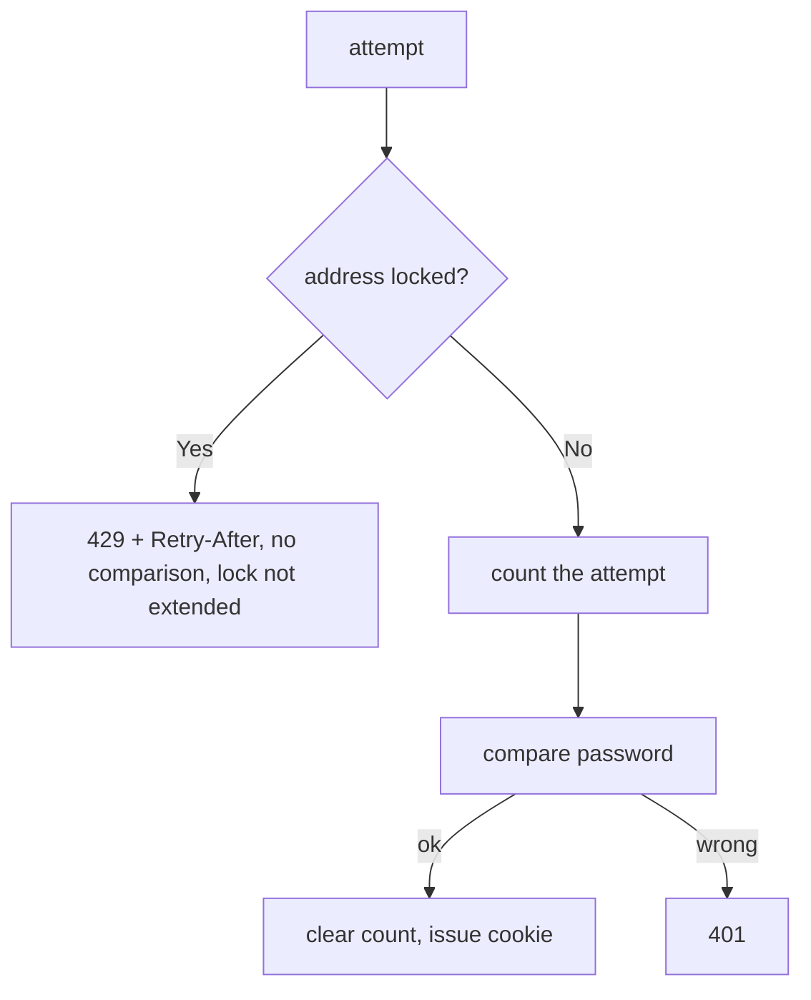

# Design 02 — Authentication & Access (`app/access/auth/`, `app/access/sso/`, `app/access/oidc/`, `app/access/saml/`, `app/access/identity/`)

**Status:** partial

Built: `app/access/identity` (key format, machine id, key extraction), `app/access/auth` (session, password rules, login limiter, sign-in mode, settings snapshot, key lookup, the authenticator), the five `/api/auth/*` and `/api/settings/require-login` routes, the five commands, and the authenticator the guard now asks.

Built: `app/access/sso` (public base, guarded IdP client, single-use flow state, allow list, bind cookie, error codes), `app/access/oidc` (settings, discovery, JWKS, PKCE, ID-token verification, identity), the two `/api/auth/oidc/*` routes, `AUTH_SSO_ALLOW`, and the real `Mode`.

Built: `app/access/saml` (settings, response parsing, XML-DSig verification over `goxmldsig`, the replay set, identity extraction, the AuthnRequest and the metadata document) and the three `/api/auth/saml/*` routes. Both sign-in types are done; `ResolveMode` now receives a real `samlUsable`, so a `saml` mode turns the password form off once its provider is configured.

**The allow list is optional.** An empty `AUTH_SSO_ALLOW` admits every account the configured provider accepts. A first draft required a non-empty list; a company IdP makes it noise, and `Configured` already refuses a half-set-up IdP.

**The trade-off, stated plainly:** with an empty list the dashboard is as open as the provider's own registration. Point `oidcIssuerUrl` and `oidcClientId` at a public provider and every account there can sign in. Set `AUTH_SSO_ALLOW` to exact addresses or `@domain` entries to close that.

### Client API

| Check | Behavior |
|---|---|
| Key extraction | `Authorization: Bearer`, then `x-api-key` on every client route; `x-goog-api-key`, then `?key=`, only under `/v1beta`. The first present value wins |
| Key validity | `identity.Classify` returns `Valid`, `ChecksumMismatch`, `Legacy` or `Malformed`. Only `Malformed` (not `sk-`, outside `[A-Za-z0-9_-]`, under 8 or over 256 bytes) is refused before lookup. The checksum is informational: the reference authenticates by exact row match. A key is valid only with an active `apiKeys` row |
| Remote caller | Always needs a valid key |
| Local caller | Needs a valid key while `requireApiKey` is on (default). With it off, passes either way. The guard hands the handler the caller (the key or a stable anonymous-local identity) through `http.CallerFrom` |
| Key lookup | `auth.KeyStore`: cache namespace `apikeys`, SHA-256 keyed, 10 s, hits only. Key routes call `Changed`. A database error counts as an invalid key |
| Key access | A key with `accessRestricted` may call only the combos and resolved `provider/model` pairs in `accessAllow` (design doc 21) |

### Local Request

One function (`app/http/locality.go`, tested over every combination). A request is local only when **all** hold:

| Rule | Detail |
|---|---|
| Socket peer | `Request.RemoteAddr` is loopback. IPv4-mapped is judged by its IPv4 part; a zoned address is not local |
| No forwarding headers | None of `X-Forwarded-*`, `X-Real-Ip`, `Forwarded`, `Via` or CDN client-IP headers, even empty |
| Host | `localhost` or a loopback IP (port, brackets, trailing dot handled). `0.0.0.0`, `[::]`, `localhost.evil.com`, userinfo and bare numbers are not. Defeats DNS rebinding |
| Origin | Absent or a loopback web origin (`null` is not) |
| Sec-Fetch-Site | Absent, `same-origin` or `none`. Another port of this machine is `same-site`, not local |

A repeated `Origin` or `Sec-Fetch-Site` is never trusted. No access decision reads `ctx.Request.Ip` (logs and limiter keys only). Set `SERVER_TRUST_LOOPBACK=false` when a tunnel or reverse proxy on this machine forwards internet traffic, because it arrives from 127.0.0.1.

### Guard Classes

Every route is declared through the guarded group `Handle(class, method, path, …)`.

- It records the class and panics on a mistake: an unknown class, a client route that is not `ClassLLM`, a page under `/api`, or a duplicate.
- A route on the bare `Route` facade is found at start and stops it.
- The policy is one pure function, `decide`, that denies by default.

| Class | Rule |
|---|---|
| Public | Health, init, version, `auth/*`, `settings/require-login`, static pages |
| Protected (default for `/api/*`) | Needs the session, or passes when `requireLogin` is off **and** the request is local |
| Always protected | Database export and import, provider routes, other destructive routes. Need the session even when `requireLogin` is off |
| Local only | Routes touching host files or secrets (CLI tool config writers, password reset, local IDE imports). Need a local request **and** the session, also when `requireLogin` is off. The reference opens them to any loopback request |
| Client API (`/v1`, `/v1beta`) | A valid key, or a local request. The key store is consulted only for remote requests |

- An unmatched path is judged by prefix: an unknown `/api` path is 401 to an anonymous caller and 404 after authentication.
- A denied request has its `Allow` header removed; denials use the client's error format.
- `/dashboard/*` redirects to `/login` without a session unless `requireLogin` is off and the request is local.
- The guard asks an `Authenticator` (`Session`, `APIKey`, `RequireLogin`, `RequireAPIKey`). A server built without one denies everything.

### Cross-Site Guard

Built as `middleware.SameOrigin` (design doc 1), before the guard. A POST, PUT, PATCH or DELETE under `/api` is refused with 403 unless:
- `Sec-Fetch-Site` is `same-origin` or `none`; or
- the header is absent and `Origin` equals `Host`; or
- neither header is present (curl, scripts).

`same-site` is refused. The exemption list is exact paths and holds only `/api/auth/saml/acs`. The client API is not covered (browser apps call it cross-origin by design).

### Dashboard Login

| Item | Behavior |
|---|---|
| Password | bcrypt cost 10 in `settings.password`. While none is stored: `AUTH_INITIAL_PASSWORD` (constant-time compare), else `123456`. A new password is 8 to 72 bytes and not `123456` or `change-me` |
| CPU guard | Comparisons take a slot semaphore (one per CPU, 2 s wait, then 503) after the limiter check |
| Default password | A remote login while the password is a well-known value is refused with `mustChangePassword` before any comparison, uncounted. A local login works and answers `mustChangePassword: true` |
| Session | HS256 JWT in the `auth_token` cookie: 24 h, issuer `rllm` (kept so a cookie from an earlier install still validates), 30 s leeway. HS256 verify and sign are `crypto/hmac` plus `subtle.ConstantTimeCompare` over base64url segments: this session uses no JWT module, and `go-jose` is present only for OIDC ID tokens (`docs/ARCHITECTURE.md`, Approved Modules). Expiry is required and the method is pinned to HS256. Only the cookie is a session |
| Claims | `authenticated`, `method` (`password`, `oidc`, `saml`), optional `email` and `name`, `pv` |
| `pv` | First 16 hex of HMAC(session secret, password hash `\|` session epoch). A password change or epoch bump ends every session. Epoch is kv row `rllmAuth/sessionEpoch`; "logout everywhere" and terminal reset bump it |
| Cookie | `HttpOnly`, `SameSite=Lax`, `Path=/`. `Secure` when `AUTH_COOKIE_SECURE=true`, TLS ends here, or a trusted proxy sends `X-Forwarded-Proto: https` (last hop). Cookies ignore ports, which is why local-only routes also check locality |
| Guard settings | `requireLogin`, `requireApiKey`, `authMode`, `ssoType`, password hash and epoch come from one snapshot cached 5 s, dropped when this process changes them. A failed read means login and key required, nothing authenticated |

| Route | Behavior |
|---|---|
| `POST /api/auth/login` | Password login |
| `POST /api/auth/logout` | `{"everywhere":true}` also ends other sessions, and only with a session |
| `GET /api/auth/status` | `hasPassword` and `defaultPassword` only for a local or signed-in caller |
| `GET /api/settings/require-login` | The flag only |
| `POST /api/auth/change-password` | Always protected. Judges the new password, then the current one under the limiter, stores the hash, re-issues the cookie |

No route resets a password over HTTP.

### Login Limiter

| Item | Behavior |
|---|---|
| Key | Client address (`X-Forwarded-For` only from a trusted proxy; IPv6 counts as its /64) |
| Counting | Every attempt is counted **before** the compare, so parallel guesses cannot all see the old count |
| Five free attempts, then locks of 30 s, 2 m, 10 m, 30 m. One hour of quiet starts over |
| Entries live 2 h (longer than the longest lock plus the quiet hour); constants are in `app/access/auth/limiter.go` |
| A dedicated, separately capped in-process store, because the shared cache evicts across namespaces |
| With the Redis store as default, counters are also kept there under the SHA-256 of the client key. Each attempt loads both copies, takes the stricter value per field and writes both back. A Redis outage never lifts a lock. The read-modify-write is not atomic: instances racing on one address can let a few extra guesses through |

Change-password shares this counter. SSO counts differently (below).

### Sign-In Methods

`auth.ResolveMode` turns `authMode` and `ssoType` into one decision.

- SSO is usable only when its type is fully configured **and** `AUTH_SSO_ALLOW` names an entry.
- Password login is off only when the mode is SSO-only **and** SSO is usable, so half-configured SSO cannot lock the administrator out.
- SSO sessions are re-checked on every request against the current mode and allow-list.

### Single Sign-On (`app/access/oidc`, `app/access/saml`, `app/access/sso`)

Shared by both types:

| Item | Behavior |
|---|---|
| Gate | Public routes refuse unless their type is the one in force. A locked address gets `sso_busy`. Only a **failed** callback counts, under the limiter prefix `sso:` so SSO and password attempts never share a count (divergence 130). Built: the prefix is `sso:` + `auth.Key(address)` |
| URL base | Built from `APP_URL` (`sso.PublicBase`, `sso.CleanURL`). Without it only a local request may use its own loopback `Host`; otherwise start fails and asks for the variable. Forwarded headers never build a URL |
| IdP client | One client (`app/access/sso/client.go`) on `network.NewClient`: no proxy, verified TLS, 10 s, 3 redirects, never https to http, 1 MiB response cap, the SSRF dialer guard (a private-network IdP needs an `UPSTREAM_ALLOW_PRIVATE` entry) |
| Flow state | Pending sign-ins and the SAML replay set live in dedicated in-process stores (10,000 pending, 100,000 replay), never Redis. A sign-in must finish on the instance that started it. Single use, 10 minutes. Built: `sso.Pending`, capped and expiring |
| Errors | Every failure redirects to `/login?error=<code>`: `sso_disabled`, `sso_not_configured`, `sso_busy`, `sso_expired`, `sso_invalid`, `sso_not_allowed`, `sso_no_email`, `sso_unverified`, `sso_idp_error`. Provider or library text goes to the debug log only |
| Session | Success sets the normal cookie and redirects to `/`. `Authenticator.IssueSSO` refuses unless that type is still in force **and** the allow list still permits the address; `Session` re-checks a provider session on every request, so switching the mode off or narrowing the list ends it at the next request rather than at the next expiry |

#### OIDC

Routes `GET /api/auth/oidc/start`, `GET /api/auth/oidc/callback`.

| Item | Behavior |
|---|---|
| Discovery | Lazy, cached 1 h per issuer and client id, dropped when settings change; failures are not cached |
| Settings | Issuer is `https` (or `http` on this machine), no credentials, query or fragment. Scopes are plain tokens, `openid` forced in, at most eight |
| Flow state | `state` (32 random bytes) keys a pending sign-in holding nonce, PKCE verifier and the settings used |
| Bind cookie | `oidc_bind`: HMAC of the state under the session secret, `HttpOnly`, `Lax`, path `/api/auth/oidc`, 10 min. It must return with the callback, so an attacker cannot plant their own `code` and `state` in a victim's browser |
| Verification | RS256 and ES256 only, pinned by the parser's algorithm allow list. `github.com/go-jose/go-jose/v4` parses the JWS and selects the JWKS key by `kid`; every claim rule is ours: issuer equals the discovered issuer, audience contains the client id, `azp` equals it when the audience has several values, `exp`/`nbf` with 60 s skew, the nonce, a non-empty `sub`, `at_hash` when present, and `email_verified` false (boolean or string) refused. `coreos/go-oidc` is not a dependency; `go-jose` is, for the parse and the key selection only |
| Identity | `email`, or `preferred_username` with exactly one `@` when `email` is absent. An address from `preferred_username` matches only **exact** allow-list entries, never `@domain`, because that claim is user-editable at some providers |
| Allow-list | Applied before any cookie is set. `iss` and `sub` are logged only as a short hash |
| Not built | The `oidc/test` route (it fetches a caller-chosen URL) |

#### SAML

Routes `GET /api/auth/saml/start`, `POST /api/auth/saml/acs`, `GET /api/auth/saml/metadata`.

| Item | Behavior |
|---|---|
| Configured | Only when `samlEntryPoint`, `samlCert` **and** the new `samlIdpEntityId` are set. A database imported from 9router lacks the last, so SAML starts off and password login keeps working until it is filled. The issuer is never taken from the response |
| Library | `github.com/russellhaering/goxmldsig` verifies the signature and nothing else, from the approved-module list. Everything else is ours: the response and assertion parsing over `encoding/xml`, the audience/recipient/time/`InResponseTo` checks, the reuse defence, the AuthnRequest and the metadata. `crewjam/saml` and `golang-jwt/jwt` are not adopted. No artifact binding (an outbound SOAP call) is built |
| Start | Unsigned AuthnRequest (HTTP-Redirect, deflated). Its id is the store key and travels as `RelayState` |
| Bind cookie | `saml_bind`: HMAC of the relay state under a name distinct from the OIDC one, path `/api/auth/saml`, must return with the response (divergence 129). The ACS is a cross-site POST, so it is `SameSite=None` when `Secure`; without `Secure` it is `Lax`, because browsers reject `None` without `Secure` |
| ACS input | POST body only (512 KiB cap enforced on the route, never the query). `SAMLart` is refused. Relay state taken once. The base64 form is size-capped and refused if it holds a DTD or entity declaration, before any parser sees it |
| Signature | A signature over the whole Response, or one over each Assertion, against the pinned certificate. Nothing else counts as proof, and a document where exactly one assertion verifies is the only shape accepted |
| Our checks | The status value; a required audience restriction naming our entity id; a `Destination` when the provider sends one; a bearer subject confirmation carrying data, its `Recipient` and `InResponseTo`; both validity windows with 60 s skew; a non-empty assertion id put in the replay set until the assertion could no longer be valid (24 h at most); the IdP entity id, our entity id and certificate must be those in force when the sign-in started |
| Reuse | Assertion ids live in an in-process set capped at 100,000. An id whose window has closed stops counting, so a replayed response fails once, not forever |
| Clock | 60 s skew, applied to the conditions and the confirmation. `goxmldsig`'s own clock is pinned to the same value |
| Identity | Email from `samlAttributeEmail`, then common names (`email`, `mail`, `emailAddress`, `upn`, Microsoft claim URIs, `urn:oid:0.9.2342.19200300.100.1.3`), then a NameID that looks like one address. Name likewise from `samlAttributeName`. Values over 320 bytes are ignored |
| CSRF | The ACS is the **only** cross-site POST in the product; its exact path is in the exemption list |
| Metadata | `SPSSODescriptor`, one POST ACS, assertions required signed, requests not signed. Served only while SAML is in force. The entity id is `<APP_URL>/api/auth/saml/metadata` unless `samlIssuer` overrides it (divergence 211) |
| Not built | Signed requests, artifact binding, single logout, encrypted assertions, the `saml/test` route |

### Files & Compatibility Formats (`app/access/identity/`)

| Item | Format |
|---|---|
| `jwt-secret` | `DATA_DIR/jwt-secret`, generated when `JWT_SECRET` is unset. A configured value is 32 bytes or more; a short file is an error and never overwritten |
| `machine-id` | `DATA_DIR/machine-id`: 16 to 128 characters of letters, digits, `-_.:`. When missing or unusable the server creates it from `/etc/machine-id`, else `crypto/rand` |
| File handling | Both `0600`, written through a temp file and rename. **Only the server creates them**, so a terminal command run as root cannot leave unreadable files |
| Machine id (hashed) | First 16 hex of `sha256(rawMachineId + salt)`; `salt` is `AUTH_MACHINE_ID_SALT` (default `endpoint-proxy-salt`) |
| API key | `sk-{machineId}-{keyId}-{crc8}`. `keyId`: six `[a-z0-9]` from `crypto/rand`, no modulo bias. `crc8`: first 8 hex of `HMAC-SHA256(AUTH_API_KEY_SECRET, machineId + keyId)` |
| Warning | A startup warning while `AUTH_API_KEY_SECRET` is the public default |

Anything the dashboard asks the router to do against its own endpoints (model test pings) runs in-process through the pipeline. There is no internal token and no header that grants access.

---

## Parity: Auth Routes

| Endpoint | Package | Status |
|---|---|---|
| `/api/auth/*` (login, logout, status, change-password; reset-password = `rllmx artisan password:reset`) | `app/http/controllers`, `app/access/auth` | done |
| `/api/auth/oidc/{start,callback}` | `app/access/oidc`, `app/access/sso`, `app/http/controllers` | done |
| `/api/auth/saml/{start,acs,metadata}` | `app/access/saml`, `app/http/controllers` | done |
| `keys:create`, `keys:list`, `keys:revoke`, `password:reset`, `db:export-plain` | `app/console/commands`, `app/access/identity` | done |
| `/api/auth/oidc/test`, `/api/auth/saml/test` | none | deferred |
| `/api/settings` (database export/import, the other settings) | `app/http/controllers` | todo (require-login is built) |
| `/api/keys/*` (list, create, reveal, rename, enable/disable, delete) | `app/http/controllers`, `app/access/auth` | done (a dashboard session even when `requireLogin` is off; the list is masked and only the reveal and the create answer a whole key) |
| `/api/locale`, `/api/tags` | `app/http/controllers` | todo |

---

## Remaining work

 are built: password login with its session and limiter, API keys, OIDC, SAML and the five commands. The design doc is `partial` because four parity rows above are still open, each owned by a later step:

- [x] The key management API (`/api/keys/*`); `/api/settings` stays with the settings step
- [ ] `/api/auth/oidc/test`, `/api/auth/saml/test`, `/api/locale`, `/api/tags` — planned
- [ ] The per-key model allow-list and quota the `Caller` already carries —, (`design doc 21`)
- **Done when:** a revoked or disabled key is rejected within the cache TTL and immediately after explicit invalidation — that holds today and a test proves it. What keeps the design doc open is the management surface and the two limits, not the guard.

---

## Divergences

Deliberate differences from the references in this area. Numbers are stable and cited from other docs.

| # | What we do differently | Why it is better |
|---|---|---|
| 94 | Any control character refused (write, send) | The rest are as harmful |
| 325 | A key limited to a list of models is refused with 403 on every chat and media route until per-request enforcement lands; only the model listings read the list. The reference checks the list on each request. **Temporary** | Failing closed is safer than letting a restricted key call every model |
| 231 | A remote caller whose API keys are refused five times in a row is locked out by the same progressive limiter as the dashboard login (key `key:<address>`, so its budget is its own); while locked, any call that presents a key gets `429` with `Retry-After`, a valid key included. A call with no key, and a local caller, are never counted | The reference lets a client try keys without limit; the key id is six characters from 36, so an unthrottled caller can walk it (improvement) |
| 232 | One client address may hold at most 50 single sign-in flows open, and the pending store drops expired flows from the old end instead of scanning all of them. The cap is per address, so the store cannot be filled from one place | `oidc/start` and `saml/start` are public; without a per-address cap, ten thousand calls made every real sign-in fail for ten minutes (improvement) |
| 51 | Only `/v1beta`, first source wins | Query keys out of proxies and logs |
| 42, 43, 44, 58 | Local = loopback peer, no proxy header, `Host` naming this machine, loopback `Origin`, `Sec-Fetch-Site` same-origin/none; session also on local-only routes; cross-site `/api` writes refused **(built, `middleware.SameOrigin`,)**; `requireApiKey` in guard; no local-only route yet, logic tested | Admin routes unreachable from web app, DNS rebinding or same-machine tunnel; one decision point |
| 52 | `pv` claim (HMAC of password hash + session epoch); password change, "logout everywhere", `password reset` end all sessions | Stolen cookie dies with the password |
| 53, 54, 57 | Count before compare, slot semaphore, no compare for locked address, Redis copy takes stricter state; remote login on well-known password refused (`mustChangePassword`); `X-Forwarded-For` only from trusted proxy, IPv6 as /64 | No free guesses in a burst, no fresh budget from forged header |
| 55, 56 | `hasPassword` only to local or signed-in callers; `Secure` from TLS, `AUTH_COOKIE_SECURE`, trusted proxy | Anonymous callers learn nothing; clients cannot pick cookie flags |
| 145 | Failed settings read stops start; corrupt session epoch fails snapshot, so no session validates | Unreadable hash never means "no password" |
| 59, 60 | One resolver for `oidc`, `saml`, `sso`, `both`. SSO usable when its provider is configured; `AUTH_SSO_ALLOW` narrows who may sign in and **empty admits anyone the provider accepts**; password login off only when SSO usable | No lockout by a half-configured IdP; an operator who wants a closed door sets the list |
| 61, 62 | `APP_URL` (remote request without it refused). State keys server-side single-use sign-in plus HMAC bind cookie; verifier, nonce server-side | Caller cannot choose where code goes; planted `code` + `state` refused |
| 63, 64 | RS256, ES256 only; issuer equals discovery; `azp` for several audiences; `at_hash` when present; `sub` required; unverified email refused; `preferred_username` only on exact allow-list entry | No algorithm confusion or token substitution; editable claim cannot admit a domain |
| 210 | `AUTH_SSO_ALLOW` empty admits every account the provider accepts | One setting to explain, and the reference's own behaviour; the closed door is one line away |
| 211 | The SAML entity id defaults to `<APP_URL>/api/auth/saml/metadata`; `samlIssuer` overrides it. A 9router import carries `urn:9router:sp` in, so a migrated IdP keeps working | A fresh install gets the value its IdP expects and the value the metadata route serves; the reference's `urn:9router:sp` stays reachable as a one-line override |
| 67, 68, 69, 70 | `samlIdpEntityId` pinned, required; request id server-side under single-use relay state; `InResponseTo` must match; IdP-initiated refused; audience naming our entity id required; assertion ids remembered 24 h. Imported setup lacks entity id, so SAML starts unconfigured | Response must answer a request this server made, once |
| 71, 72, 73, 74 | Only while SAML in force; nine fixed codes; `SAMLart` refused before parsing; POST body 512 KiB, response 256 KiB, no DTD, bearer only; encrypted assertions unsupported | No back door when off; bounded input; response cannot choose connection |
| 129 | `saml_bind` cookie (HMAC of relay state) must return with it | Attacker's sign-in cannot finish in victim's browser |
| 130 | Failed callback only | People behind one address do not lock each other out |
| 12, 50 | `crypto/rand`, unbiased; checksum classified (ok, mismatch, legacy), never rejects | Unguessable ids; default-secret checksum failures still work |
| 144 | Non-JSON body: 400, ends nothing, so mistyped `everywhere` never passes for plain logout | Failure reported as failure |
| 22 | Socket peer decides; `X-Forwarded-For` only from loopback or `SERVER_TRUSTED_PROXIES`; `X-Real-IP` never read | Forged header cannot grant access |
| 66 | **(not built)**, with the SSRF-guarded client | Needs the guard (planned) |
| 207 | A session carries `pv`, an HMAC of the stored hash and the session epoch, so a password change or a "logout everywhere" ends every issued session at once | The reference has no revocation: a stolen cookie stays valid for its full 24 h after a password change |
| 208 | The login limiter keys an IPv6 caller by its /64, and a burst of comparisons is bounded by one slot per CPU with a 2 s wait then 503 | Addressing rotation within one prefix buys no fresh budget, and a guess storm cannot spend every core |
| 330 | The key list answers a masked value and only `GET /api/keys/{id}` returns one key whole, on a session, with a line in the log. The reference's list carries every key's full value and the browser masks it. **Built** | A secret does not leave the API in a listing; one deliberate reveal is auditable, a page race is not |
| 331 | `PUT /api/keys/{id}` renames; the reference's takes only `isActive` and `access`. **Built** | Renaming is what an operator means; delete and create would change the key and its usage history |
| 332 | The last active key may be disabled or deleted, as the reference allows | The reference behaves the same, and an operator on this machine recovers through `keys:create`; a lockout rule here would be a behaviour nobody asked for (trade-off) |

---

## Findings

One row per lesson; the decision is what the code does because of it.

| Finding | Decision |
|---|---|
| `goxmldsig`'s `Validate` returns the element it verified, not the document it was handed. | Every claim check runs on that returned value; the envelope supplies only status and destination. |
| Inclusive C14N pulls in-scope namespace declarations, so a signature made while attached can fail once detached. | The verifier reads only what it proved, never the re-serialised document. |
| The ACS parses the certificate on every sign-in, and the stored value changes only when the row does. | `saml.ParseCertificate` caches one certificate keyed by the stored text. |
| A revocation must not wait for the key cache. | Every mutation calls `Keys.Changed`, and a test looks a key up before disabling it and expects the next lookup to fail; the ten-second TTL is not the answer. |
