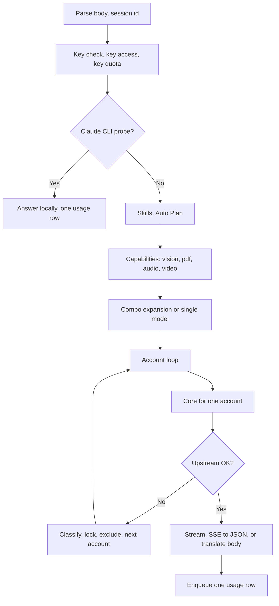

# Design 03 — Request Pipeline (`app/gateway/pipeline/`)

**Status:** partial

Built as a library, reached by `POST /v1/chat/completions`. `app/gateway/pipeline` has no HTTP types.

- `Pipeline.Handle(ctx, Input, Opener) Output` parses the body through the client codec, resolves the model, translates once, walks the provider's accounts, answers and enqueues exactly one usage row on every path.
- An answer is a relayed stream, a forced stream collected into JSON, or a buffered body translated back.
- The controller builds the `Input`, supplies the `Opener` that starts the client's stream and writes an `Output` that is not `Streamed`.
- The stream opens on its first frame, so an upstream that fails before sending anything still gets a plain error and the next account is tried.

The per-request engine. One call walks these stages; each is a package or a function in one.

| Stage | Behavior |
|---|---|
| 1. Parse | Parse the body; strip the `[1m]` marker from `model`; resolve a session identity (design doc 11) |
| 2. Key checks | `requireApiKey`, key access, key quota (design doc 21) |
| 3. Bypass | A request from a Claude CLI user agent that is a warmup, a `count` probe, a title probe, a prefill `{`, or (setting `ccFilterNaming`) a topic-naming probe is answered locally in the client's format with one fixed text. It still ends in one usage row with no tokens and no provider |
| 4. Skills, Auto Plan | May prepend prompts or reroute the model (design doc 11) |
| 5. Capabilities | `translate.DetectNeeds` reads the input kinds the current turn carries (vision, pdf, audio, video) and `Needs.Met` compares them with a model's capability row. Older turns never count. The combo handling is the caller; a single model is not rerouted |
| 6. Combo | Expand a combo (design doc 4), or use the single model |
| 7. Account loop | Select an account, refresh its token if due, run the core, classify a failure, lock, exclude, retry with the next account (design doc 5) |
| 8. Core | See below |
| 9. Usage | Enqueued as one metadata-only row when the stream completes |

**Core for one account:**
1. Detect the source format: endpoint first, then body shape.
2. Choose the target format: a model's declared format, a provider's lossless transport for the source format, or the registry default. Custom OpenAI-compatible nodes map to `openai` or `openai-responses`, Anthropic-compatible nodes to `claude`.
3. Apply the provider thinking override and the upstream model id.
4. Decide streaming: the client's `stream`, unless the provider forces streaming or the model is an image model. `Accept: application/json` (without `text/event-stream`) turns off a stream the format starts by default (Ollama) when the body has no `stream` field; an explicit `stream: true` and a Gemini URL action are never overridden.
5. **Native passthrough** when client and provider speak the same native dialect (Claude Code to Anthropic, Gemini CLI, Antigravity, Codex). The client tool is read from headers only (user agent, `x-app`, `originator`,.) and never trusted for access. A native client keeps its own shape; every Claude-format body still gets the cleanup Anthropic needs.
6. Otherwise strip modalities the model cannot read, prefetch remote images, translate.
7. De-duplicate tools; run token savers, then the skill routers (fail open, with a bypass header for each).
8. `Executor.Execute`. On 401 or 403, refresh credentials (up to three tries), persist them, run once more.
9. Non-OK upstream: parse the error and return it to the account loop. OK: stream it, convert SSE to JSON, or translate a non-stream body. An OK answer whose type is HTML, or is neither a stream nor JSON on a streaming call, is a 502 in the client's shape with the page title; nothing is locked or cleared.

---

## Parity: Client API

| Endpoint | Package | Status |
|---|---|---|
| `POST /v1/chat/completions` | `app/http/controllers` | done |
| `X-Rllm-Cache` header: request `use`/`bypass`, response `hit`/`miss` | `app/gateway/pipeline`, `app/http/controllers` | done |
| `POST /v1/messages` | `app/http/controllers` | done |
| `POST /v1/messages/count_tokens` | `app/http/controllers`, `app/llm/translate` | done |
| `POST /v1/responses`, `/v1/responses/compact` | `app/http/controllers` | done (compact is a plain Responses call for every provider but Codex;: a Codex call goes to the upstream `/compact` path and the JSON answer is forwarded as sent, D120) |
| `POST /v1beta/models/{m}:generateContent`, `:streamGenerateContent` | `app/http/controllers` | done |
| `GET /v1/models`, `/v1/models/info`, `/v1/models/{m}`, `GET /v1beta/models` | `app/http/controllers`, `app/gateway/catalog` | done |
| `POST /v1/api/chat` (Ollama) | `app/http/controllers` | done (NDJSON by default, JSON for `stream:false` or `Accept: application/json`; D136) |
| `POST /v1/embeddings` | `app/gateway/media` | done |
| `POST /v1/images/generations` | `app/gateway/media` | done |
| `POST /v1/audio/speech`, `/transcriptions`, `GET /v1/audio/voices` | `app/gateway/media` | done |
| `POST /v1/videos/*`, `GET /v1/videos/{id}` | `app/gateway/media` | done (a web video answers the completed job and a poll of it is a 404, D317) |
| `POST /v1/search`, `POST /v1/web/fetch` | `app/gateway/media` | done |
| `POST /v1/systemone` | `app/gateway` | deferred (the smart strategy is built, D338; nace and v1m serve this route, design doc 8) |
| URL rewrites (`/codex/*`, `/responses`, `/v1/v1/*`, `/systemone`; ref `next.config.mjs`) | `app/http` | done (pre-guard; non-canonical paths refused) |

---

## Parity: Pipeline Stages

| Stage | Reference | Package | Status |
|---|---|---|---|
| Guard (key, session, loopback) | `dashboardGuard.js`, `sse/services/auth.js` | `app/http`, `app/access/auth` | partial |
| Key access restriction | `sse/services/keyAccess.js` | `app/access` | done (enforced per request; D325 is retired) |
| Session identity | `utils/sessionManager.js` | `app/gateway/conversation` | Built (client-named id by reference priority, else opening assistant text, else per connection, two-hour life; `Bound` keyed hash; the pipeline reads it, once an account is chosen: the Claude user id and session header, and a keyed hash for Codex's `session_id`; continuity store) |
| Bypass (warmup, title) | `utils/bypassHandler.js` | `app/gateway/pipeline` | done |
| Capability detection (current-turn needs: vision, pdf, audio, video) | `services/combo.js` (`detectRequiredCapabilities`) | `app/llm/translate` | done (`DetectNeeds`, `Needs.Met`; the combo order reads them) |
| Capacity adapter (fallback pools per capability) | `services/capacityAdapter.js` | `app/gateway` | todo |
| Model resolution, aliases, nodes, inference | `services/model.js`, `sse/services/model.js` | `app/llm/routing` | done (resolver, snapshot; D80-81; a combo name is answered 404 until) |
| Combos: fallback, round-robin, smart (System One), fusion | `services/combo.js`, `services/systemoneRouter.js` | `app/gateway` | done (D335 to D338; the per-capability pool stays out, D337) |
| Empty-stream failover | `services/emptyFailover.js` | `app/llm/stream` | done |
| Request-scoped 4xx combo advance | `services/combo.js` | `app/gateway` | done |
| Account selection and strategies | `sse/services/auth.js` | `app/gateway/account` | done |
| Error rules and backoff | `config/errorConfig.js`, `services/accountFallback.js` | `app/gateway/account` | done |
| Per-model locks (`modelLock_*`) | `sse/services/auth.js` | `app/gateway/account`, `app/store/repository` | done (write and clear in `app/store/repository`, read by the selector) |
| Token refresh: proactive, reactive, background, dedup | `services/tokenRefresh*`, `sse/services/backgroundTokenRefresh.js` | `app/llm/oauth` | done |
| Format detection, transport, target format | `services/provider.js` | `app/gateway/pipeline` | Built (endpoint decides the client format; a model's `targetFormat`, else the transport format; nodes by type and `apiType`) |
| Native passthrough | `utils/clientDetector.js` | `app/gateway/pipeline` | partial (the stream layer passes through when client and upstream formats are equal, whatever the client tool; client tool detection from headers, from an allow-listed header set (`pipeline.PickHeaders`); a Claude Code client keeps its own shape; Claude normalization in `app/llm/translate`, D142; the Codex and Gemini CLI body shapes) |
| Claude request preparation (`prepareClaudeRequest`) | `translator/formats/claude.js` | `app/llm/translate` | done (D118) |
| Tool-name adaptation | `utils/claudeCloaking.js` | `app/llm/translate`, `app/gateway/pipeline` | done |
| Executor base, retry, URL fallback | `executors/base.js` | `app/llm/executor` | Built; the `baseUrls` fallback (D291) (in-place retry by status, data overrides, 2 s default delay; `baseUrls` fallback never tried: no shipped provider needs it, D102; a 401 or 403 on a login renews its token and retries once, D222 retired) |
| Streaming: SSE parse and emit, usage, timers | `utils/stream.js`, `streamHandler.js` | `app/llm/stream` | done |
| Forced SSE to JSON, non-stream translation | `handlers/chatCore/*` | `app/llm/stream`, `app/gateway/pipeline` | Built (`Collect` for a stream-only provider; a buffered body through the codecs) |
| Usage save, daily aggregate, cost | `src/lib/db/repos/usageRepo.js` | `app/store/analytics`, `app/gateway/pipeline` | done (one row per request on every path with price and error class; the readers and routes serve the dashboard, design doc 16) |
| Response cache (opt-in, per key and global, no streams or tool-call answers) | none in the references | `app/gateway/pipeline`, `app/providers` | done (lookup after resolution and before translation, store in `deliver` after the account accepted; a hit selects no account and its row is `cached` at cost 0; D24, D148) |
| Request details (body dumps) | `src/lib/db/repos/requestDetailsRepo.js` | none | out |
| Live-catalog guards: kiro, codex, cursor, kimchi, qoder (extended) | `handlers/chatCore.js` | `app/gateway/catalog` | done (`app/llm/catalog`) |

---

## Remaining work
**The engine, every chat route, the model catalog and the response cache are built.**

- [x] Parse, resolve, target format, the account loop, the per-account core, the usage row on every path
- [x] Request-scoped 4xx handling, per-format error bodies, HTML upstream error cleanup (a 2xx HTML page or non-stream type on a streaming call is a 502, D149)
- [x] The `POST /v1/chat/completions` route, the controller, the lazy pipeline source in `app/providers`, bypass, image prefetch
- [x] `/v1/messages`, `/v1/messages/count_tokens`, `/v1/responses`, `/v1/responses/compact`, `/v1beta/models/*`, `/v1/api/chat`, the `Accept: application/json` rule, the NDJSON opener
- [x] The model catalog routes
- [x] The response cache
- [x] Key checks and combos
- [x] Token savers (`design doc 10`, step 3.1)
- [x] Skill prompts: the local and catalog routers on the hub request, after the savers (`design doc 11`, step 3.2)
- [ ] Skills and auto plan (`design doc 11`, steps 3.2 to 3.4)
- [x] Capability detection (vision, pdf, audio, video): `translate.DetectNeeds` and `Needs.Met`, current turn only; the combo order reads it
- **Done when:** every endpoint passes golden and end-to-end tests with `-race`; the same prompt through OpenAI, Anthropic, Responses and Gemini yields consistent usage rows.

---

## Divergences

Deliberate differences from the references in this area. Numbers are stable and cited from other docs.

| # | What we do differently | Why it is better |
|---|---|---|
| 49 | Connection aborted | Truncation visible |
| 192 | Short instruction text of our own writing (reference's is the official prompt, which we do not copy) | Backend refuses a request with no instructions |
| 120 | Never written into the body; the upstream `/compact` path is chosen for Codex only, by the route; any other provider gets a plain Responses call. The compaction answer is forwarded to the client as sent | Strict upstreams reject unknown fields |
| 220 | Locks clear only after the answer is accepted: a non-empty body that parsed, or a stream that delivered an event. A page, an empty body or a broken stream clears nothing and locks nothing (reference clears on the status line) | An upstream that returns 200 with junk does not heal an account |
| 221 | A non-stream upstream body has a total time cap (10 minutes); the reference has none | A server that sends headers and then goes quiet cannot hold a request for ever |
| 223 | A bypass reply is a typed response written by the client's own codec, and a prefill `{` matches plain string content too. The reference builds an OpenAI reply by hand and translates it: Claude non-stream came back with empty content and no stop reason, Claude streams ended with `[DONE]`, OpenAI streams carried a stray `data: null`, and a missing `stream` meant a stream | The reply is well formed in every client format and a missing `stream` is false (D191) |

---

## Findings

One row per lesson; the decision is what the code does because of it.

| Finding | Decision |
|---|---|
| The stores open in a runner after every provider registered, so the route table cannot hold a finished pipeline. | `PipelineSource.Get` builds it on the first request and retries after a failure. |
| A warmup naming a combo or a model with no account still needs an answer, and only OpenAI and Claude bodies carry a CLI probe. | The bypass runs before model resolution and never calls upstream. |
| The framework logs a malformed body through a package variable a test never sets, and the first bad-JSON test crashed the driver. | `tests.NewRoute` sets it. |
| A hit must not pay for an image fetch or a body translation. | The cache lookup sits between resolution and translation, keyed on the client's own bytes. |
| `ChatController.Serve` reads the path only to pick the writer (`NewNDJSON` for Ollama, `NewSSE` otherwise). | One controller serves five formats; the fuzz target found `..0`, which the segment check now refuses. |

