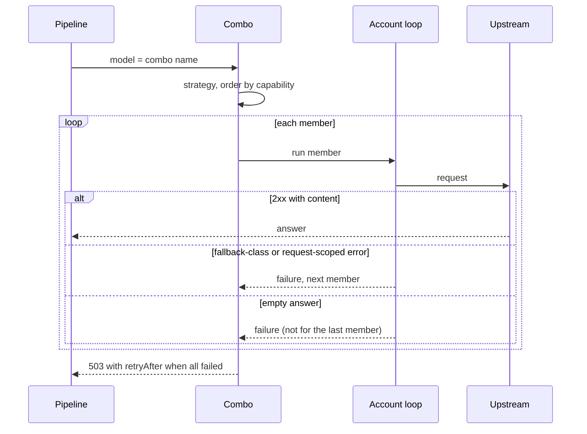

# Design 04 — Model Resolution & Combos (`app/llm/routing/`)

**Status:** partial

Built: `app/llm/routing` (the resolver, the 5 s snapshot and the suffix grammar below) and `app/gateway/combo` (policy, order, rotation, sticky choice), called by `app/gateway/pipeline`. Built: the connection, node and override routes in the Parity table below. `app/gateway` also holds the pipeline, the catalog, the conversation store, prefetch and account selection; the capacity adapter and the combo management routes are planned.

### Resolution (`Resolver.Resolve`, built)

The input is at most 256 bytes with no control characters (`ErrTooLong`, `ErrBadInput`); an empty result is `ErrEmpty`. Two suffixes are removed first and reported on the `Target` (`ContextMarker`, `Thinking`), never left in the model name, so `claude-opus-5[1m](high)` and `claude-opus-5(high)[1m]` reach the same place:
- A trailing `[1m]` context marker (any case, stacked ones too).
- A trailing thinking suffix `name(value)`. Values: `none` or `off`, `auto`, a level (`minimal`, `low`, `medium`, `high`, `xhigh`, `max`, `ultra`) or a token budget up to 1,000,000. An unknown value is dropped without an override.

Then:

| Rule |
|---|
| Split at the first slash (the rest is the model, so `openrouter/anthropic/claude-x` works). The prefix is a provider id, alias or extra alias from the registry (`cc` is `claude`, `cx` is `codex`), or a local name (`el`, `jina`, `jina-ai`, `polly`, `aws-polly`, `xmtp`, `xiaomi-tokenplan`) |
| Only a prefix that is **not** one of those is matched against user provider nodes, by exact prefix, trying node types `openai-compatible`, `anthropic-compatible`, `custom-embedding`. A node with an empty prefix matches nothing. The node id becomes the provider. A built-in name cannot be taken over by a node, and a built-in prefix never reads the node list. An unknown prefix passes on as the provider id |
| Combo name (a combo name with a slash is never reached), then user alias (`kv` scope `modelAliases`, value `"provider/model"` or `{"provider","model"}`; the result is **not** looked up as an alias again, so aliases cannot chain or loop; any other shape is ignored), then the built-in alias `grok-build` to `gcli/grok-build`, then prefix inference |
| Inference | On the lower-cased name, first match wins: `codex-auto-review`, `gpt-5.x`, `gpt-6-`, `gpt-daybreak-`, `gpt-reserve...` is codex; `claude-` anthropic; `us\|eu\|ap\|global` + `anthropic\|meta\|amazon\|mistral\|xai` bedrock; `gemini-` gemini; `gpt-`, `o1`, `o3`, `o4` openai; `deepseek-` openrouter; anything else openai |
| A name that resolves to `anthropic` with no active `anthropic` connection, when a `claude` connection is active, is served by `claude`: the reference sends a bare `claude-*` id there rather than failing with no credentials. An explicit `provider/model` prefix is never rewritten |
| The resolver does not decide access. `routing.NewAllow` checks the resolved target afterwards, in the pipeline before the response cache and in the catalog for the listing |

Stored data comes through a `Snapshot` that reads aliases, nodes and combo names at most once every 5 s each (`Invalidate` drops them at once). A failed read is an error, never a guess, and is not cached. A node whose data is not JSON, or whose prefix is not a string, has an empty prefix.

### Combos

A combo has a name and an ordered list of `provider/model` strings or other combo names. The strategy comes from `settings.comboStrategies[name].fallbackStrategy`, then `settings.comboStrategy`, then `fallback`.

| Strategy | Behavior |
|---|---|
| `fallback` | Try members in order |
| `round-robin` | Rotate the start member, with a sticky count (`comboStickyRoundRobinLimit`) |
| `smart` | A router model picks the member; session-sticky; confidence threshold; policy in `smartPolicy` |
| `fusion` | Ask a panel in parallel with tools stripped, wait for a quorum, then a judge model combines the answers |

**Built.** `Resolver.Expand` flattens a combo into `routing.Member` values (`app/llm/routing/combo.go`). `combo.Read` and `combo.Order` apply the strategy (`app/gateway/combo`), and `call.comboRun` walks the members (`app/gateway/pipeline/combo.go`).

- `comboStickyRoundRobinLimit` below one counts as one; the rotation happens before the first attempt and advances whatever the outcome.
- A smart choice is remembered per combo and session for 2 h, at most 5,000 entries, and survives a router failure. `sessionSticky:false` or `smartPolicy:"per-turn"` asks again every turn; a confidence below the threshold keeps the declared order.
- The fusion panel is `min(max(2, minPanel), n)`, gives stragglers 8 s and the panel 90 s. A single answer is re-run with the client's own request instead of sent to the judge.

- Members are reordered so capable models come first when the request needs vision, pdf, audio or video, in three tiers: members meeting every need, members meeting the hard needs, then the rest. The declared order holds inside a tier, and the order a strategy produces is the order the loop tries. The **capacity adapter** pool is not built: a request never gains a model the operator did not name in the combo (`D337`).
- A member may name another combo. `Expand` follows it in place with a visited set and a depth limit of 3, so a cycle is `ErrComboCycle` and a deeper chain `ErrComboDepth`, both a 400 before any account is tried (`D336`). A member that does not resolve is skipped; a combo with nothing reachable is `ErrComboEmpty`, also a 400.
- A request-scoped 4xx also moves to the next member, but never locks an account. A 502, 503 or 504 with a cooldown of at most 5 s is waited out; a longer one ends the search with that answer.
- An empty answer (zero content, or an SSE stream that opened and produced nothing) counts as a failure for every member but the last, where it is returned as it stands. A stream that opened to the client is never retried.
- When every member fails: the first request-scoped answer verbatim, else the last failure, with `retryAfter` when one gave it. A member that found no account is not an answer, so the search continues.
- One usage row per client request (`D335`): `comboName` names the combo, and the row's provider, model, connection and attempt belong to the member that answered.
- `fusion` runs the panel with tools stripped, non-streaming, a quorum of two, 8 s for stragglers and 90 s overall, then sends the answers to the judge. A `smart` choice sticks to the session.
- A member whose provider's breaker is open goes last, after the strategy and the capability order, for `fallback`, `round-robin` and `smart`; nothing is dropped, and `fusion` is not reordered (`design doc 12`, divergence 7).
- The smart router and the fusion judge are ordinary pipeline requests on their own names, so each writes its own usage row and none of their spend is added to the client's row (`D338`).

---

## Parity: Provider, Model and Combo Routes

| Endpoint | Package | Status |
|---|---|---|
| `/api/providers` (list, create), `/api/providers/{id}` (get, update, delete) | `app/http/controllers` | done |
| `/api/providers/{id}/overrides` | `app/http/controllers` | done (; D147; `builtinHeaders` empty until) |
| `GET /v1/models`, `/v1/models/info`, `/v1/models/{id}`, `GET /v1beta/models` | `app/gateway/catalog`, `app/http/controllers` | done (`/v1/models` also carries `thinking_levels` for a reasoning model) |
| `GET /api/tags` (Ollama's model list) | `app/gateway/catalog`, `app/http/controllers` | done (the caller's own catalog, so a restricted key sees its allow list) |
| `/api/providers/{id}/test`, `/api/providers/validate` | `app/http/controllers` | partial (API-key, node and registry probes built; an OAuth account of a provider with a login is checked without a call to the provider (renew when due, then look for a held token); AWS, cookie, special probes and pasted tokens answer "test not supported yet" (D95-99, D215)) |
| `/api/providers/{id}/models` | `app/http/controllers` | partial (nodes: the node's own `/models`; registry: embedded list plus `customModels`, minus `disabledModels`, no request; both Built; live catalog per OAuth provider) |
| `/api/provider-nodes` (list, create), `/{id}` (update, delete) | `app/http/controllers` | done |
| `/api/provider-nodes/validate` | `app/http/controllers` | done |
| `/api/providers/client` (usage list, filters, totals) | `app/http/controllers` | todo (quota fetchers) |
| `/api/providers/test-batch`, `/api/providers/{id}/test-models`, `/api/models/test` | `app/http/controllers`, `app/gateway/probe` | done (llm models only) |
| `/api/providers/suggested-models`, `/api/providers/kilo/free-models` | `app/http/controllers` | todo (fixed URL list, guarded client) |
| `/api/models/*` (alias, custom, disabled, availability) | `app/http/controllers` | done (D352, D353, D357); `PUT /api/models` is a scope cut (D359); catalog-sync waits for 2.6e |
| `/api/combos/*` (+ presets) | `app/http/controllers` | done (D356, D358) |
| `/api/pricing` | `app/http/controllers` | done (D354, D355) |
| `/api/translator/*` | `app/http/controllers` | partial (the console log read, clear and stream routes; the playground is planned) |
| `/api/media-providers/tts/*/voices` | `app/http/controllers`, `app/gateway` | done |
| Media model resolution (bare id, slash id, `provider/model`, per-kind) | `app/llm/upstream` media index | done |
| A search or fetch provider named in the body (`provider`, else `model`), and a connection borrowed from another provider (`credentialFallback`) | `app/gateway/media`, the provider's media block | done |
| `/api/oauth/{provider}/authorize`, `exchange`, `callback`, `status`, `device-code`, `poll` and `/callback` | `app/llm/oauth`, `app/http/controllers`, `web` | partial (authorize, exchange, callback, status and `/callback` for claude and codex, D150-153; `device-code` and `poll` are); replaces `[provider]/[action]` |
| `/api/oauth/*` importers (codex, grok-cli, cursor, kiro, zed, xiaomi-mimo, gitlab pat) plus Windsurf, Zed, Trae, Mimo callback shapes | `app/llm/oauth` | todo |

---

## Remaining work
**Routing, the combos and their management routes are built; the capacity adapter and the capability overlay are planned.**

- [x] `app/llm/routing`: model string to combo, alias, node or provider; `Resolver`, `Snapshot`, `Reserved` for node prefixes
- [x] Registry loader and seed data for nine providers; the other ids arrive with their executor (`design doc 8`)
- [x] Capability rows (`design doc 7`; the catalog overlay waits for step 2.6e)
- [x] `passthroughModels` on the 23 providers the reference marks (CommandCode, the opencode family, kimchi, bedrock, zed, openrouter and the rest): the flag raises a provider's model listing; an id its list does not name already reached the executor, so chat behaviour is unchanged
- [x] Combo expansion, sticky round-robin, per-combo strategies
- [x] Empty-stream failover and the request-scoped 4xx combo advance
- [ ] Capacity adapter pool
- [x] Provider-connection, provider-node and override routes
- [x] The `Checker` and its four routes (`/test`, `/validate`, node `/validate`, `/models`)
- [x] `/api/combos*` — CRUD, presets and the suggestion routes (`design doc 4`, D356, D358)
- [x] `/api/models/*` — list, alias, custom, disabled and availability (`design doc 4`, D352, D353, D357)

---

## Divergences

Deliberate differences from the references in this area. Numbers are stable and cited from other docs.

| # | What we do differently | Why it is better |
|---|---|---|
| 86, 87, 88, 90 | Allow-list views (new fields hidden); key-like names masked; updates from fixed field list, tokens and locks refused, `providerSpecificData` merged in one transaction; node fields on a connection never change by update | Later field hidden by default; client cannot unlock or poison an account |
| 106, 125, 127 | 400 for repeated keys, `__all`, empty models; limit text rules only for 401, 402, 403, 429, non-4xx | One body, one reading; one request cannot lock a whole provider; prompt quoting "rate limit" cannot lock healthy account |
| 147 | Provider data, overrides share one name rule (letters, digits, dashes, not reserved); refuse every control character, C1 included | One definition of allowed header |
| 79 | One row, case-insensitive | One rule |
| 81 | 5 s snapshot with `Invalidate`; failed read fails the request | No wrong routing on storage fault; second instance may lag 5 s (trade-off) |
| 91 | Strict pattern, not a built-in, unique, base URL checks, on write only | Shadowing prefix would hide a built-in; existing rows still read (trade-off) |
| 225 | `GET /v1/models` lists only models a caller can call: a registry provider with at least one active, readable connection, and a node with one; every such connection counts and a model is listed if any accepts it. The reference lists the whole static catalog when no connection exists and counts only the first connection of a provider. Entries carry `created`; a read route changes no row (the reference refreshes credentials during a GET). Custom-model rows are matched by provider id, alias and node prefix, type `llm` only. Combos are not listed until | An empty gateway advertises nothing, a second account's models show, and an alias-keyed row from a real 9router database appears |
| 226 | `/v1/models/info`, `/v1/models/{id}` and `/v1beta/models` are built from the same filtered list as `/v1/models`; the Gemini list has real token limits and `models/<id>` names. The reference answers `info` and `/v1beta/models` from the static catalog with no key filter, and invents 128000/8192 | A restricted key cannot learn a model it may not call; limits are the capability row's |
| 213 | An update takes a fixed field list only: a client cannot set `testStatus`, `lastError*`, `errorCode`, `backoffLevel`, a lock, a token or a node connection's copied fields. Only the server writes health, and the `Checker` records test outcomes. Toggling `isActive` does not clear a cooldown | A dashboard form cannot hide a real cooldown or poison an account (improvement) |
| 335 | A combo request writes **one** usage row, naming the combo in `comboName` and the member that answered in `provider`/`model`/`connectionId`; the reference writes a row per member tried. **Built** | This router's analytics, quota and D306 all assume one row per request; a member's spend is visible through the row that answered |
| 336 | A combo member may name another combo, expanded with a visited set and a depth limit of 3; the reference nests with no guard. **Built** | A cycle is a 400 at the combo, never a stack overflow |
| 337 | The capacity adapter's per-capability pool is not built; ordering only reorders the members the operator named. **Built** | A request never gains a model the combo did not name |
| 350 | `/api/tags` is Ollama's list shape over the caller's real catalog, on the client class with an API key; a digest is the SHA-256 of the id and the family is the provider **(built)** | The reference answers a fixed fake list behind the dashboard, where no Ollama client can reach it |
| 352 | The alias map is written in one direction, alias to target, and an alias another model holds is a 409. Both routes that write it share one rule **(built)** | The reference's `/api/models` PUT stores model to alias while `/api/models/alias` stores alias to model, so its two routes disagree; it also lets a second model take an alias silently |
| 353 | `GET /api/models` lists the registry with custom models in and disabled out, and answers the alias that points at each model. Node models stay on `/api/providers/{id}/models` **(built)** | The reference reads its alias map backwards, so the `alias` field is nearly always the bare id, and a list route there mixes in rows the catalog does not resolve |
| 356 | Combo create and update validate the kind, allow an empty member list, answer the stored combo, and a duplicate name is a 409. A rename carries `settings.comboStrategies[name]` to the new name and a delete drops it **(built)** | The reference returns the request body echoed, leaves the strategy under the old name, and lets a rename race the unique index into a 500 |
| 357 | `clearCooldown` drops the named lock and the account lock, leaves every other model's lock alone, and `__all` names `modelLock___all` **(built)** | The reference's `__all` maps to a key that never exists, so the account lock cannot be cleared from that page, while its activation side effect wipes every lock on the connection |
| 358 | Presets enumerate the embedded provider list for both sources; the Claude list also includes the stored aliases that point at it **(trade-off)** | The reference reads the first Cursor account's live catalog from a presets preview; here the live list stays behind the model guard and the preview spends nothing |
| 359 | `PUT /api/models` is not built **(scope cut)** | The reference's model-to-alias write is the mirror of a map it does not own, and no dashboard page calls it |
| 338 | The smart router and the fusion judge run through the ordinary pipeline on their own model names, so each writes its own usage row; none of their spend is added to the client's row. **Built** | Router and judge cost is visible without inflating the client's usage |

---

## Findings

One row per lesson; the decision is what the code does because of it.

| Finding | Decision |
|---|---|
| A model must be listed exactly when some connection would accept it. | `account.ModelEnabled` is called by both the selector and the catalog. |
| A model must never be shown under a spelling the pipeline would route elsewhere. | Each `Allow` entry is resolved and compared with the listed `provider/model` exactly, case included. |
| A dead node must not be asked again on every request. | A failed or empty fetch is cached as an empty list for 30 s, keyed by node id and base URL, never the credential. |
| `claude-opus-5[1m](high)` and `claude-opus-5(high)[1m]` must reach the same target. | The resolver strips a trailing marker and a trailing thinking suffix in a loop before anything else. |
| A node must not shadow a built-in name whatever the stored row says. | `Registry.Reserved` decides: an id, an alias, an extra alias or a local name. |

