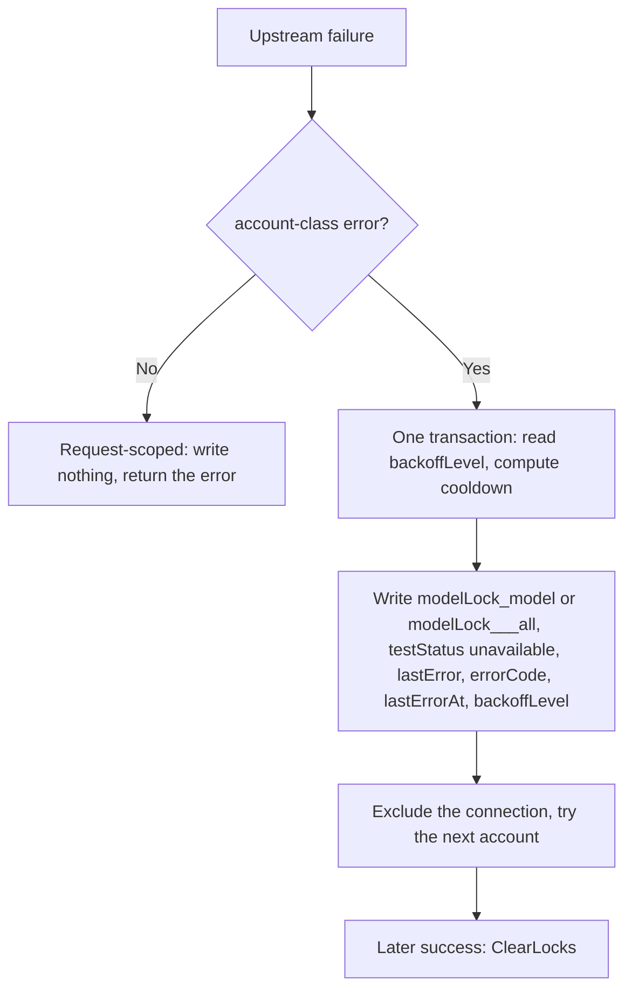

# Design 05 — Account Selection, Error Rules & Backoff (`app/gateway/account/`)

**Status:** done

Built: `app/gateway/account` (the selector, the error rules, the backoff arithmetic and the reporter) over the `modelLock_*` fields `app/store/repository` writes and clears. Called by the account loop in `app/gateway/pipeline`. The selector, rules and reporter below describe what is built.

### Selection (`Selector.Select`)

Serialized per provider by a mutex, so the usage counters it writes cannot race inside one process (two processes on one database are unsupported). It returns one connection or an error.

**Candidates:** the provider's **active** connections in priority order (unset priority sorts last), minus:
- rows whose stored data is not valid JSON (skipped, counted in `Selection.Skipped`, never written);
- connections already tried in this request (`Request.Exclude`);
- connections whose `testStatus` is `expired`, a refresh token refused for good (divergence 212);
- for Codex, connections whose own `providerSpecificData.enabledModels` is non-empty and lacks the requested model;
- connections **locked** for the model: `modelLock_<model>` or `modelLock___all` is a time in the future (an unreadable or null lock is no lock; a lock ending exactly now has ended).

**Strategy:** `providerStrategies[provider].fallbackStrategy`, then `settings.fallbackStrategy`, then `fill-first`; an unknown name is `fill-first`. Settings are read through a 5 s snapshot. The settings write accepts that object shape, or the bare strategy word the selector reads the same way, and keeps any other key inside a provider's entry. Only `fill-first` and `round-robin` are accepted (`account.KnownStrategy`); the combo words are not provider strategies.

| Strategy | Behavior |
|---|---|
| `fill-first` | First available connection; writes nothing |
| `round-robin` | Takes the most recently used connection while its stored `consecutiveUseCount` is below the limit (`providerStrategies[provider].stickyRoundRobinLimit`, then `settings.stickyRoundRobinLimit`, then 3; zero, negative or unparsable values fall through), writing `lastUsedAt` and the count plus one. Otherwise the least recently used (never-used first, by priority), writing count 1. Both are persisted, so rotation survives a restart. The written time is never at or before the stored one, so two uses in one millisecond still order |

**Pinning.** `Request.Prefer` names one connection (the reference reads it from the `x-connection-id` header on image and video calls, so the header is read). While it is among the candidates it wins before any strategy and writes nothing; a locked, excluded or expired one falls back to the strategy.

**No candidate left:** if every candidate is locked, the error is `*AllLockedError` with the earliest lock end that applies to the model, "reset after 2m 30s" text, and the first such connection's last error and code. It becomes a 503 with `retryAfter`. No candidates, or locks without a future end, is `ErrNoConnections`.

**Not in the selector:** the Freebuff model-assignment hook. A provider whose data says `noAuth` (today only `opencode`) is served through a virtual `noauth` account that is never stored, selected, counted, locked or reported, so its requests reach the executor with nothing connected; any other provider with no stored connection still answers "No active credentials" (`design doc 8`).

The circuit breaker is not here either, and never can be: it is per provider while `Select` serves one provider, so there is no second candidate to skip to. Combo ordering moves an open provider's members last instead (`design doc 12`).

**The Antigravity quota gate is built.** A request carries `Request.Hold`, which names a connection spent for a model and the moment it frees. Such a connection counts as locked until then, and `AllLockedError` reports the earliest lock or hold. The selector reads memory only; `app/gateway/account` does not import `app/llm/quota`.

### Error Classification (`account.Classify`)

`DefaultRules` is a data table, checked top to bottom, text rules before status rules. Text is lower-cased, matched as a substring, and only its first 4096 bytes are scanned.

| Match | Result |
|---|---|
| Codex: `model is not supported when using codex with a chatgpt account` | 30 min |
| `codebuddy-intl`: `request illegal`, `conversation id missing` | exponential backoff |
| `nvidia`: `degraded` on a 400, the model cluster's own refusal | 15 min, the model only: the connection keeps its other models |
| `no credentials`, `improperly formed request` | 2 min |
| `request not allowed` | 5 s |
| `insufficient credit`, `credit balance is too low` | exponential backoff |
| `rate limit`, `too many requests`, `quota exceeded`, `capacity`, `overloaded`, only for status 401, 402, 403, 429 and non-4xx | exponential backoff (on any other 4xx the text may echo the request, so it stays request-scoped) |
| status 401, 402, 403, 404 | 2 min |
| status 429 | exponential backoff |
| other 4xx (400, 406, 408, 413,.) | request-scoped: no lock, error returned (a combo moves to the next member) |
| anything else (5xx, network, status 0) | transient, 30 s |

### Backoff

- Cooldown is `2 s x 2^(level-1)` for the **new** level, capped at 5 minutes. The new level is the stored one plus one, capped at 15, kept in `backoffLevel`.
- The stored level is read inside the same database transaction that writes the lock (`ConnectionsRepo.LockFromLevel`), so concurrent failures all count.
- A provider-reported reset time replaces the cooldown (level back to 0), capped at 30 minutes except for Antigravity. One in the past is ignored and does not turn a request-scoped error into a lock.
- GitHub's `you've reached your additional usage limit for your plan` on a 402 locks the whole account until the first instant of the next UTC month.

### Locking (`Reporter`)

- Lock values are ISO-8601 UTC strings with milliseconds in the connection's JSON `data`. `lastError` is cut to 200 characters. The error text is stored for the dashboard and logged at WARN for the operator — shortened, scrubbed by the redacting channel, with provider, model, connection, status and, when a lock is written, the cooldown. A refusal of the request itself gets its own line and writes no lock.
- A success (`Succeed`, `ConnectionsRepo.ClearLocks`) removes that model's lock, the account-level lock and every lock that has ended. `testStatus` returns to `active` and the error fields and `backoffLevel` reset only when no lock in the future remains.

---

## Remaining work
**The selector is built and the pipeline calls it.**

- [x] `app/gateway/account` `Selector`: per-provider mutex, persisted counters, `Exclude`, `Prefer`
- [x] Error rules as data, then backoff and lock arithmetic on top of the existing `modelLock_*` fields
- [x] `Reporter`: `Fail` and `Succeed`
- [x] Called from the account loop
- [x] Exclusion hook for Antigravity quota (`Request.Hold`,)
- [x] The circuit breaker is not a selector concern; combo order reads it (`design doc 12`)
- [x] Credential-less providers: `opencode` is chat and needs none, so a request to it is served with a virtual `noauth` account (never stored); media providers with `noAuth` or `authType: none` are served with no connection the same way

---

## Divergences

Deliberate differences from the references in this area. Numbers are stable and cited from other docs.

| # | What we do differently | Why it is better |
|---|---|---|
| 167 | Executor returns it in `Result.ResetAt`; account lock uses it in place of backoff only when in the future, capped 30 minutes, backoff level cleared. Message with no zone read as UTC+8, as reference does | Wrong or distant date cannot lock an account for days |
| 82 | One mutex per provider | No cross-provider queueing |
| 170 | 402/403 whose body names quota or balance: 429 rate-limit error, account cooled down, next tried; other 403s stay auth errors | Empty plan temporary, not a bad key |
| 443 | An Antigravity 429 whose only text is "Resource has been exhausted (e.g. check quota)" with no details is a refused prompt, not a quota: the executor does not retry it in place, sends the request once more with the system text moved into the first user turn, and answers a second refusal as a 400 that says it is not the user's quota. The 400 is request-scoped, so no account is locked and no strike is counted | Google fingerprints `systemInstruction` and refuses the same body the same way every time; the reference's answer is the same, and a lock or three retries only spent the account's pace on a body that cannot pass (improvement) |
| 212 | A connection whose `testStatus` is `expired` is never a candidate, and is not the last resort either | A dead refresh token cannot serve a request, so it neither burns an attempt nor lands a 401 lock that hides the real state; the reconnect in the dashboard clears it |

---

## Findings

One row per lesson; the decision is what the code does because of it.

| Finding | Decision |
|---|---|
| Twelve concurrent 429s must store level 12, not twelve times level 1. | `Reporter.Fail` classifies with the level read inside the lock transaction. |
| A 401 or a 5xx between two 429s must not restart their backoff. | Only a backoff rule raises the level; a provider-reported reset is the one thing that clears it. |
| A slow success must not undo the failure of a faster, later request. | `Succeed` passes when the request began, and a lock written after it is left alone. |
| 4.34: the upstream's own message was stored for the dashboard and kept out of the log, so a 429 left an operator with a status and no reason. | `Reporter.Fail` logs the shortened message at WARN, through the redacting channel, with provider, model, connection and status; a request-scoped refusal gets its own line. |
| 4.41: a failure reported on a context the caller had already given up on wrote no lock — the transaction's first read failed at 0.064 ms — and left two lines in the log, the framework's failing `SELECT` and `recording a failed account failed`. | `serveFail` stops before the report when `ctx.Err() != nil`: a probe, the router's question or the fusion panel that ran out of its own budget locks nothing, because the caller's timeout is not the account's fault and no account is left to try. A timeout the router's own body budget ends, with the caller still waiting, is reported and locks as before. |

