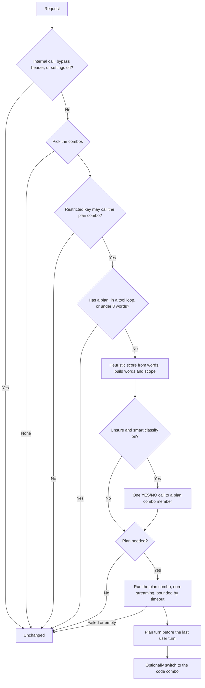

# Design 11 — Skills, Session & Auto Plan (`app/gateway/skill/`, `app/gateway/conversation/`, `app/gateway/plan/`)

**Status:** done

The skills registry, both routers, the catalog sync, the dashboard's read and sync routes, the Studio, rule hooks, config fields, the session cache and Auto Plan are built (steps 3.2, 3.3 and 3.4). Session ids are built.

### Skill Layout

A folder under `DATA_DIR/skills/<id>/`; the six core skills ship embedded in the binary (`app/gateway/skill/builtin/`). An operator folder with the same id replaces the embedded one.

| File | Content |
|---|---|
| `manifest.json` | id, name, description, hook, default enabled, legacy enabled key, routing mode, threshold, triggers, keywords, config schema |
| `prompt.txt` or `prompt.md` | The prompt. `prompt.txt` wins over `prompt.md`. |
| `rules.json` | Optional declarative rules: `{"rules":[...]}`, at most 16 KiB and 20 rules |

Bounds: manifest 32 KiB, prompt 64 KiB, id `^[a-z0-9][a-z0-9_-]{0,63}$`, name 128 bytes, description 4 KiB, 100 triggers or keywords of 128 bytes each, control characters refused. A folder that fails a check is skipped and listed under `problems`; it is never half-loaded.

`install_command`, `update_command`, `uninstall_command` and `hook.js` are read only to be reported as unsupported. Nothing in a skill folder is executed.

The core prompts are the reference's own where it has a skill: caveman, ponytail, watermarks-remover, human-handwritten (our `prose-humanizer`), commit-lint, human-commit and taste-skill. Caveman and ponytail are the Token Saver's own prompts, so they carry no skill of their own (404 retired). Each built-in folder names its source, and an edit tracks it. `code-humanizer` has no reference counterpart and keeps this router's own text.

### Packages

`app/gateway/skill` holds the registry (`manifest.go`, `registry.go`), the scorer (`scorer.go`), the two routers (`local.go`, `ecc.go`), the injector and `Apply` (`skill.go`), the settings projection (`setting.go`), config fields (`config.go`), declarative rules (`rule.go`), the Studio's folder operations (`studio.go`) and the catalog sync (`sync_ecc.go`). `app/git` is the only package that starts a process (`clone.go`), and it downloads a tarball when git is missing (`github.go`).

The scorer is our own copy, not a shared package. `tests/imports_test.go` forbids a sub-package from importing a sibling, and the only shared home would be a parent with one consumer (divergence 400).

### Routers

| Router | Behavior | Bypass header |
|---|---|---|
| Local skill router | A routable skill in `smart` mode is injected when its own TF-IDF score clears its own threshold, at most two per request. An `always` skill is injected on every request. | `x-9router-local-skill-router: off` |
| ECC auto router | Skills with `source: "ecc"` are scored with id x5, name x4, keywords x3, triggers x3 and description x1. Settings: `ecc_auto_skill_routerEnabled`, `...Confidence` (0.35), `...MaxSkills` (1, clamped to 1-5). | `x-9router-skill-router: off` |

Scoring is TF-IDF over lower-cased, stemmed words. A score is `min(1, dot x 1.8 + 0.35 trigger boost)`; a greeting or a bare sum is skipped; the query is cut at 4 KiB and 400 tokens.

The enabled switch is `<id>Enabled`, then the manifest's `legacy_enabled_key`, then `default_enabled`. The mode is `<id>RoutingMode`, then the manifest's `routing_mode`, then `smart`. Both live in the settings row, so a toggle never rewrites an imported file (divergence 401).

The matched skills are stored on the usage row as ids only (`skills`), never their prompt text, so a served request says which skills were active (design doc 16).

### Catalog Sync (`skills:sync`, `/api/skills/sync`)

Two entry points, both admin actions: `rllmx artisan skills:sync --source <folder|https-url> [--tag main] [--force]` and `POST /api/skills/sync`. A body that names no source takes the official catalog (`skill.ECCSource`, branch `skill.ECCBranch`), which the route always adds to the git allowlist; a source it does name must be https and on the `skillSources` allowlist. A local folder is the command line's business. Never at start-up, from a client request or from a skill's content.

A remote source is cloned through `app/git`; when git is missing or refuses, the GitHub tarball is fetched over the guarded client. The clone is bounded at 60 s and 64 MiB, checked while it runs (divergence 403), is made beside the skills folder, and follows no redirect.

A skill folder is read through a root, so a link out of it is refused (divergence 420), and a catalog skill never replaces another of the same id (divergence 423). One sync runs at a time; the route answers 503 when one is in flight.

The sync reads only `SKILL.md` text: YAML frontmatter with `name` and `description`, then the body. It writes our own `manifest.json`, `prompt.md` and `_index.json` into `DATA_DIR/skills/ecc-imported/<id>/`. A destination whose manifest no longer says `source: ecc` belongs to the operator and is skipped unless `--force`. The CLI names its own source; the dashboard's button takes the official catalog, as the reference's does (D402).

`db:import-config --skills-from <folder|https-url>` copies whole skill folders, manifest and prompt, into `DATA_DIR/skills/`. It skips an invalid folder with a warning and reports the ignored files.

### Config Fields

A manifest may declare `config_schema` fields: `key`, `type` (`enum`, `text`, `number`, `slider`, `toggle`), `label`, `default`, `legacy_key`, `min`, `max`, `step` and `options`. The value lives in the settings row under `legacy_key`, else `<id>_<key>`. A slider's `step` is bounded by its range and the dashboard shows the value and both ends.

The default key carries the id, so two skills naming a field `level` do not share a value. `PATCH /api/settings` validates each value against its field: an enum option, a number within its range, a switch, or up to 256 printable bytes of text.

`{key}` in the prompt takes the stored value, else the field's default; a token with neither stays literal. A field with no placeholder is appended as an `Active Configuration:` list, with a slider's scale. `routing_mode` is never listed. The response-cache key carries every stored value, so a changed level never serves an older answer.

### Rules

A skill whose hook is `pre-route` or `pre-request` carries `rules.json`; every rule's stage must equal the hook. Each rule has a `when` and a `then`:

```json
{
  "rules": [{
    "stage": "pre-request",
    "when": { "modelRegex": "^claude-", "messageRegex": "(?i)refactor", "header": { "name": "x-client", "regex": "^cli$" } },
    "then": { "injectPrompt": "Prefer small, reviewable diffs.", "setHeader": { "name": "x-team", "value": "platform" } }
  }]
}
```

| Rule | Detail |
|---|---|
| Match | Every `when` field present must match. RE2, patterns at most 512 bytes, the last user message cut at 64 KiB |
| Header match | Only a header the pipeline already copies into a request, so a rule cannot read what the pipeline dropped |
| Bypass | `x-9router-local-skill-router: off` together with `x-9router-skill-router: off` leaves the rules off as well |
| `rerouteModel` | `pre-route` only, at most 256 bytes. A restricted key must first be allowed the name it asked for, then the rerouted target, so a rule never widens access |
| `injectPrompt` | `pre-request` only, at most 4 KiB, injected once per request and once per combo member |
| `setHeader` | `pre-request` only. `authorization`, `proxy-authorization`, `host`, `cookie` and `content-length` are refused, as is the provider's own auth header. One value per name, at most eight |

Headers are merged over the operator's overrides at send time and filtered again there, because an executor may apply an override without the shared guard. Deepseek ignores overrides, so a rule's header does not reach it. A rules file that fails a check fails the whole folder.

### Skills Studio

`GET /api/skills/{id}`, `POST /api/skills`, `PUT` and `DELETE /api/skills/{id}` create, read, edit and remove a custom skill. Writes are serialised. Only a folder whose manifest says `source: custom` may be rewritten or deleted; the embedded core set and the catalog's imports are read-only. A generated body that names `hook_script`, an install command or `source` is refused with 400.

The id is derived from the name: lower case, letters and digits kept, a space or a dash between words, every other symbol dropped, and a numeric suffix when the result is taken by the embedded set, the catalog folder or a folder already there. The dashboard's form asks for the name alone. An explicit id from another client is still checked: it must match the manifest's alphabet, must not be the catalog folder or an embedded id, and the target must be a real directory, never a symlink. An update removes a `prompt.txt` or `rules.json` the new body drops, so no stale file keeps running (divergence 411).

### Dashboard

`GET /api/skills` lists every installed skill with its effective switch, mode and unsupported files, plus the folders that were skipped. It never returns prompt text.

`/dashboard/skills` groups the installed skills (prompt skills, hook rules, imported catalog, the operator's own), each with its switch, the routing mode and one control per `config_schema` field, and marks a folder this build cannot rewrite. A switch in the list header turns every skill off at once (D433): it stops the local and catalog routers and the rule hooks, and the response-cache key is empty while it is off. The Studio dialog loads `GET /api/skills/{id}`, writes a prompt for a `system-prompt` skill or rule rows for the two request hooks, and never sends a script or an install command. The catalog sync card is one button plus the replace switch, and says how many skills it counted. The auto-plan card keeps its switch in the header and writes the eight `autoPlan*` keys with the plan reader's own bounds.

### Session Id (`app/gateway/conversation/`, built)

`Store.Resolve` returns the id a request belongs to. First match wins; every candidate is trimmed and dropped above 256 characters.

| Order | Source | Returned as |
|---|---|---|
| 1 | Claude Code: `metadata.user_id` as `..._session_<id>` or JSON `session_id`, then `X-Claude-Code-Session-Id` | `claude:<id>` |
| 2 | Antigravity: `request.sessionId`, or the conversation uuid in `requestId` | `antigravity:<id>` |
| 3 | Headers `X-Session-Id`, `Session-Id`, `Session_id`, `X-Amp-Thread-Id`, `X-Client-Request-Id` | as sent |
| 4 | Body fields `prompt_cache_key`, `session_id`, `conversation_id`, plain `metadata.user_id` | as sent |
| 5 | Hash of the first 50 characters of the assistant text (at least 50 needed; 5000 entries) | derived |
| 6 | One id per connection (1000 entries) | made up |

A made-up id is a random UUID plus the time in milliseconds, and it expires after two hours.

- The pipeline holds one store (`Deps.Sessions`, made when none is given) and resolves the id once an account is chosen, because the last fallback is one id per account.
- The Claude user id and `x-claude-code-session-id` carry the id without its `claude:` prefix.
- Codex's `session_id` carries `Bound`, the keyed hash, never the client's value.
- `translate.SessionOf` reads the session out of a user id.

**Session cache** (`app/gateway/conversation/skills.go`, built). An in-memory LRU of 2000 conversations lasting four hours, keyed by the caller's API key and the `X-Session-Id` or `Session-Id` header. It holds the router-prefixed skill ids already injected and a failover count, never prompt or message text.

On a repeat turn a matched skill becomes the reference's one-line reminder instead of its full prompt. "Always" skills are never reminded. After a turn moves to another account, later turns of that conversation carry the failover notice. A request with no session header keeps no state. Session state is not part of the response-cache key (divergence 410).

### Auto Plan-Then-Code (`app/gateway/plan/`, built)

Settings, all in the settings row: `autoPlanEnabled`, `autoPlanMode` (`auto` or `manual`), `autoPlanComboId`, `autoCodeComboId` (an id or a name), `autoPlanComplexityThreshold` (1-10, default 6), `autoPlanSmartClassify`, `autoPlanMaxTokens` (200-4000, default 800), `autoPlanTimeoutMs` (1000-60000, default 15000) and `autoPlanShowInResponse`. The last one is stored and answered but changes nothing: the plan never travels in the answer, as in the reference.

The package is `app/gateway/plan`, not `app/plan`: `gateway/pipeline` must import it, and imports run down the domains only.



**Classifier.** The heuristic scans the last user turn, cut at 16 KiB. A turn already carrying a `<PLAN>` marker, any tool turn or tool call, and a turn under eight words are skipped by name. A question or typo wording is skipped unless the turn also builds something and runs 25 words.

The score adds `0.15` at 12, 25 and 50 words each, `0.2` per build word capped at `0.4`, `0.2` per scope phrase capped at `0.4`, and `0.2` when both are present, clamped to 0..1. The plan is needed at `score >= threshold/10`.

A verdict within 0.25 of the threshold, with smart classify on, asks one member of the planning combo one YES/NO question; a failed call keeps the heuristic.

**The plan call** is a pipeline call of the router's own: an OpenAI-format body whatever the client speaks. It carries the client's turns with the architect instruction in front, and no tools, rules, skills or second plan. Its context is bounded by `autoPlanTimeoutMs`, and it leaves its own usage row.

The answer is cut at 32 KiB and inserted as one system turn before the last user turn; the same plan is never inserted twice. A combo member re-reads the client body, so the plan is put back into every member.

**The code switch** names the configured combo. A restricted key must be allowed both the planning combo and the code combo; a key that is not allowed either is not planned for, and its request runs as it named it, rather than paying for a plan and being refused a model it never named.

A request whose plan was injected is not read from or stored in the response cache.

An error at any step fails open. Bypass: `x-9router-auto-plan: off`. The outcome is one DEBUG line naming the verdict, the tokens and the combo, never the text.

---

## Parity: Extended Features

| Feature | Reference (extended) | Package | Status |
|---|---|---|---|
| Freebuff provider and OAuth device login | `executors/freebuff.js`, `src/lib/oauth/providers/freebuff.js` | `app/llm/executor/freebuff.go`, `app/llm/oauth` | todo |
| Freebuff strict model assignment | `src/sse/services/auth.js` | `app/gateway/account` | todo |
| Health EMA, circuit breaker | `src/lib/routing/health.js` | `app/health` | diverged (breaker used in routing) |
| Model probe | `src/lib/routing/modelProbe.js` | `app/probe` | todo |
| Model ranking, combo suggestion | `src/lib/routing/modelRanking.js`, `/api/combos/suggest` | `app/gateway` | todo |
| Latency SSE | `/api/health/latency-stream` | `app/health` | todo |
| OpenRouter live model sync | `src/app/api/v1/models/route.js` | `app/gateway/catalog` | todo |
| Skills registry (system-prompt hooks) | `src/lib/skillsRegistry.js` | `app/gateway/skill` | done (3.2) |
| ECC auto skill router | `src/skills/autoRouter.js` | `app/gateway/skill` | done (3.2) |
| Local skill router | `src/skills/localSkillRouter.js` | `app/gateway/skill` | done (3.2) |
| Session LRU and continuity notice | `src/lib/session/cache.js` | `app/gateway/conversation` | done (3.3) |
| Skills Studio | `src/app/api/skills`, dashboard skills page | `app/gateway/skill`, `web` | done (3.3): routes; the dashboard page is not built yet |
| Auto Plan-Then-Code | `src/lib/autoPlanRouter.js` | `app/gateway/plan` | done (3.4) |
| Setup wizard | `src/app/setup/page.js` | `web` | todo |
| Proxy-pool fitness | `open-sse/services/proxyPoolFitness.js`, `proxyPoolFitnessRepo.js` | none | out (no proxies) |
| Hermes Agent memory (MEMORY.md and USER.md injected by the `hermes-toolkit` skill, `HERMES_HOME`, bypass header `x-9router-hermes-memory`) | `src/lib/plugins/hermes/memory.js` | `app/gateway/hermes`, `app/gateway/skill` | done (read and inject; auto-save by LLM extraction is not built) |
| Hermes process manager, installer and Telegram bridge | `src/lib/plugins/hermes/{process,install,telegram}.js` | none | out |
| Native autostart | `src/lib/autostart.js` | none | out |
| Self-updater, update check | `src/lib/updater`, `updateCheck.js` | none | out |
| Headroom auto-setup, watchdog | `src/lib/headroom/*` | none | out |

---

## Remaining work
**Nothing.**

- [x] Rule hooks: RE2 on bounded input; inject, reroute or set a header; deny `authorization`, `host`, `cookie`, `content-length`
- [x] Skills Studio routes: create, edit and delete a custom skill under `DATA_DIR/skills/`
- [x] Session cache: the LRU and the continuity notice
- [x] `app/gateway/plan`, driven by the `autoPlan*` settings
- **Done when:** Auto Plan's settings drive the plan-then-code flow.

---

## Divergences

Deliberate differences from the references in this area. Numbers are stable and cited from other docs.

| # | What we do differently | Why it is better |
|---|---|---|
| 177 | All state per request or in bounded cache keyed by connection and session; compact route sets a flag on request | Reference races: two requests at once can send each other's session id, compact address, turn index |
| 178 | Session value derived from conversation, bound to connection by keyed hash; value client chose never sent | One tenant cannot pick cache key another tenant's conversation uses |
| 179 | Workspace ids, session ids, identity values must match plain token pattern, else left out | Stored value cannot add a header line |
| 180 | Falls back to id derived from provider and connection | Accounts of one router do not look like one machine to the provider |
| 200 | `os/exec` in one package, `git`, running only `git clone --depth 1 --single-branch --no-tags --branch <ref> -- <url> <dir>`; argument array; `https` URL on admin list that passes SSRF guard; minimal environment; timeout; size cap; falls back to GitHub API | Ref or URL injectable into the reference's shell string |
| 3, 11 | No install commands; declarative rules only (3.3) | No code execution; only spawned process is allowlisted `git clone` (scope cut) |
| 400 | The skill scorer is a copy inside `app/gateway/skill`, not a package shared with the token savers | The import rule forbids a sibling import; a shared parent would serve one consumer and would couple two packages that change separately (trade-off) |
| 401 | A skill's switch and mode live in the settings row (`<id>Enabled`, `<id>RoutingMode`); the manifest only supplies the default | A dashboard toggle never rewrites an imported folder, so `skills:sync` keeps a clean diff and `--force` stays meaningful |
| 402 | The catalog sync takes an operator-named, allowlisted source; nothing is bundled or hardcoded | The reference pins an outside repository in a script; ours cannot fetch a catalog the operator did not name |
| 403 | The clone and the tarball are bounded at 64 MiB, checked while the clone runs and cut off | A repository cannot fill the data directory before an admin notices |
| 404 | **Retired.** The duplicate `caveman-style` and `ponytail-style` skills are gone: the Token Saver owns both prompts, so a skill of the same text would only give a second switch for one behavior | The saver's own switch is the only one an operator has to think about |
| 405 | The Studio writes only a folder whose manifest says `source: custom`; the id is checked server-side and a symlink is refused | The reference passes an unvalidated id into `path.join` and `fs.rm -r`, so `../..` deletes and writes outside the skills folder |
| 406 | A config value's default settings key is `<id>_<key>`, with `legacy_key` honored | The reference stores a bare `key`, so two skills declaring `level` read and write one value |
| 407 | A rule may match only a header the pipeline already keeps in a request | The reference's hook context is undocumented; ours cannot read a header the pipeline itself dropped |
| 408 | A reroute first checks the name the client asked for against a restricted key's list, then the target | A rule could otherwise turn a forbidden model into a permitted one |
| 409 | Session state is keyed by the caller's id and the session id together | The reference keys by a client-chosen session id, so one client can read or mark another's conversation state |
| 410 | Session state is not part of the response-cache key | The reminder and the full prompt carry the same instruction and the notice is advisory; adding it would split the cache per turn (trade-off) |
| 411 | An edit removes a prompt or rules file the new body drops | The reference leaves a stale `prompt.txt` or `hook.js` behind, so the old text keeps applying |
| 412 | Auto plan runs for every client format and every chat path the pipeline serves; the reference plans only inside its OpenAI-compatible handler | One router serves five client APIs, and Gemini names its model in the path, so a hook inside one handler would work for one client only |
| 413 | The smart classifier asks the planning combo's first member | The reference pins `gpt-4o-mini`; on a router with no such connection its second tier fails open every time, silently spending nothing and classifying nothing |
| 414 | The plan call is hermetic: an OpenAI-format body, no tools, no rules, no skills, no second plan, cancelled when its timeout expires | The reference copies the client body with its tools and leaves a timed-out plan request running; a tool-calling model would answer the planner with a tool call instead of a plan |
| 415 | A request whose plan was injected is neither read from nor stored in the response cache | The key hashes the client's body, which cannot see a plan written afterwards; a cached answer would stand in for a planned one (trade-off) |
| 416 | A restricted key that may not call the planning combo or the code combo is not planned for, and its request runs as it named it | The reference renames the model after its access check, so a restricted key can be moved onto a combo it may not call; refusing after the plan call is paid for would charge the key for a model it never named |
| 417 | No `/api/auto-plan/settings`; the nine keys live in `/api/settings` | The reference's own dashboard never calls that route and patches `/api/settings` directly, and one settings row is one place to validate and read |
| 419 | A manifest field's `legacy_key` may not name a credential, and a stored value under one is never rendered | The reference reads any settings key into a prompt, so a skill folder could send the dashboard hash or the SSO secret upstream |
| 420 | A skill folder is read through a root: a link to a file outside it is refused | A cloned or downloaded folder is not trusted, and a link to `jwt-secret` would become a prompt every request carries |
| 421 | `legacy_enabled_key` is read as the whole key the manifest names | The reference's reader appends its own suffix, so the legacy key could not be found |
| 422 | A skill is recorded in the conversation when the turn is answered, not when its body is built | A failed turn that the client retries would otherwise get a reminder for a prompt no model read |
| 423 | The catalog folder fills only ids nothing else holds | The reference lets a later folder replace an earlier one by listing order, so an import could replace a skill the operator wrote |
| 424 | Every internal call (the plan, its question and the smart router's) carries every bypass switch and no session id | A call this router makes for itself must not run a skill, a saver or a rule, or mark the conversation |
| 433 | One switch turns every skill off: it stops the local and catalog routers and the rule hooks, and leaves the response-cache key empty | An operator needs one emergency switch; per-skill toggles would mean hunting each row while a prompt runs |

---

## Findings

| Finding | Decision |
|---|---|
| The extended fork stores `routing_mode` but never reads it for caveman and ponytail | Both routers honor it; recorded in design doc 10 as the same reference defect |
| The settings writer rejected any key it did not list, so an imported skill's switch could not be saved | PATCH accepts `<id>Enabled` and `<id>RoutingMode` for the manifest's id alphabet, and nothing else |
| The response-cache key hashed the client body before any skill ran | The key now carries the installed-set signature, the stored config values, the matched rule ids and the skill keys (design doc 20) |
| The reference catalog script trusts a fixed repository and unbounded checkout | The source is allowlisted and the clone is size-bounded (divergences 402, 403) |
| Six core skills duplicated the savers' style keys | Distinct ids keep both switches independent (divergence 404) |
| The 3.2 loader read `config_schema` as a single object, so every reference manifest that carries an array (caveman, commit-lint) failed to load | `config_schema` is a list of typed fields, checked field by field (design doc 10's prompt list) |
| The 3.2 registry scanned one level of the skills folder, so `skills/ecc-imported/<id>/` never loaded and the catalog folder itself was reported as broken | The registry reads the catalog folder's children, and the folder signature covers them |
| The 3.3 double skill bypass left every "always" skill to its manifest, so a bypassed request still carried them | Both bypass headers now stop the routers before any skill is scored |
| The reference's Studio deletes and writes any path a request names | The router refuses a non-custom folder, an embedded id, the catalog folder and a symlink before any write (divergence 405) |
| The reference's `dispatchHook` imports `hook.js` with no sandbox and is never called | Rules are data; nothing in a skill folder runs (design doc 22) |
| The reference's repeat-turn reminder keyed on the client's session id alone | The key includes the caller, so one key never reads another's state (divergence 409) |
| The reference's classifier pins `gpt-4o-mini`, a model the router may not serve | The second tier asks a member of the planning combo, so it spends a call the operator already configured (divergence 413) |
| The reference's code-combo switch runs after its key check | A key that may not call the code combo is not planned for, so it is never moved onto one and never charged for a plan it cannot use (divergence 416) |
| The 3.5 audit found the Studio wrote to the data directory and not the skills folder, so no skill could be created through the dashboard | one `skillsDir()` for the registry and the Studio |
| `legacy_enabled_key` never matched: the reader added `Enabled` to the whole key | `Readers` builds both readers in one place (divergence 421) |
| A skill folder could link `prompt.txt` to a file outside it, and a `legacy_key` could name a credential | the folder is read through a root and a credential key is refused (divergences 419, 420) |
| The smart router's question ran skills and savers and marked the session, so the real request got a reminder | every internal call carries every bypass switch and no session id (divergence 424) |
| The reference's plan call keeps the client's tools, and `Promise.race` leaves the timed-out request running | The internal call carries no tools and is cancelled by its context (divergence 414) |
| The reference's `stripPlanMarkersForClient` is imported and never called, so `autoPlanShowInResponse` is decorative | The flag is stored and answered, and the design says plainly that it changes nothing: the plan never travels in the answer |
| `/api/settings` is a fixed view, so a skill's saved config value was never read back and the control snapped to its default. | `GET /api/skills` carries each skill's stored `values`, read under the same `SettingKey` the write uses. |
