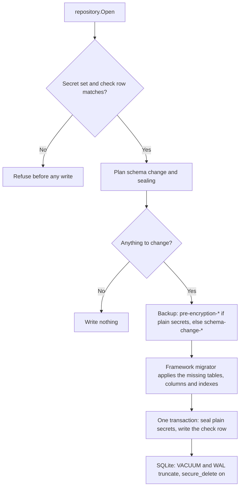

# Design 15 — Storage (`app/store/repository/`, `app/store/dialect/`, `app/store/document/`)

**Status:** partial

Two databases, SQLite (default, 9router's format) or PostgreSQL, both reached through the `DB` facade.

| Facade | What it gives |
|---|---|
| `DB` | `Select`, `Insert`, `Update`, `Delete`, `Statement`, `Table`, `Transaction`, `BeginTransaction`, `Connection`, `WithContext` — the interface for every 9router table |
| `Schema` | `HasTable`, `GetIndexes`, exact DDL (`Schema.Sql`), migration registration; columns are read through `DB` (see "No implicit DDL") |
| `Orm` | Not used: its naming, timestamps and auto-migration are the compatibility problem |

No `database/sql` handle, pool, dialect layer or migration runner of ours. SQL is written once with `?` and `dialect.Rebind` rewrites it for PostgreSQL (quoted text skipped), because PostgreSQL knows only `$1, $2`. `dialect` owns the stored-value formats and `document` the byte-preserving JSON editor, so a package outside the store imports those two.

| Connection | Holds | Schema |
|---|---|---|
| `sqlite` or `postgres` | Configuration (the writer) | The 9router schema, the compatibility contract |
| `sqlite_ro` | Configuration, read-only (`mode=ro`, `query_only`, no WAL pragma) | Commands that must not write: `db:check`, and the analytics key lookup that `db:import-analytics` builds before the import |
| `sqlite_backup` | Configuration, read-only (`mode=ro`, no `query_only`, no WAL pragma) | `db:backup` only: SQLite refuses `VACUUM INTO` under `query_only`, and `mode=ro` already stops every write to the source |
| `sqlite_analytics` or `postgres_analytics` | Usage rows | Router-LLM's own |

### 15.1 Main Store

SQLite at `${DATA_DIR}/db/data.sqlite` (`storage/app/db/data.sqlite`), or PostgreSQL via `DB_*`. `DB_CONNECTION` (default `sqlite`) picks the engine and must be `sqlite` or `postgres`; anything else stops the start. `config/database.go` declares `sqlite`, `sqlite_ro`, `sqlite_backup`, `sqlite_analytics`, `postgres`, `postgres_analytics`. `DB.Connection(name)` picks one; `DB_DATABASE` and `DB_DATABASE_ANALYTICS` name them.

| Backend | Driver | Notes |
|---|---|---|
| SQLite | `goravel/sqlite` (CGO-free, `ncruces/go-sqlite3` via GORM) | `DB_DATABASE` points at the 9router file. Pool limits come from the `pool` block. The driver sets no pragma, so the DSN carries them: `busy_timeout(5000)`, `journal_mode(WAL)`, `synchronous(NORMAL)`, `foreign_keys(ON)`, `secure_delete(ON)`, `temp_store(MEMORY)` on each connection, plus `_txlock=immediate` (every `Transaction` starts `BEGIN IMMEDIATE`). A `PRAGMA` runs through `Statement` or `Select`; its value cannot be bound. `SQLITE_DQS 0`, so string literals use single quotes |
| PostgreSQL | `goravel/postgres` | Same tables. JSON stays `TEXT`. Types follow the driver. Only our additive migrations create DDL; nothing auto-migrates (see "No implicit DDL") |

| Rule | Detail |
|---|---|
| Writes | A read-then-write runs in `DB.Transaction(...)`; the facade rolls back on error |
| Raw SQL | Plain SQL with `?` (rebound for PostgreSQL) through `Select`, `Insert`, `Update`, `Delete`, `Statement`. Every table and column is quoted and named exactly as stored. `Table(name)` does not quote identifiers and struct `Insert`/`Update` drop zero values, so neither is used on shared tables. A row struct tags every selected column `db:"camelCase"`: outside a transaction the scanner ignores an untagged column, inside one it fails with `missing destination name` |
| Lookups | A one-struct `Select` finding no row returns `sql.ErrNoRows` and logs an error holding the bound arguments. A lookup by secret (an API key) selects into a slice and checks its length |
| Row types | Plain structs, never models, every table including analytics. A timestamp is a `string` (`TEXT`, `2006-01-02T15:04:05.000Z` UTC); a boolean binds as 0 or 1. No mapper converts anything |
| No implicit DDL | Nothing creates, alters or drops a shared table by itself. Additive changes are migrations registered with `WithMigrations`, planned first with `Schema.HasTable`, `Schema.GetIndexes` and a column read through the `DB` facade (`pragma_table_info` on SQLite, `information_schema.columns` on PostgreSQL, because `Schema.GetColumns` fails on a composite key). `HasColumn` and `HasIndex` are not used. When nothing is missing nothing is written. The plan runs `SELECT 1` first, because a `Schema` check returns false on a query error |
| Helpers | Sealing at the storage boundary, `kv` scopes with exact key formats, unknown JSON keys kept, NUL bytes stripped and the timestamp format are thin wrappers in `app/store/repository` and `app/store/sealer` around the facade call |
| Tests | One suite, one engine per run: SQLite by default, PostgreSQL when `TEST_PG_DSN` names a server (`make test-pg`). `tests.UsingPostgres` selects, `tests.OpenAny` opens; PostgreSQL gets one schema per test, created and dropped by the helper. A test green on SQLite and broken on PostgreSQL stays invisible until the variable is set |
| Tests that stay SQLite | `tests.RequireSQLite` skips a test whose subject only exists in a file: `VACUUM INTO` backups and `OpenSnapshot`, `ExportPlain`, `Vacuum`, the WAL checkpoint, the pragma reads (`integrity_check`, `auto_vacuum`), the byte-for-byte `dumpTables` comparisons, and reopen-by-file. Each call site states why. Everything else, including the schema plan, migration, sealing, every repository, `Tx` and its advisory lock, `Check` and the analytics store, runs on both |
| Fixture | `app/store/repository/fixture_test.go` opens a copy of a real 9router database from `references/data.sqlite` (or `RLLMX_FIXTURE`). Skips when absent; never writes the original and checks its size and mtime after. Proves the additive plan is empty, that reading writes nothing, that a written row keeps every column but `updatedAt`, and that migration seals every plain secret |
| Dependencies | `tidwall/gjson` and `sjson` (row editing, below), `gofrs/flock` (the data lock), `subosito/gotenv`; approved in `docs/ARCHITECTURE.md` (Approved Modules) |

### Tables

DDL follows the reference (`src/lib/db/schema.js`, pinned in `PARITY.md`). Every column is `TEXT` unless noted; `INTEGER` is `BIGINT` on PostgreSQL. Index names are the reference's.

| Table | Columns | Indexes |
|---|---|---|
| `_meta` | `key PK`, `value NOT NULL` | |
| `settings` | `id INTEGER PK CHECK (id = 1)`, `data NOT NULL` | |
| `providerConnections` | `id PK`, `provider NOT NULL`, `authType NOT NULL`, `name`, `email`, `priority INTEGER`, `isActive INTEGER DEFAULT 1`, `data NOT NULL`, `createdAt NOT NULL`, `updatedAt NOT NULL` | `idx_pc_provider (provider)`, `idx_pc_provider_active (provider, isActive)`, `idx_pc_priority (provider, priority)` |
| `providerNodes` | `id PK`, `type`, `name`, `data NOT NULL`, `createdAt NOT NULL`, `updatedAt NOT NULL` | `idx_pn_type (type)` |
| `apiKeys` | `id PK`, `key NOT NULL UNIQUE`, `name`, `machineId`, `isActive INTEGER DEFAULT 1`, `createdAt NOT NULL`, `accessRestricted INTEGER DEFAULT 0`, `accessAllow` | `idx_ak_key (key)` |
| `combos` | `id PK`, `name NOT NULL UNIQUE`, `kind`, `models NOT NULL`, `createdAt NOT NULL`, `updatedAt NOT NULL` | `idx_combo_name (name)` |
| `kv` | `scope NOT NULL`, `key NOT NULL`, `value NOT NULL`, `PRIMARY KEY (scope, key)` | `idx_kv_scope (scope)` |

`accessRestricted` and `accessAllow` are the only columns an older file may lack; the migration adds them. The framework's migration table is `migrations` (`config/database.go`), a plain identifier 9router ignores.

**Legacy usage tables.** 9router also has `usageHistory`, `usageDaily` and `requestDetails`, and a `proxyPools` table.

| Table | What we do |
|---|---|
| `usageHistory`, `usageDaily`, `requestDetails` | Never created, never written; `db:import-analytics` reads them, `--drop-old` removes them |
| `requests` feature columns | `savers` and `skills`, `TEXT`, added to the analytics store with the trace work. Additive: an older analytics file gains both on open, and the rows written before the change read back empty |
| `proxyPools`, `proxyPoolFitness` | Never created; an existing table keeps its rows untouched |
| Migration 5 | Belonged to `proxyPools` and stays retired, so later tables keep the names a database already recorded |

### JSON Shapes

| Where | Content |
|---|---|
| `providerConnections.data` | `displayName`, `accessToken`, `refreshToken`, `idToken`, `apiKey`, `expiresAt`, `expiresIn`, `lastRefreshAt`, `projectId`, `testStatus`, `lastError`, `errorCode`, `lastErrorAt`, `backoffLevel`, `lastUsedAt`, `consecutiveUseCount`, dynamic `modelLock_<model>`, `providerSpecificData` (copilot token, base URL, API type, account id, device id, proxy settings kept but unused, enabled models, assigned model,.) |
| `providerNodes.data` | prefix, base URL, API type |
| `combos.models` | JSON array |
| `kv` scopes | `modelAliases`, `customModels` (key `providerAlias\|id\|type`), `mitmAlias`, `pricing`, `disabledModels`. Go-only scopes use the prefix `rllm`: `rllmKeyLimits` (key = API key id), `rllmAuth/sessionEpoch`, `rllmCrypto/check` |

### Row Editing

| Rule | Detail |
|---|---|
| Unknown fields | Kept on every write. A row is edited in place with `tidwall/sjson` after `gjson.Valid` confirms it parses (`sjson` returns garbage on corrupt input without an error), so other bytes are untouched (checked with big numbers, unicode and ``) |
| Duplicate top-level key | The row counts as corrupt: `sjson` edits the first, a JavaScript reader takes the last |
| Key addressing | Backslash-escape every ASCII byte that is not a letter, digit, `_` or `-` (22 key shapes checked), so `google/gemma-4-31b-it:free` is one top-level key |
| String encoding | Without HTML escaping, as the reference does (`sjson` would turn `<`, `>`, `&` into `<` and friends) |
| Ids | v4 UUIDs from `google/uuid` |
| Create | Keeps whitelisted fields, takes `priority = MAX + 1` for its provider |
| Update | Merges only the patched keys. `testStatus` to `active` clears the error fields, sets `backoffLevel` 0 and nulls every `modelLock_*` |
| Priorities | Renumbered 1.N only on a priority update or a delete (ties go to the most recently updated) |
| Dedup on create | OAuth by email; Codex also by `chatgptAccountId`; others by workspace id or `username` with both sides present; API keys by provider and name (`ErrNameConflict` when overwriting is refused) |
| Atomic helpers | `MarkUnavailable`, `ClearLocks`, `TouchUsage`, `UpdateCredentials` each read and write in one transaction. This closes four reference races: backoff level read outside the write, lost counter increments, clearing from a stale snapshot, replacing `providerSpecificData` from the caller's copy |
| Corrupt rows | A list returns a corrupt connection flagged `Corrupt` with raw text; every write refuses it (`ErrCorruptRow`); refresh, lock and backoff skip it. A restricted key whose `accessAllow` does not parse allows nothing; an unrestricted one stays unrestricted |

### Sealed Secrets (`app/store/sealer`, format owner; divergences 139 to 141)

| Item | Detail |
|---|---|
| Value | `enc:v1:` + unpadded base64url of `nonce(12) \|\| AES-256-GCM ciphertext+tag`. Stays a string, so TEXT columns and JSON string fields keep their types |
| Keys | `DB_ENCRYPTION_SECRET`: 64 hex characters, required. HKDF-SHA256 derives two subkeys: info `rllm/v1/aes-gcm` (cipher) and `rllm/v1/nonce` (synthetic-nonce HMAC) |
| `Seal` | Random nonce |
| `SealFixed` | Nonce is `HMAC-SHA256(nonceKey, aad \|\| 0x00 \|\| plain)[:12]`. Used only for `apiKeys.key`, so the unique index and `WHERE "key" = ?` still work; it leaks only equality |
| Binding | Additional data names the place: `rllm/v1/apiKeys/key`, `rllm/v1/providerConnections/<id>/<path>`, `rllm/v1/settings/<field>`, `rllm/v1/check`. A ciphertext moved to another row or field does not open |
| Sealed | `apiKeys.key`; connection `data`: `apiKey`, `accessToken`, `refreshToken`, `idToken`, `sessionToken`, `copilotToken`; `providerSpecificData`: `apiKey`, `sessionToken`, `copilotToken`, `accessKeyId`, `secretAccessKey`, `mimoPassToken`, `cookie`, `clientSecret`; `settings.oidcClientSecret` |
| Not sealed | `password` (bcrypt hash), `mitmSudoEncrypted` (never read) |
| Boundary | Sealing happens in `app/store/repository` only. A write keeps the stored ciphertext of an unchanged value, so untouched rows stay byte-identical. A field that does not open marks a connection `Corrupt` or a key `Unreadable` |

- One backup, then two atomic steps. The migrator gives each migration its own transaction and cannot share one with sealing, so sealing is repeatable: a start that stopped between them finds the schema current and seals what is still plain. The backup precedes both.
- A failed backup aborts. Rows with damaged JSON are left alone with a warning.
- `pre-encryption-*` is never pruned; `schema-change-*` is pruned to 3.
- PostgreSQL converts too, with a `pg_dump` warning. The read-only open used by commands never converts.
- **Way back:** `rllmx artisan db:export-plain` (asks the dashboard password, SQLite only; the command is `rllmx artisan db:export-plain`, built on the `ExportPlain` store function) writes a `VACUUM INTO` copy with every secret opened and the `rllmCrypto` rows removed.
- Old usage tables keep the plain keys they always had; `import-analytics --drop-old` removes them.

### Schema Handling

| Item | Detail |
|---|---|
| `_meta` keys | `schemaVersion` 1 (migration level), `backupSchemaVersion` 2 (gates the pre-change backup). `appVersion`, `migratedAt`, `totalRequestsLifetime` are 9router bookkeeping: on an existing database rllmx never changes `schemaVersion`, `backupSchemaVersion` or `appVersion` and does not bump the counter (it lives in the analytics store). Go-only migrations are tracked by the framework in the `migrations` table, not in `_meta` |
| Fresh database | `_meta` empty or missing. Stamped `schemaVersion` 1, `backupSchemaVersion` 2, `appVersion` `rllmx-<version>` and `migratedAt`, each only when absent, so 9router opens it as migrated |
| Plan first | Compute missing tables, columns, indexes and pending Go migrations. Nothing missing and the check row present means nothing written and no backup. Otherwise backup, then the framework migrator applies the forward-only migrations (one per table or column, created with exact DDL). Never drop, rename or retype. An added column is nullable or has a `DEFAULT` |
| Newer database | A newer `backupSchemaVersion` starts read-write only on known tables and columns, with a warning |
| Backup | `VACUUM INTO` a full copy at `db/backups/<label>-rllmx-<version>-<YYYYMMDD-HHMMSS>/data.sqlite`, directory `0700`, file set to `0600` afterwards (the copy follows the umask). Three newest automatic backups kept; `rllmx artisan db:backup` never prunes. Includes `requestDetails` when present. PostgreSQL: use `pg_dump` |
| Unknown objects | `proxyPools`, `proxyPoolFitness`, `sqlite_sequence`, a stale `sqlite_stat1` are left alone; `PRAGMA optimize` may add `sqlite_stat1/4`, which comparison tests ignore |
| Names | Go-only tables use plain identifiers (letters, digits, underscore), so 9router's backup, which interpolates names unquoted, still works on a shared file |
| PostgreSQL columns | `information_schema.columns` filtered by `table_schema = current_schema`, exact names; the migrator's `addColumn` uses `ADD COLUMN IF NOT EXISTS` |

**Files in `DATA_DIR`:** `jwt-secret`, `machine-id`, `db/data.sqlite`, `db/analytics.sqlite`, `db/backups/`, `db/analytics-backups/`, `skills/`, `model-catalog.json` (version 3; a copy another build wrote is rebuilt), `rllmx.lock`. Directories `0700`, files `0600`. `DATA_DIR` defaults to `storage/app`; logs sit in `storage/logs` (`rllmx.log`), so `storage/` is the one volume to keep. The main store holds only router configuration.

**Seeding and import.** `rllmx artisan db:import-config` seeds an empty store from a 9router database (`app/store/importer`); `rllmx artisan db:import-analytics` moves old usage history. Steps and rules: `docs/WORKFLOWS.md`.

### 15.2 Analytics Store (`app/store/analytics/`)

| Item | Detail |
|---|---|
| Location | SQLite `${DATA_DIR}/db/analytics.sqlite`, created with `auto_vacuum=INCREMENTAL` (verified on open, warning if another mode). PostgreSQL: schema `rllmx_analytics` on the main server or the database named by `DB_DATABASE_ANALYTICS`, created before its tables (`Schema` has no create-schema call, so `CREATE SCHEMA IF NOT EXISTS` goes through `Statement`; `HasTable` looks in every schema, so PostgreSQL names are schema-qualified) |
| Planning | The analytics tables are planned and created by their own idempotent pass in `app/store/analytics`, not through the framework's `migrations` table. A migration that runs on another connection is recorded in the default connection's table, and this file can be deleted and recreated on its own |
| Privacy | The row type has no field for a body, header, prompt or upstream message; a test fails if one is added. Writing is unconditional |
| `errorClass` | One of `none`, `auth`, `access_denied`, `key_quota`, `rate_limit`, `quota`, `invalid_request`, `not_found`, `no_account`, `upstream_5xx`, `network`, `timeout`, `stream_stall`, `client_closed`, `unknown`; anything else is stored as `unknown` |
| API key | Stored by id and `apiKeyName` (copied at write time, 64 characters, control characters removed; the only free text), never the secret |
| `estimated` | `1` when token counts were guessed because the provider reported none; old rows read 0 |

| Table | Columns |
|---|---|
| `requests` | `id` (integer PK, identity on PostgreSQL), `ts` (unix ms), `requestId`, `apiKeyId`, `apiKeyName`, `connectionId`, `provider`, `model`, `endpoint`, `sourceFormat`, `status`, `errorClass`, `stream`, `cached`, `estimated`, `promptTokens`, `completionTokens`, `cachedTokens`, `cacheWriteTokens`, `reasoningTokens`, `cost`, `latencyMs`, `ttfbMs`, `comboName`, `attempt`, `importId` (unique, null for live rows) |
| `rollupHourly`, `rollupDaily` | Key `(bucket, provider, model, connectionId, apiKeyId, endpoint)`, every dimension `NOT NULL DEFAULT ''`; sums `requests`, `errors`, the five token counts, `cost`. UTC buckets |
| `meta` | Lifetime request counter |

Indexes on `requests`: `(ts)`, `(apiKeyId, ts)`, `(connectionId, ts)`, `(provider, model, ts)`. A column an older file lacks is added on open: plan first, no write when current, SQLite backed up first (`${DATA_DIR}/db/analytics-backups/`, `0700`/`0600`), a failed backup aborts.

**Writer.** `Enqueue(Record) bool` never blocks; a closed writer or a full queue (10,000) drops the row and counts it.

- One goroutine flushes at 500 rows or 1 s, in one transaction: insert, pre-aggregate, upsert rollups in sorted key order.
- A failed flush drops that batch and logs it.
- `Close(ctx)` stops accepting, then drains until the context ends.
- Measured: a burst sized to the queue is kept; sustained traffic above the write rate shows in the drop counter.

**Opening another file.** The legacy import, `--drop-old` and any test need a second SQLite connection.

- `repository.Opener` builds one; `providers.SQLiteOpener` registers a fresh `database.connections.<name>` key per call, because the framework caches a built connection by name for the process's life. A shared name would hand every caller the first file it opened.
- The pool is closed through `Conn.Close`.
- The db commands take the same opener through `commands.Facades`, and both stores open through `data.OpenAnalytics`, so a command sees the file the server sees.

**Retention.** `ANALYTICS_RETENTION_DAYS` (90) prunes `requests` and `rollupHourly` in batches. `rollupDaily` is kept, so long charts and key quota totals stay correct.

### 15.3 Maintenance

Jobs are registered with `WithSchedule` in `bootstrap/app.go`. They run in the server process and stop with it.

- Each event is named and uses `SkipIfStillRunning`; the framework always recovers a job panic.
- The facade has no jitter, no clock injection and no context, so a job takes its start offset and clock as arguments (a fake in tests), watches the application context, and keeps its last start, end and error in memory for the API.
- Shutdown waits for a running job with no limit, so jobs stay short.

| Job | Schedule | Work |
|---|---|---|
| Optimize, checkpoint | Every 6 h and at start | `PRAGMA optimize`, WAL checkpoint on both SQLite files |
| Prune, vacuum, analyze | Daily and at start | Prune and incremental vacuum on the analytics file; `ANALYZE` on PostgreSQL analytics tables |

Job names: `optimize`, `checkpoint` (main), `analytics-optimize`, `analytics-checkpoint` (usage store, every 6 h), `analytics-prune`, `analytics-analyze` (daily). Each takes its own start offset, since the Schedule facade has no jitter.

A failing job never blocks start. The main file never switches `auto_vacuum`.

| Command | Behavior |
|---|---|
| `db:vacuum` | Full `VACUUM`; asks y/N or takes `--yes`; refuses while `rllmx.lock` is held (`gofrs/flock`) |
| `db:check` | Full `integrity_check` plus a schema comparison naming tables, columns and indexes, never a row value. Changes nothing; exit 1 on any problem |
| `db:migrate` | Creates or updates the schema the server expects, using the same migrator and the same backup-before-change rule; seals what is still plain. Takes `rllmx.lock`, so it refuses while a server runs. The one command that may open the empty file a start-up leaves behind; a path with no file is refused, so a mistyped `DB_DATABASE` never makes a database |
| `db:backup [--out dir]` | `0600` copy. PostgreSQL: the command prints a `pg_dump` hint and calls `os.Exit(2)` itself, because Artisan only ever exits 0 or 1 |
| `db:import-analytics [--from file] [--drop-old]` | Copies the source with `VACUUM INTO`, imports in batches of 5,000 into the usage store, verifies the row count, the five token sums and the cost, and seeds the lifetime counter once. Takes `rllmx.lock`. `--drop-old` needs a terminal and a typed `DROP`, refuses when a row was unreadable, writes `db/backups/before-drop-*` and then drops `usageHistory`, `usageDaily` and `requestDetails` |
| `db:import-config --from <file or dir> [--dry-run] [--yes] [--with-sso] [--skills-from <dir>]` | Seeds an **empty** destination from a legacy source read through a private copy: connections (locks and error state removed), API keys, nodes, combos, four `kv` scopes and the allow-listed settings, in one transaction with the original ids and timestamps. Secrets are re-sealed for the destination; a sealed source is refused. The destination needs the schema `db:migrate` creates; a missing or empty file is refused, and the dry run and the apply check it before anything is copied, skills included. Prints counts and key names only. Takes `rllmx.lock`, a dry run included |

The framework's `migrate:*`, `db:wipe` and `db:seed` would drop or rewrite the 9router tables, and `WithCommandsFilter` does not reach them: the database provider registers without consulting the list.

- `providers.CommandsServiceProvider` wraps the bound `Artisan` and filters every `Register` through the same allow-list (see Framework Choices).
- Prompts are typed answers read with `Ask`: y/N for `db:vacuum` and `db:import-config`, `DROP` for `--drop-old`. The framework's `Confirm` widget is not used.
- Each refuses without a terminal unless `--yes` is given.

---

## Parity: Database Contract

| Item | Reference | Status |
|---|---|---|
| Configuration tables and indexes (`backupSchemaVersion` 2) | `src/lib/db/schema.js` | done on SQLite; written but never run on PostgreSQL (`TEST_PG_DSN`, `make test-pg`; SQLite-only cases listed above) |
| `usageHistory`, `usageDaily`, `requestDetails` tables | `src/lib/db/schema.js` | diverged (not created or written; read only by `rllmx artisan db:import-analytics`) |
| `settings` single row with `CHECK (id = 1)` | `src/lib/db/schema.js` | done |
| `_meta` keys and backup-before-change rule (`schemaVersion` 1 = migration level) | `src/lib/db/migrate.js` | done |
| `_meta.totalRequestsLifetime` bump | `src/lib/db/repos/usageRepo.js` | diverged (counter in the analytics store; importer seeds from this key once) |
| `modelLock_<model>` fields | `src/sse/services/auth.js` | done (written and cleared by `app/store/repository`, read by `app/gateway/account`) |
| `kv` scope `rllmResponseCache` (per-key response-cache flag) | none | done: `KVRepo.ResponseCacheEnabled` reads it, the key API writes it, and a key's delete removes it |
| `kv` scope `rllmKeyLimits` (a key's budget) | none | done: `quota.Limits` reads, writes and deletes it; the key API sets it |
| `kv` scopes and key formats | `src/lib/db/repos/*` | done (the four shared scopes; Go-only scopes arrive with their step) |
| API key, machine id, JWT and bcrypt formats | `src/shared/utils/apiKey.js`, `machineId.js`, `src/lib/auth/dashboardSession.js` | done (`app/access/identity` golden vectors, `app/access/auth` `iss`, `method`, `pv`) |
| `proxyPools`, `proxyPoolFitness` tables | `schema.js`, extended `proxyPoolFitnessRepo.js` | out (not created, read or dropped; left alone if present, divergences 202, 214) |
| Legacy `db.json`, `usage.json`, `disabledModels.json`, `request-details.json` import | `src/lib/db/migrate.js` | out |

One row above is still open: PostgreSQL is written and has never been run here, so `make test-pg` is the evidence still missing. The proxy tables are `out`, which is a decision. That is why this design doc is `partial`: the schema and both engines are built, and the PostgreSQL run is what a done status waits on.

---

## Parity: Router-LLM Additions

No reference counterpart.

| Item | Status |
|---|---|
| Analytics store (`requests`, rollups, `meta`), writer, retention, legacy importer | done on SQLite; PostgreSQL paths built (`app/store/analytics`) |
| PostgreSQL mapping | built; run `make test-pg` with `TEST_PG_DSN` against a server |
| Sealed secrets: `enc:v1:` values in `apiKeys.key`, connection `data`, `settings.oidcClientSecret`; check row in kv scope `rllmCrypto` | done (converted after a full backup; no plain secret left in the file or its WAL) |
| Pre-encryption backup (never pruned), `rllmx artisan db:export-plain` | done (SQLite only) |
| `rllmx artisan db:backup`, `check`, `vacuum` | done |
| `rllmx artisan db:migrate` (rides the schema without a server start) | done |
| `rllmx artisan db:import-config` (seed from a 9router database) | done |
| `rllmx artisan db:import-analytics` (usage history import) | done |
| Skill folder import in `import-config` | new |

---

## Divergences

Deliberate differences from the references in this area. Numbers are stable and cited from other docs.

| # | What we do differently | Why it is better |
|---|---|---|
| 5, 13 | Not read; setting is the control; docs follow SQLite code | No dead switch |
| 32 | `db import-config` into empty SQLite or PostgreSQL database | **New feature** |
| 198 | Retired: the database layer is the `DB` facade with plain SQL | Recorded so the number stays citable (framework choice) |
| 27, 36 | `VACUUM INTO` full copy (`0700`/`0600`); failed backup aborts | No change without restore point |
| 37, 38, 39, 40 | Such column panics at start, `db check` reports it; one small pool, writes serialized by `BEGIN IMMEDIATE` and busy timeout (`db check` separate read-only connection); corrupt rows returned raw, never written; repeated key counts as corrupt; `db check` runs `integrity_check`, compares schema | Read runs while write transaction holds its own connection; unreadable data never destroyed |
| 83, 92 | Skipped, counted, never written; one transaction each | Corrupt row not chosen then overwritten |
| 140 | First start on plain database copies whole file (`pre-encryption-*`, never pruned), aborts on failure; `db export-plain` writes decrypted copy | Original always recoverable |
| 35, 85 | Lock level, lock clearing, usage count, `providerSpecificData` patches each in one immediate transaction (30 callers tested) | No lost updates |
| 139 | AES-256-GCM (`enc:v1:`) under `DB_ENCRYPTION_SECRET`, bound to row and field; synthetic nonce in key column for exact lookup; freed pages overwritten, file rebuilt | Copied file, backup, WAL, PostgreSQL schema yield no credential; usage rows hold key id and name only |
| 133 | `<source fingerprint>:<row id>`, totals verified per source | Second database not skipped as imported |
| 141 | Sealed database no longer opens in 9router; `db export-plain` makes usable copy; `import-config` refuses sealed source | Credentials at rest outweigh two-way drop-in (trade-off) |
| 202 | Not created, read, dropped: `db:import-analytics --drop-old` removes exactly `usageHistory`, `usageDaily`, `requestDetails`; `proxyPoolFitness` left by an extended install stays untouched | No feature reads the table; dropping data this program does not understand is worse than leaving it (scope cut) |

---

## Findings

One row per lesson; the decision is what the code does because of it.

| Finding | Decision |
|---|---|
| The Schema facade's SQLite column reader scans the primary-key position into a bool and fails on `kv`'s two-column key. | Columns are read with `pragma_table_info` / `information_schema.columns` instead. |
| The framework migrator logs a migration once and never re-runs it. | `Store.Migrate` repairs a dropped index or column from its own plan. |
| `WithCommandsFilter` does not reach the database provider, which registers fifteen commands with a bare `artisan.Register`. | `providers.CommandsServiceProvider` wraps the bound `Artisan` to close that (F-fix). |

