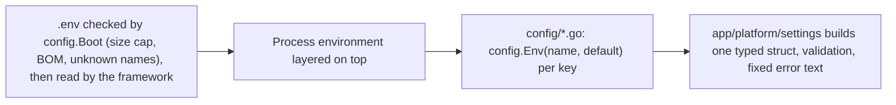

# Design 17 — Configuration (`config/`, `app/platform/settings/`)

**Status:** partial

The settings and variable tables below are parity data: the keys the store reads and writes back. A key whose *behaviour* belongs to a later step is marked there, and that step's design doc owns it.

Environment variables and an optional `.env` in the working directory, read by the framework's config loader through `config/*.go`. The process environment wins. Every variable has a default in the `config.Env(name, default)` call.

### Loading

| Rule | Detail |
|---|---|
| Empty value | Viper treats set-but-empty as unset, so the default applies — process environment and `.env` alike |
| Errors | Never quote a value: `APP_PORT: invalid value`. Our checks (unknown name, size cap, range) exit non-zero naming the variable. A `.env` syntax error or a missing or short `APP_KEY` is reported by the framework, in its words |
| Unknown names | A `.env` entry in an owned group (`SERVER_`, `HTTP_`, `AUTH_`, `DB_`, `ANALYTICS_`, `CACHE_`, `LOG_`, `STREAM_`, `UPSTREAM_`, `OAUTH_`, `MEDIA_`, `SAVER_`, `CATALOG_`, `TRANSLATOR_`, `PROVIDER_`) that the code does not read fails startup, as does a lower-case spelling of a real name. The process environment is never scanned. `TEST_*` and Windows `=C:` are ignored |
| Data dir | Accepts `~` and a relative path; made absolute |
| Secrets | No secret reaches the `Log` facade; what slips through a URL, header or error text is scrubbed by `app/platform/redactor`, in front of every file channel. There is no `Secret` string type |
| Expansion | `$NAME` and `${NAME}` in unquoted and double-quoted values, from names defined earlier in the same file (unknown becomes empty; the process environment is not consulted). A value with `$` must be single-quoted; single-quoted values are literal |
| `.env.example` | Lists exactly what the code reads. A test checks both directions, that each name matches `^[A-Z]+(_[A-Z0-9]+)+$` and that none collides after case folding. A variable is added by the step that reads it |
| Raw key names | The framework exposes no key list, so `config.Boot` reads `support.EnvFilePath` with `subosito/gotenv`, the parser the loader already uses. It supplies key names, the size cap and the BOM check only |

### Naming

- Goravel-owned names are used as the framework defines them: `APP_NAME`, `APP_ENV`, `APP_KEY`, `APP_DEBUG`, `APP_URL`, `APP_HOST`, `APP_PORT`, `JWT_SECRET`. `APP_KEY` is 32 characters (`./artisan key:generate`), is required by the framework at boot, and is not the database sealing secret.
- Every other variable has the form `<GROUP>_<NAME>`, upper case, with no product prefix. Groups: `SERVER` (guard and limit settings), `HTTP` (the listener's `http.server.*` keys, the same tree as Goravel's `http.*`), `AUTH`, `DB`, `ANALYTICS`, `CACHE`, `LOG`, `STREAM`, `UPSTREAM`, `OAUTH`, `MEDIA`, `SAVER`, `CATALOG`, `TRANSLATOR`, `PROVIDER`. `DATA_DIR` stands alone.
- Booleans are `true` or `false`, and the name says what `true` does (`OAUTH_BACKGROUND_REFRESH=true`, never `DISABLE_*`).
- Durations are Go durations (`200s`, `5m`), so no unit in the name. Sizes and counts carry the unit (`_MB`, `_DAYS`).
- Secrets and URLs end in `_SECRET`, `_PASSWORD`, `_URL`, so the log redaction handler recognizes them. There is no config printer command; print the names, never the values.
- 9router names that no longer exist are not read. `AUTH_API_KEY_SECRET` and `AUTH_MACHINE_ID_SALT` must hold the values 9router used (`API_KEY_SECRET`, `MACHINE_ID_SALT`) to keep imported keys valid, and `JWT_SECRET` keeps the 9router name and value. The mapping is in `this design doc, Environment Variables`.

### Variables

No code reads rows marked *planned* yet, so setting one in `.env` fails startup with `unknown variable` until it is implemented. Only `.env` entries in these groups are checked; the process environment is never scanned.

| Group | Variables (default) |
|---|---|
| Server | `APP_PORT` (20128), `APP_HOST` (127.0.0.1), `HTTP_SERVER_READ_HEADER_TIMEOUT` (10s, 1s to 5m), `HTTP_SERVER_IDLE_TIMEOUT` (120s, 1s to 1h), `HTTP_SERVER_SHUTDOWN_GRACE` (30s, 1s to 10m; a second signal exits at once), `HTTP_COMPRESSION` (true; Brotli or gzip, D327), `HTTP_H2C` (false; HTTP/2 on the plain listener), `SERVER_MAX_BODY_MB` (128), `SERVER_TRUST_LOOPBACK` (true), `SERVER_TRUSTED_PROXIES` (empty: loopback only; addresses or CIDRs whose `X-Forwarded-For` and `X-Forwarded-Proto` are believed), `APP_URL` (empty; `http(s)://host[:port]`, no userinfo, path or query, http only for loopback; base for OAuth, OIDC and SAML callbacks) |
| Data | `DATA_DIR` (`storage/app`) |
| Auth | `JWT_SECRET` (generated into `jwt-secret`), `AUTH_INITIAL_PASSWORD`, `AUTH_API_KEY_SECRET`, `AUTH_MACHINE_ID_SALT`, `AUTH_COOKIE_SECURE` (false), `AUTH_REFUSE_DEFAULT_PASSWORD` (false), `AUTH_SSO_ALLOW` (empty: **any account the provider accepts**; exact addresses or `@domain`) |
| Database | `DB_CONNECTION` (`sqlite` by default, or `postgres`), `DB_DATABASE` (the SQLite file, empty: `DATA_DIR/db/data.sqlite`; the PostgreSQL database), `DB_HOST`, `DB_PORT`, `DB_USERNAME`, `DB_PASSWORD`, `DB_SCHEMA` (`public`), `DB_SSLMODE` (`require`; PostgreSQL only), `DB_ENCRYPTION_SECRET` (required) |
| Analytics | `DB_DATABASE_ANALYTICS` (empty: `DATA_DIR/db/analytics.sqlite`, or the schema `rllmx_analytics` on PostgreSQL), `ANALYTICS_RETENTION_DAYS` (90) |
| Cache | `REDIS_HOST`, `REDIS_PORT`, `REDIS_PASSWORD`, `REDIS_DB` (empty `REDIS_HOST`: the memory store only) |
| Response cache | `CACHE_RESPONSE_MAX_ENTRIES` (1000, 1 to 100000), `CACHE_RESPONSE_MAX_MB` (64, 1 to 4096): the in-process bound; ignored when `REDIS_HOST` is set |
| Logging | `LOG_CHANNEL` (`single`; `daily` or `stack` also), `LOG_LEVEL` (info). The file, the formatter (`text` or `json`) and the retention days are keys of the channel in `config/logging.go` (`storage/logs/rllmx.log`), not variables. No `print` flag: the framework drops console output on a custom driver, and nothing is copied to the console |
| Streams | `STREAM_STALL_TIMEOUT` (360s, 5s to 1h), `STREAM_FIRST_CHUNK_TIMEOUT` (200s, 5s to 1h), `STREAM_USAGE_WAIT` (3s, 100ms to 30s; how long a finished turn waits for a late usage report), all read; `STREAM_EMPTY_PEEK_DEADLINE` (45s, 1s to 10m) (planned,) |
| Upstream | `UPSTREAM_CONNECT_TIMEOUT` (60s, 1s to 10m), `UPSTREAM_ALLOW_PRIVATE` (empty: public targets only; host names, addresses or CIDRs; link-local and the cloud metadata addresses are refused even when listed), `UPSTREAM_TLS_CURVE` (`x25519` offers only that group, `default` offers the standard list; anything else fails the start), `UPSTREAM_CLAUDE_CLI_VERSION` (empty: the latest published Claude Code, read from npm every six hours, never below the build's floor; a value is `x.y.z` and turns the lookup off), built |
| OAuth login | `OAUTH_CALLBACK_HOST` (127.0.0.1): an IP address, the bind address of the fixed-port login listener |
| OAuth refresh | `OAUTH_BACKGROUND_REFRESH` (true) and `OAUTH_REFRESH_DELAY` (1500ms, 0s to 1m, pause between accounts), built. `OAUTH_REFRESH_GOOGLE_DELAY` (12s, 0s to 1m, the pause after an account of a provider that sets `slowRefresh`, plus 0 to 4 s of jitter), built |
| Media | `MEDIA_VIDEO_TIMEOUT` (120s, 5s to 10m; one video create or poll), built. `MEDIA_SEARXNG_URL` (empty; an http or https address with a host), built |
| Token savers | `SAVER_HEADROOM_URL` (empty; the settings row's `headroomUrl`, then `http://localhost:8787`) |
| Catalog | `CATALOG_SYNC` (true; `false` stops the timer, and a file already in `DATA_DIR` is still loaded), built |
| Translator | `TRANSLATOR_ENABLED` (false) (planned) |
| OAuth clients | `OAUTH_CLIENT_ID_<PROVIDER>` for antigravity, claude, codex, github, google, kimi, kimi_coding, minimax_code, muse, nous, trae, windsurf, xai; `OAUTH_CLIENT_SECRET_<PROVIDER>` only for antigravity, google, trae. Default empty, which disables that provider's login; `.env.example` carries working values. `google` serves Gemini and Gemini CLI, `minimax_code` both MiniMax Code regions, `xai` xAI and Grok CLI. Built: `OAUTH_CLIENT_ID_CLAUDE` and `OAUTH_CLIENT_ID_CODEX` (at most 256 characters, no spaces or control characters); adds `OAUTH_CLIENT_ID_GITHUB`; adds `OAUTH_CLIENT_ID_GOOGLE`, `OAUTH_CLIENT_SECRET_GOOGLE` (Gemini CLI), `OAUTH_CLIENT_ID_ANTIGRAVITY` and `OAUTH_CLIENT_SECRET_ANTIGRAVITY`; adds `OAUTH_CLIENT_ID_MINIMAX_CODE` (both MiniMax Code sites; CodeBuddy and GLM need none); adds `OAUTH_CLIENT_ID_KIMI`, `OAUTH_CLIENT_ID_MUSE`, `OAUTH_CLIENT_ID_NOUS` and `OAUTH_CLIENT_ID_XAI` (the Grok CLI login reads the xAI one; Kilo Code needs none). iflow is not built (D279), so it has no variable |
| Provider overrides | `PROVIDER_AZURE_ENDPOINT`, `..._AZURE_DEPLOYMENT`, `..._AZURE_API_VERSION`, `..._AZURE_ORGANIZATION`, `..._MIMO_PLATFORM_URL`, `..._COMMANDCODE_BASE_URL` (planned) |

### Not Read

- `REQUIRE_API_KEY` appears in the reference's example file but no code reads it. The `requireApiKey` setting is the control.
- `ENABLE_REQUEST_LOGS` and `OBSERVABILITY_*` have no replacement: usage is always recorded and holds metadata only (design doc 16).
- Dropped with their feature: `NODE_ENV`, `NEXT_*`, cloud URLs, tunnel, MITM, proxy, updater, browser-pool and Devin variables. The `HTTP_PROXY` family is ignored.

### Settings Row

Everything the dashboard edits lives in `settings.data` with the reference's defaults. Keys this version does not use are kept. The defaults list is in `this design doc, Settings Keys`.

---

## Parity: Settings Keys

Defaults from the reference `DEFAULT_SETTINGS`; every key read and written back. **honored**: acting step built; **stored**: round trip only.

The status column is the v1 target, not the build state: behavior lands later. Until then the store reads and writes the key back; nothing acts on it.

| Keys | Status |
|---|---|
| `requireLogin`, `requireApiKey`, `authMode`, `ssoType`, `oidc*`, `saml*`, `password` | honored |
| `stickyRoundRobinLimit`, `providerStrategies`, `fallbackStrategy` | honored |
| `comboStrategy`, `comboStickyRoundRobinLimit`, `comboStrategies` | honored: the combo routing reads them through the same 5 s settings cache (`design doc 4`). A `comboStrategies[name]` entry carries `fallbackStrategy`, and for a smart or fusion combo `smartPolicy`, `sessionSticky`, `confidenceThreshold`, `routerModel`, `judgeModel` and `fusionTuning` (`minPanel`, `stragglerGraceMs`, `panelHardTimeoutMs`); none of those has a top-level form |
| `capacityAdapter` | stored: the pool is not built (`D337`) |
| `providerThinking` | stored; read by no code yet |
| `quotaVisibility` | stored; the quota page reads it (`design doc 18`) |
| `providerOverrides` | honored: read and written by the override routes; applied to an upstream call by the executors |
| `rtkEnabled`, `headroomEnabled`, `headroomUrl`, `headroomCompressUserMessages`, `headroomTimeoutMs`, `cavemanEnabled`, `cavemanLevel`, `cavemanRoutingMode`, `ponytailEnabled`, `ponytailLevel`, `ponytailRoutingMode`, `customPromptEnabled`, `customPrompt` | honored |
| `claudeAutoPing`, `codexAutoPing` | stored and round-tripped in the reference's shape (a switch, or an object of connections and schedules); no scheduler reads them yet (`design doc 16`) |
| `responseCache` | honored (`{enabled, ttlSeconds, maxEntryKb}`, default off; D24, D148); written by the settings API |
| `ccFilterNaming` | honored (answers the Claude CLI topic-naming probe locally; absent = off; dashboard toggle with the settings API) |
| `autoPlan*`, `<skillId>Enabled`, `<skillId>RoutingMode`, `ecc_auto_skill_router*` (extended) | honored; the per-skill keys are accepted for the manifest's id alphabet by the settings API |
| `skillSources` | honored: the https allowlist a `skills:sync` clone or `/api/skills/sync` may use; empty refuses every clone |
| `<skillId>_<field>`, or the field's `legacy_key` | a skill's `config_schema` value; PATCH checks it against that field's type, options and range (design doc 11) |
| `enableObservability`, `observabilityMaxRecords`, `observabilityBatchSize`, `observabilityFlushIntervalMs`, `observabilityMaxJsonSize` | stored (usage always recorded, metadata only) |
| `outboundProxyEnabled`, `outboundProxyUrl`, `outboundNoProxy` | out (no default, never read; a value in an imported row is kept as stored and skipped by `db:import-config`) |
| `headroomAutoStart`, `headroomCodeAware`, `headroomKompress`, `hermesServiceAutoStart` (extended), `pxpipe*` | stored |
| `tunnelEnabled`, `tunnelUrl`, `tunnelProvider`, `tailscaleEnabled`, `tailscaleUrl`, `tunnelDashboardAccess`, `mitmEnabled`, `mitmRouterBaseUrl`, `dnsToolEnabled`, `cloudEnabled` | stored |
| `tokenSaverEnabled`, `tokenSaverBudget` (extended) | stored and imported, no behavior (trim dropped, D9) |

---

## Parity: Environment Variables
### 1. Renamed

| 9router variable | Router-LLM variable | Note |
|---|---|---|
| `PORT` | `APP_PORT` | Goravel name |
| `HOSTNAME` | `APP_HOST` | Goravel name |
| `DATA_DIR` | `DATA_DIR` | as is; default `storage/app`, not `~/.9router` |
| `JWT_SECRET` | `JWT_SECRET` | as is (also the Goravel name); same value keeps existing sessions valid |
| `INITIAL_PASSWORD` | `AUTH_INITIAL_PASSWORD` | |
| `API_KEY_SECRET` | `AUTH_API_KEY_SECRET` | must equal the 9router value for existing keys to validate |
| `MACHINE_ID_SALT` | `AUTH_MACHINE_ID_SALT` | must equal the 9router value |
| `AUTH_COOKIE_SECURE` | `AUTH_COOKIE_SECURE` | as is |
| `STRICT_PRODUCTION_GUARD` (extended) | `AUTH_REFUSE_DEFAULT_PASSWORD` | name says what `true` does |
| `LOG_LEVEL` | `LOG_LEVEL` | as is |
| `ENABLE_TRANSLATOR` | `TRANSLATOR_ENABLED` | planned, step |
| `STREAM_STALL_TIMEOUT_MS` | `STREAM_STALL_TIMEOUT` | Go duration (`360s`), not milliseconds |
| `STREAM_FIRST_CHUNK_TIMEOUT_MS` | `STREAM_FIRST_CHUNK_TIMEOUT` | duration |
| `EMPTY_PEEK_DEADLINE_MS` | `STREAM_EMPTY_PEEK_DEADLINE` | duration |
| `FETCH_CONNECT_TIMEOUT_MS` | `UPSTREAM_CONNECT_TIMEOUT` | duration |
| `NINEROUTER_TLS_ECDH_CURVE` | `UPSTREAM_TLS_CURVE` | same intent; this program's own name and only two values |
| `CLAUDE_CLI_VERSION` | `UPSTREAM_CLAUDE_CLI_VERSION` | same intent; the group names the outbound identity it changes |
| `FETCH_KEEPALIVE_TIMEOUT_MS` | — | not read: the Go pool's idle timeout is fixed and a dropped socket costs one replay |
| `FETCH_FRESH_RETRY` | — | not read: the replay has no kill switch |
| `VIDEO_FETCH_TIMEOUT_MS` | `MEDIA_VIDEO_TIMEOUT` | duration; built, |
| `DISABLE_BACKGROUND_TOKEN_REFRESH` | `OAUTH_BACKGROUND_REFRESH` | polarity inverted: `true` enables, default `true` |
| `BG_REFRESH_DELAY_MS` | `OAUTH_REFRESH_DELAY` | duration; pause between two accounts in a background pass (not a start delay; the first pass always waits 10 s) |
| `BG_REFRESH_GOOGLE_DELAY_MS` | `OAUTH_REFRESH_GOOGLE_DELAY` | duration |
| (browser-built redirect) | `OAUTH_CALLBACK_HOST` | new: fixed-port login listener bind address (default `127.0.0.1`; `0.0.0.0` in a container) |
| `SEARXNG_URL` | `MEDIA_SEARXNG_URL` | built, |
| `HEADROOM_URL` | `SAVER_HEADROOM_URL` | done |
| `MODEL_CATALOG_SYNC` (`off` disables) | `CATALOG_SYNC` | boolean: `false` stops the timer only; built |
| `AZURE_ENDPOINT`, `AZURE_DEPLOYMENT`, `AZURE_API_VERSION`, `AZURE_ORGANIZATION` | `PROVIDER_AZURE_*` | planned, |
| `KIMI_OAUTH_CLIENT_ID`, `KIMI_CODING_OAUTH_CLIENT_ID` | `OAUTH_CLIENT_ID_KIMI`, `OAUTH_CLIENT_ID_KIMI_CODING` | |
| `MIMO_PLATFORM_URL`, `COMMAND_CODE_API_BASE_URL` | `PROVIDER_MIMO_PLATFORM_URL`, `PROVIDER_COMMANDCODE_BASE_URL` | planned, |
| OAuth client ids and secrets hardcoded in `open-sse/providers/registry/*.js`, `shared.js`, `services/nous.js` | `OAUTH_CLIENT_ID_<PROVIDER>` and `OAUTH_CLIENT_SECRET_<PROVIDER>` (18 variables, listed in `.env.example`) | diverged: configuration, not code |

---
### 2. Not Read

| 9router variable | Status |
|---|---|
| `ENABLE_REQUEST_LOGS`, `OBSERVABILITY_*` | out (usage always recorded, metadata only) |
| `HTTP_PROXY`, `HTTPS_PROXY`, `ALL_PROXY`, `NO_PROXY` (and lowercase) | deferred (transports built with no proxy) |
| `NINE_ROUTER_PASSWORD`, `NINE_ROUTER_API_KEY` | out (no remote CLI mode) |
| `STRICT_SSL` | out (TLS always verified) |
| `REQUIRE_API_KEY` | out (the reference never reads it) |
| `NODE_ENV`, `NEXT_*`, `BASE_URL`, `CLOUD_URL`, `INSTANCE_NAME` | out |
| `TUNNEL_*`, `CLOUDFLARED_PROTOCOL`, `MITM_*`, `DEBUG_MITM`, `UPDATER_*`, `TRAY_MODE`, `NINEROUTER_*`, `NINE_ROUTER_PROXY_*` internals, `DEVIN_*`, `CLI_DEVIN_*`, `OBSCURA_*`, `NINEROUTER_BROWSER_POOL`, `MINIMAX_DESKTOP_DATA_DIR`, `APP_BUILD_MD5` | out |

---
### 3. New Variables

No reference counterpart: `HTTP_SERVER_READ_HEADER_TIMEOUT`, `HTTP_SERVER_IDLE_TIMEOUT`, `HTTP_SERVER_SHUTDOWN_GRACE`, `SERVER_MAX_BODY_MB`, `SERVER_TRUST_LOOPBACK`, `SERVER_TRUSTED_PROXIES`, `AUTH_SSO_ALLOW`, `UPSTREAM_ALLOW_PRIVATE`, `DB_CONNECTION`, `DB_DATABASE`, `DB_HOST`, `DB_PORT`, `DB_USERNAME`, `DB_PASSWORD`, `DB_SCHEMA`, `DB_ENCRYPTION_SECRET`, `LOG_CHANNEL`, `REDIS_HOST`, `REDIS_PORT`, `REDIS_PASSWORD`, `REDIS_DB`, `DB_DATABASE_ANALYTICS`, `DB_SSLMODE`, `ANALYTICS_RETENTION_DAYS`. Framework-owned `APP_KEY` (32 characters) and `APP_URL` (public gateway address, for OIDC and SAML) as Goravel defines them; `APP_NAME`, `APP_ENV`, `APP_DEBUG` too, no product meaning.

---

## Divergences

Deliberate differences from the references in this area. Numbers are stable and cited from other docs.

| # | What we do differently | Why it is better |
|---|---|---|
| 26 | Goravel config loader via `config/*.go`; `config.Boot` checks size cap, BOM, unknown names first; never quotes a value; `$` needs single quotes | Predictable format |
| 194 | Goravel-owned names as framework defines them (`APP_*`, `JWT_SECRET`); every other variable `<GROUP>_<NAME>`, no prefix (`AUTH_API_KEY_SECRET`, `AUTH_MACHINE_ID_SALT`, `HTTP_SERVER_*`). `JWT_SECRET` keeps its name; values of `API_KEY_SECRET`, `MACHINE_ID_SALT` copy over unchanged | One naming contract, group-owned unknown-name check, framework names. Risk: shared host may carry another program's `DB_*`/`LOG_*`, so only `.env` entries scanned |
| 201 | Retired: logging is the `Log` facade with its redacting channel | Recorded so the number stays citable (framework choice) |
| 6, 10, 105 | Not read, implemented, adopted; settings keys kept and imported | Dead or unsafe (scope cut) |
| 28 | All log output through one redactor, and the Console Log is a second reader behind it, so the ring only ever holds scrubbed text **(built)** | Errors, headers can carry tokens |
| 33 | All `<GROUP>_<NAME>`, Go durations; old names not read | One contract; operators rename (design doc 17) (trade-off) |

---

## Findings

One row per lesson; the decision is what the code does because of it.

| Finding | Decision |
|---|---|
| Viper treats a set-but-empty value as unset, so a default applies where an operator may expect an empty string. | Documented behavior; operators set an explicit value. |
| The framework exposes no key list for `.env`. | `config.Boot` reads the file with `subosito/gotenv` for names, the size cap and the BOM check. |

