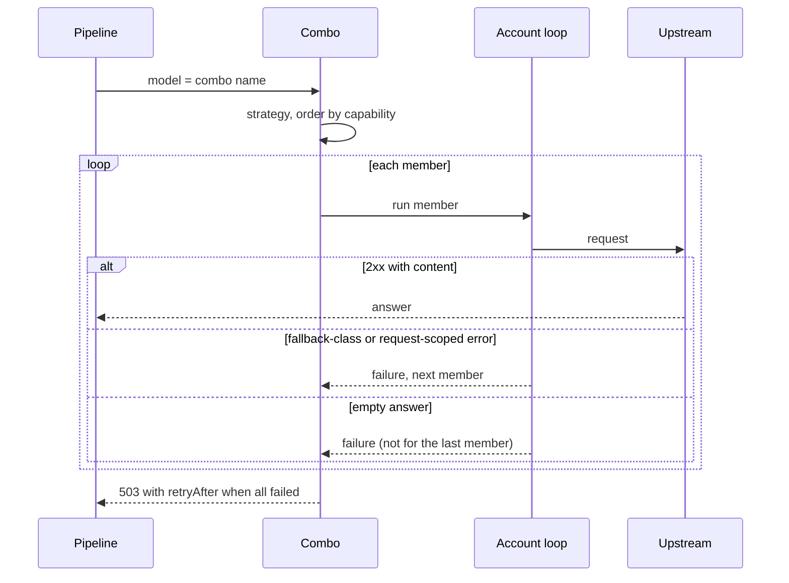

# PRD 04 — Model Resolution & Combos (`app/routing/`)

**Status:** partial · **Steps:** 1.7, 2.4

Built in 1.7a: `app/routing` (the resolver, the 5 s snapshot and the suffix grammar below). Nothing calls it yet; the first caller is the 1.8 pipeline. Built in 1.7c: the connection, node and override routes in the Parity table below. `app/combo` does not exist: combo expansion, strategies and the management routes are 1.7c and 2.4.

### Resolution (`Resolver.Resolve`, built in 1.7a)

The input is at most 256 bytes with no control characters (`ErrTooLong`, `ErrBadInput`); an empty result is `ErrEmpty`. Two suffixes are removed first and reported on the `Target` (`ContextMarker`, `Thinking`), never left in the model name, so `claude-opus-5[1m](high)` and `claude-opus-5(high)[1m]` reach the same place:
- A trailing `[1m]` context marker (any case, stacked ones too).
- A trailing thinking suffix `name(value)`. Values: `none` or `off`, `auto`, a level (`minimal`, `low`, `medium`, `high`, `xhigh`, `max`, `ultra`) or a token budget up to 1,000,000. An unknown value is dropped without an override.

Then:

| Step | Rule |
|---|---|
| 1. `provider/model` | Split at the first slash (the rest is the model, so `openrouter/anthropic/claude-x` works). The prefix is a provider id, alias or extra alias from the registry (`cc` is `claude`, `cx` is `codex`), or a local name (`el`, `jina`, `jina-ai`, `polly`, `aws-polly`, `xmtp`, `xiaomi-tokenplan`) |
| Node prefixes | Only a prefix that is **not** one of those is matched against user provider nodes, by exact prefix, trying node types `openai-compatible`, `anthropic-compatible`, `custom-embedding`. A node with an empty prefix matches nothing. The node id becomes the provider. A built-in name cannot be taken over by a node, and a built-in prefix never reads the node list. An unknown prefix passes on as the provider id |
| 2. Bare name | Combo name (a combo name with a slash is never reached), then user alias (`kv` scope `modelAliases`, value `"provider/model"` or `{"provider","model"}`; the result is **not** looked up as an alias again, so aliases cannot chain or loop; any other shape is ignored), then the built-in alias `grok-build` to `gcli/grok-build`, then prefix inference |
| Inference | On the lower-cased name, first match wins: `codex-auto-review`, `gpt-5.x`, `gpt-6-`, `gpt-daybreak-`, `gpt-reserve...` is codex; `claude-` anthropic; `us\|eu\|ap\|global` + `anthropic\|meta\|amazon\|mistral\|xai` bedrock; `gemini-` gemini; `gpt-`, `o1`, `o3`, `o4` openai; `deepseek-` openrouter; anything else openai |
| 3. Access | The resolver does not decide access. Key allow lists check the resolved target afterwards |

Stored data comes through a `Snapshot` that reads aliases, nodes and combo names at most once every 5 s each (`Invalidate` drops them at once). A failed read is an error, never a guess, and is not cached. A node whose data is not JSON, or whose prefix is not a string, has an empty prefix.

### Combos

A combo has a name and an ordered list of `provider/model` strings or other combo names. The strategy comes from `settings.comboStrategies[name].fallbackStrategy`, then `settings.comboStrategy`, then `fallback`.

| Strategy | Behavior |
|---|---|
| `fallback` | Try members in order |
| `round-robin` | Rotate the start member, with a sticky count (`comboStickyRoundRobinLimit`) |
| `smart` | A router model picks the member; session-sticky; confidence threshold; policy in `smartPolicy` |
| `fusion` | Ask a panel in parallel with tools stripped, wait for a quorum, then a judge model combines the answers |

- Members are reordered so capable models come first when the request needs vision, pdf, audio or video. The **capacity adapter** appends models from a per-capability pool when no member qualifies.
- A request-scoped 4xx also moves to the next member, but never locks an account.
- An empty answer (zero content, or an SSE stream with no content within the peek deadline) counts as a failure for every member but the last.
- When every member fails: 503 (or the last status) with `retryAfter` when known.
- `fusion` runs the panel with tools stripped, non-streaming, a quorum of two, 8 s for stragglers and 90 s overall, then sends the answers to the judge. A `smart` choice sticks to the session.

---

## Parity: Provider, Model and Combo Routes

| Endpoint | Package | Status | Step |
|---|---|---|---|
| `/api/providers` (list, create), `/api/providers/{id}` (get, update, delete) | `app/http/controllers` | done (1.7c; D86-88, D93, D104, D213) | 1.7c |
| `/api/providers/{id}/overrides` | `app/http/controllers` | done (1.7c; D147; `builtinHeaders` empty until 1.7d) | 1.7c |
| `GET /v1/models`, `/v1/models/info`, `/v1/models/{id}`, `GET /v1beta/models` | `app/catalog`, `app/http/controllers` | done (1.8f; D225, D226; combos join the list in 2.4; live catalogs 1.10) | 1.8f |
| `/api/providers/{id}/test`, `/api/providers/validate` | `app/http/controllers` | partial (API-key, node and registry probes built in 1.7d; OAuth, AWS, cookie and special probes answer "test not supported yet" until 1.9 and 1.10; D95-99, D215) | 1.7d, 1.9, 1.10 |
| `/api/providers/{id}/models` | `app/http/controllers` | partial (nodes: the node's own `/models`; registry: embedded list plus `customModels`, minus `disabledModels`, no request; both built in 1.7d; live catalog per OAuth provider 1.10) | 1.7d, 1.10 |
| `/api/provider-nodes` (list, create), `/{id}` (update, delete) | `app/http/controllers` | done (1.7c; D90, D91) | 1.7c |
| `/api/provider-nodes/validate` | `app/http/controllers` | done (1.7d; D96-99) | 1.7d |
| `/api/providers/client` (usage list, filters, totals) | `app/http/controllers` | todo (quota fetchers) | 2.6 |
| `/api/providers/test-batch`, `/api/providers/{id}/test-models`, `/api/models/test` | `app/http/controllers`, `app/probe` | todo (pipeline) | 2.5, 2.6 |
| `/api/providers/suggested-models`, `/api/providers/kilo/free-models` | `app/http/controllers` | todo (fixed URL list, guarded client) | 2.6 |
| `/api/models/*` (alias, custom, disabled, availability, catalog-sync) | `app/http/controllers` | todo | 2.6 |
| `/api/combos/*` (+ presets) | `app/http/controllers` | todo | 2.4 |
| `/api/pricing` | `app/http/controllers` | todo | 2.6 |
| `/api/translator/*` | `app/http/controllers` | todo | 2.6 |
| `/api/media-providers/tts/*/voices` | `app/http/controllers`, `app/media` | todo | 1.11 |
| `/api/oauth/{provider}/authorize`, `exchange`, `callback`, `status`, `device-code`, `poll` and `/callback` | `app/oauth`, `app/http/controllers`, `web` | todo for claude, codex (D150-154); replaces `[provider]/[action]` | 1.9 |
| `/api/oauth/*` importers (codex, grok-cli, cursor, kiro, zed, xiaomi-mimo, gitlab pat, iflow cookie) plus Windsurf, Zed, Trae, Mimo callback shapes | `app/oauth` | todo | 1.10 |

---

## Remaining work
**Steps 1.7 (resolution and management routes built, probes 1.7d) and 2.4 (combos).**

- [x] `app/routing`: model string to combo, alias, node or provider; `Resolver`, `Snapshot`, `Reserved` for node prefixes (1.7a)
- [x] Registry loader and seed data for nine providers (1.7a); the other ids arrive with their executor in 1.10 (`PRD 8`)
- [ ] Capability rows (`PRD 7`, 1.8)
- [ ] Combo expansion, sticky round-robin, per-combo strategies, capacity adapter
- [ ] Empty-stream failover and the request-scoped 4xx combo advance
- [x] Provider-connection, provider-node and override routes (1.7c)
- [x] The `Checker` and its four routes (`/test`, `/validate`, node `/validate`, `/models`) (1.7d)
- [ ] `/api/combos*` — **2.4**

---

## Divergences

Deliberate differences from the references in this area. Numbers are stable and cited from other docs.

| # | What we do differently | Why it is better |
|---|---|---|
| 86, 87, 88, 90 | Allow-list views (new fields hidden); key-like names masked; updates from fixed field list, tokens and locks refused, `providerSpecificData` merged in one transaction; node fields on a connection never change by update | Later field hidden by default; client cannot unlock or poison an account |
| 106, 125, 127 | 400 for repeated keys, `__all`, empty models; limit text rules only for 401, 402, 403, 429, non-4xx | One body, one reading; one request cannot lock a whole provider; prompt quoting "rate limit" cannot lock healthy account |
| 147 | Provider data, overrides share one name rule (letters, digits, dashes, not reserved); refuse every control character, C1 included | One definition of allowed header |
| 79 | One row, case-insensitive | One rule |
| 81 | 5 s snapshot with `Invalidate`; failed read fails the request | No wrong routing on storage fault; second instance may lag 5 s (trade-off) |
| 91 | Strict pattern, not a built-in, unique, base URL checks, on write only | Shadowing prefix would hide a built-in; existing rows still read (trade-off) |
| 225 | `GET /v1/models` lists only models a caller can call: a registry provider with at least one active, readable connection, and a node with one; every such connection counts and a model is listed if any accepts it. The reference lists the whole static catalog when no connection exists and counts only the first connection of a provider. Entries carry `created`; a read route changes no row (the reference refreshes credentials during a GET). Custom-model rows are matched by provider id, alias and node prefix, type `llm` only. Combos are not listed until 2.4 | An empty gateway advertises nothing, a second account's models show, and an alias-keyed row from a real 9router database appears |
| 226 | `/v1/models/info`, `/v1/models/{id}` and `/v1beta/models` are built from the same filtered list as `/v1/models`; the Gemini list has real token limits and `models/<id>` names. The reference answers `info` and `/v1beta/models` from the static catalog with no key filter, and invents 128000/8192 | A restricted key cannot learn a model it may not call; limits are the capability row's |
| 213 | An update takes a fixed field list only: a client cannot set `testStatus`, `lastError*`, `errorCode`, `backoffLevel`, a lock, a token or a node connection's copied fields. Only the server writes health, and the `Checker` (1.7d) records test outcomes. Toggling `isActive` does not clear a cooldown | A dashboard form cannot hide a real cooldown or poison an account (improvement) |

---

## Findings

**The catalog and the selector share one rule.** `account.ModelEnabled` (a Codex account's own enabled-model list) is called by the selector and by the catalog, so a model is listed exactly when some connection would accept it. The alias grammar is `routing.ParseAlias`, used by the resolver and the catalog.

**A restricted key's list is exact.** Each `Allow` entry is resolved through the resolver and compared with the listed `provider/model` exactly, so a model is never shown under a spelling the pipeline would route elsewhere. Case differences do not match, as in the resolver.

**A down node costs one wait per window.** A failed or empty node fetch is cached as an empty list for 30 s, so a dead node is not asked again on every request. The cache key is the node id and base URL, never the credential, and the stored value is the model list only.

**The suffixes come off before anything else.** `claude-opus-5[1m](high)` and `claude-opus-5(high)[1m]` must reach the same target, and a model name that itself contains a parenthesis would otherwise be split at the wrong place. The resolver strips a trailing marker and a trailing thinking suffix in a loop, in either order, then looks at the slash.

**A node prefix never reads the node list for a built-in name.** `Registry.Reserved` is the single decision: an id, an alias, an extra alias or a local name. A node can therefore not shadow `cc`, `openai` or `polly`, whatever the stored row says.
