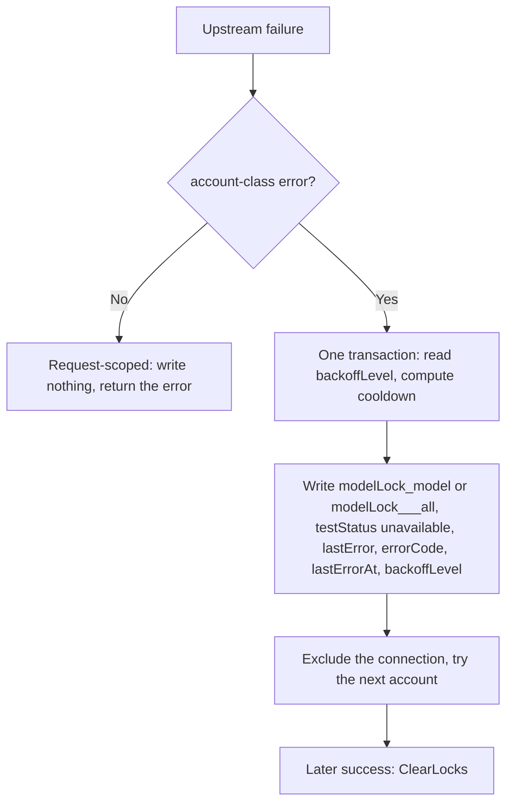

# PRD 05 — Account Selection, Error Rules & Backoff (`app/account/`)

**Status:** partial · **Steps:** 1.7

Built in 1.7b: `app/account` (the selector, the error rules, the backoff arithmetic and the reporter) over the `modelLock_*` fields `app/repository` writes and clears. Called by the account loop in `app/pipeline` since 1.8c. The selector, rules and reporter below describe what is built.

### Selection (`Selector.Select`)

Serialized per provider by a mutex, so the usage counters it writes cannot race inside one process (two processes on one database are unsupported). It returns one connection or an error.

**Candidates:** the provider's **active** connections in priority order (unset priority sorts last), minus:
- rows whose stored data is not valid JSON (skipped, counted in `Selection.Skipped`, never written);
- connections already tried in this request (`Request.Exclude`);
- connections whose `testStatus` is `expired`, a refresh token refused for good (divergence 212);
- for Codex, connections whose own `providerSpecificData.enabledModels` is non-empty and lacks the requested model;
- connections **locked** for the model: `modelLock_<model>` or `modelLock___all` is a time in the future (an unreadable or null lock is no lock; a lock ending exactly now has ended).

**Strategy:** `providerStrategies[provider].fallbackStrategy`, then `settings.fallbackStrategy`, then `fill-first`; an unknown name is `fill-first`. Settings are read through a 5 s snapshot.

| Strategy | Behavior |
|---|---|
| `fill-first` | First available connection; writes nothing |
| `round-robin` | Takes the most recently used connection while its stored `consecutiveUseCount` is below the limit (`providerStrategies[provider].stickyRoundRobinLimit`, then `settings.stickyRoundRobinLimit`, then 3; zero, negative or unparsable values fall through), writing `lastUsedAt` and the count plus one. Otherwise the least recently used (never-used first, by priority), writing count 1. Both are persisted, so rotation survives a restart. The written time is never at or before the stored one, so two uses in one millisecond still order |

**Pinning.** `Request.Prefer` names one connection (the reference reads it from the `x-connection-id` header on image and video calls, so the header is read in 1.11). While it is among the candidates it wins before any strategy and writes nothing; a locked, excluded or expired one falls back to the strategy.

**No candidate left:** if every candidate is locked, the error is `*AllLockedError` with the earliest lock end that applies to the model, "reset after 2m 30s" text, and the first such connection's last error and code. It becomes a 503 with `retryAfter`. No candidates, or locks without a future end, is `ErrNoConnections`.

**Not in the selector:** credential-less providers (a virtual connection), the Freebuff model-assignment hook and the circuit-breaker skip (PRD 12). The step that needs each adds it. The Antigravity quota gate is built (1.10g): a request carries `Request.Hold`, a function that names a connection spent for the model and the moment it frees up; a held connection counts as locked until then, and `AllLockedError` reports the earliest such moment, lock or hold. The selector reads memory only and `app/account` does not import `app/quota`.

### Error Classification (`account.Classify`)

`DefaultRules` is a data table, checked top to bottom, text rules before status rules. Text is lower-cased, matched as a substring, and only its first 4096 bytes are scanned.

| Match | Result |
|---|---|
| Codex: `model is not supported when using codex with a chatgpt account` | 30 min |
| `codebuddy-intl`: `request illegal`, `conversation id missing` | exponential backoff |
| `no credentials`, `improperly formed request` | 2 min |
| `request not allowed` | 5 s |
| `insufficient credit`, `credit balance is too low` | exponential backoff |
| `rate limit`, `too many requests`, `quota exceeded`, `capacity`, `overloaded`, only for status 401, 402, 403, 429 and non-4xx | exponential backoff (on any other 4xx the text may echo the request, so it stays request-scoped) |
| status 401, 402, 403, 404 | 2 min |
| status 429 | exponential backoff |
| other 4xx (400, 406, 408, 413, ...) | request-scoped: no lock, error returned (a combo moves to the next member) |
| anything else (5xx, network, status 0) | transient, 30 s |

### Backoff

- Cooldown is `2 s x 2^(level-1)` for the **new** level, capped at 5 minutes. The new level is the stored one plus one, capped at 15, kept in `backoffLevel`.
- The stored level is read inside the same database transaction that writes the lock (`ConnectionsRepo.LockFromLevel`), so concurrent failures all count.
- A provider-reported reset time replaces the cooldown (level back to 0), capped at 30 minutes except for Antigravity. One in the past is ignored and does not turn a request-scoped error into a lock.
- GitHub's `you've reached your additional usage limit for your plan` on a 402 locks the whole account until the first instant of the next UTC month.

### Locking (`Reporter`)

- Lock values are ISO-8601 UTC strings with milliseconds in the connection's JSON `data`. `lastError` is cut to 200 characters. The error text is stored for the dashboard and **never logged**; the log line carries provider, model, status and cooldown.
- A success (`Succeed`, `ConnectionsRepo.ClearLocks`) removes that model's lock, the account-level lock and every lock that has ended. `testStatus` returns to `active` and the error fields and `backoffLevel` reset only when no lock in the future remains.

---

## Remaining work
**Step 1.7b is built and the 1.8c pipeline calls it.**

- [x] `app/account` `Selector`: per-provider mutex, persisted counters, `Exclude`, `Prefer`
- [x] Error rules as data, then backoff and lock arithmetic on top of the existing `modelLock_*` fields
- [x] `Reporter`: `Fail` and `Succeed`
- [x] Called from the account loop (1.8c)
- [x] Exclusion hook for Antigravity quota (`Request.Hold`, 1.10g)
- [ ] Freebuff model assignment, credential-less providers, the circuit-breaker skip — the steps that need each (**1.10**, **2.5**)

---

## Divergences

Deliberate differences from the references in this area. Numbers are stable and cited from other docs.

| # | What we do differently | Why it is better |
|---|---|---|
| 167 | Executor returns it in `Result.ResetAt`; account lock uses it in place of backoff only when in the future, capped 30 minutes, backoff level cleared. Message with no zone read as UTC+8, as reference does | Wrong or distant date cannot lock an account for days |
| 82 | One mutex per provider | No cross-provider queueing |
| 170 | 402/403 whose body names quota or balance: 429 rate-limit error, account cooled down, next tried; other 403s stay auth errors | Empty plan temporary, not a bad key |
| 212 | A connection whose `testStatus` is `expired` is never a candidate, and is not the last resort either | A dead refresh token cannot serve a request, so it neither burns an attempt nor lands a 401 lock that hides the real state; the reconnect in the dashboard clears it |

---

## Findings

**The backoff level is read where the lock is written.** `Reporter.Fail` hands the repository a function that classifies with the level read inside the lock transaction, so twelve concurrent 429s store level 12, not twelve times level 1. Classifying once outside, then writing, loses every concurrent increment.

**A fixed cooldown keeps the level.** A 401 or a 5xx between two 429s must not restart their backoff, so only a backoff rule raises the level and a provider-reported reset is the one thing that clears it.

**A failure newer than the request survives a success.** `Succeed` passes when the request began and the repository leaves a lock written after it alone, so a slow success cannot undo the failure of a faster, later request.
