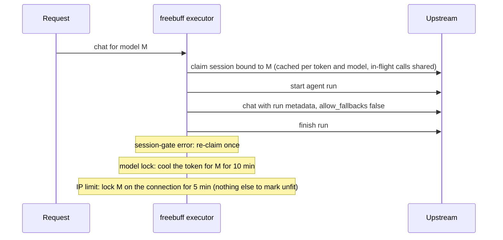

# PRD 08 — Executors (`app/llm/executor/`)

**Status:** partial · **Steps:** 1.8c, 1.10a, 1.10b to 1.10k

Built in 1.8c: `app/llm/executor` with the `Executor` interface (`Execute(ctx, Request) (Response, error)`), the default executor, the URL builders, the retry table and the upstream error parser. It returns the response unread; the pipeline decides stream or buffer. The credential is read from the connection at the last moment and is never stored, logged or put in an error. Not built: a per-provider executor, token refresh on 401/403 (1.9), the `baseUrls` fallback. Everything below the interface is the design step 1.10 completes.

```go
type Executor interface {
    Execute(ctx context.Context, req Request) (Result, error)
}
```

The base behavior covers per-status retry (a rule written without a delay waits 2 s), header merge and the connect timeout. A claude-format transport with no `auth` block sends the key raw in `x-api-key` with `anthropic-version`. The pipeline picks the URL and hands it over in `Request.URL`. The `baseUrls` fallback is loaded and validated but no executor tries the next address yet (divergence 102); credential refresh lives in `app/llm/oauth`. Executors share `cloneHeaders`, `jsonResult` and, for Responses backends, `responses_body.go`; a failed 2xx body counts as a failed attempt, so the account rotates.

| Item | Behavior |
|---|---|
| In-place retries | 502 x3 after 3 s, 503 x3 after 2 s, 504 x2 after 3 s, 429 x0; a provider's registry entry may override. A network error follows the 502 rule |
| Connect timeout | `UPSTREAM_CONNECT_TIMEOUT` (60 s) aborts when response headers do not arrive |
| Header overrides | Merged last, within the header denylist. Settings key `providerOverrides`, `{providerId: {headers}}`, edited at `PUT /api/providers/{id}/overrides` (built in 1.7c): at most 20 headers, a value up to 8192 bytes, names `[A-Za-z0-9-]+`, no `host`, `content-length`, `content-type`, `connection`, `transfer-encoding`, `authorization` or `cookie`, no control character in a value. The write merges one provider's entry in a single transaction |

**Key check (built in 1.7d).** A registry file may carry an `auth` block: `scheme` (`bearer`, `raw` or `query`), the header or parameter `header`, an optional `validateUrl` (default `/models` beside the chat address, and always on the provider's own host), static `headers` (never a credential or framing header) and the `badKey` statuses (default 401, 403). `upstream.Load` refuses anything else. One generic prober reads it; a file with no block, and every OAuth, cookie and AWS provider, answers `test not supported yet`. The block holds how a key is *checked*; the executors in 1.10 add how it is *sent*.

**Default executor.** Used by any provider without a dedicated one. Everything comes from the registry entry: base URL(s), format, URL suffix, auth descriptor (bearer, raw `x-api-key`, or split apiKey/oauth), static headers, quirks, retry table, forced streaming, refresh grant. It also applies the JSON-schema to `json_object` fallback for compatible nodes, strips parameters a provider rejects, and injects reasoning content where required.

### Specialized Executors

Registered by provider id; aliases in parentheses.

| Executor | What it adds |
|---|---|
| antigravity | `v1internal:streamGenerateContent`, function-name sanitizing, thought-signature handling, reset-time parsing |
| gemini-cli | Cloud Code envelope `{project, model, request}`, client headers |
| codex | Body shaped to the Codex backend (allowlisted fields, `system` to `developer`, stored item ids removed, tools flattened and Unicode-property patterns stripped, effort among the model's levels, Lite prefix); workspace and session headers; `/compact` chosen by the route (`Request.Compact` from the path, never executor state), answered with JSON and forwarded to a Responses client as sent; remote images inlined through the `inlineImages` quirk (16 images, 20 MB per request); the first 256 KiB of the stream are read for `server_is_overloaded` and `service_unavailable_error` (same account, the 503 rule), `model_at_capacity` (503 at once so another account serves), and replayed byte for byte when clean. The look ends at the first output delta, at 256 KiB, or when no byte arrives for `STREAM_STALL_TIMEOUT` (D228). An error after real output is never retried. Its image-generation models (`gpt-image-2.6-flare`, `gpt-image-2.6-sunburst`), `imageConfig` and the native generation path await 1.11 (`PRD 13`). Built in 1.10b; `prompt_cache_key` is always the keyed session (D227), instructions are our own text (D192), the effort comes from the model's `levels` and has no hyphen suffix (D229) |
| github | The pipeline picks the wire format from the model data (`targetFormat` for Claude and Codex models) and the executor picks the address of that format; the GitHub token is exchanged for a Copilot token (one mint per account for any number of requests, kept in the memory-only `connections` cache group and sealed with the account, replaced 5 minutes before expiry, replaced once on a 401, a refused token never sent again); a chat body is fitted to Copilot (text and image parts, `max_completion_tokens`, no `reasoning_effort: none`). Built in 1.10c: the executor sends the minted token, one `x-request-id` per request and the data's fixed identity headers (`copilot-integration-id`, `editor-version`, `editor-plugin-version`, `user-agent`, `openai-intent`, `x-github-api-version`, `x-vscode-user-agent-library-version`, `X-Initiator: user`, `anthropic-version`) on all three endpoints; the chat body fit applies only to `/chat/completions`. The parameter rules (`max_tokens` to `max_completion_tokens` for `gpt-5*` and `o1`, `o3` and `o4`, no `temperature` on `gpt-5.4*`) are data in `params.json` |
| grok-cli | Responses body shaped to the proxy's allowlist, native item ids only, tool outputs without a call dropped; identity and session headers from the account and the derived session; `prompt_cache_key` is always the derived session, never the client's; a bounded per-account turn counter; the agent id is the stored one or derived from the connection, never from the machine |
| kiro | AWS headers, host ordering, the integrity gate (`executor/kiro.go`), `translate/kiro*.go`. Host regionalisation covers only the service/region pairs the provider serves (`q` and `runtime`: `us-east-1`, `eu-central-1`; `codewhisperer`: `us-east-1`); the gate is always on (D288) |
| cursor (`cu`) | Connect protobuf over HTTP/2 to the agent service: a fresh session per turn, the current turn and its history, the offered tools, the requested model with its effort, the service's own requests acknowledged on the open stream, and the answer as chat chunks. Built in 1.10i; the picker's `default`/`auto` resolved through the account's model list (five minutes in the memory-only cache), one empty-turn retry with the conversation's tail (D280), the machine id required (D267), and an image refused with the client's 400 (D273) |
| bedrock (`br`), bedrock-xai (`brx`) | SigV4 (`app/protocol/sigv4`), region validation, event-stream framing (`app/protocol/eventstream`) |
| vertex, vertex-partner | Project-scoped URLs, service-account JWT minting |
| azure | Deployment URL, `api-key` header |
| iflow | Not built (D279) |
| freebuff | The backend envelope (`codebuff_metadata` at the top level, a run opened and closed, the assistant marker, the closing tool), a session claimed once per account and model, and a login status poll (`app/llm/oauth/freebuff`) |
| zed | `app/llm/zed`: the token exchange (one mint per account, 50 minutes, replaced once on a 401), the live catalog with a one-hour cache, the provider envelope, and the native sign-in (`app/llm/oauth/zed`) |
| commandcode | The agent wrapper (`codec` `commandcode`), the API SDK stream read as events, and an error the upstream carries inside a 200 turned back into its status. The 0.5.116 sync brought the CLI 1.88.5 body: a 64,000-token default, `memory`/`taste`/`skills` null and `permissionMode: standard`, argument JSON that cannot vanish, a tool result named from its own call and marked `error-text`, reasoning only when it is real, and `params.reasoning_effort` |
| qoder, qoder-cn | `app/protocol/cosy`: the encoded body, the wrapped key and the digest; the account's live model list (one hour), the payload built from its own block, the `{statusCodeValue, body}` envelope read from its first frame, and the queue wait (ten minutes, clamped to the interval the queue clears in) |
| windsurf | gRPC-web protobuf |
| trae | Two-step session and event stream |
| zed | Short-lived LLM token exchange, NDJSON events |
| grok-cli (`gcli`) | Responses-API proxy with a field allowlist |
| opencode, opencode-go, opencode-zen | The free lane's fingerprint (its own two tool definitions, the environment marker, the session id's shape, a TLS offer of its own); the keyed lanes' Responses fit; Zen's stub tools and the free identity for a `-free` id. 0.5.116: Go's addresses are `https://opencode.ai/inference/go/…`, its Claude lane asks for adaptive thinking, and a tool named for a terminal goes out as `run_command` with the caller's name restored |
| xiaomi-tokenplan | The cluster picks the host (`sgp`, `cn`, `ams`); the model's own target format picks `/anthropic/v1/messages` or `/v1/chat/completions`. Built in 1.10i |
| xiaomi-mimo | Two routes: the cloud API with the account's key, and the account service for `mimo-v2.6-*` when the account holds a pass token, authorized by a session cookie (`app/llm/oauth/xiaomi`) and with the effort moved to `output_config`. Built in 1.10i |
| ollama-local | The daemon address is the account's `baseUrl` (default `http://localhost:11434`), validated and joined with `/api/chat`; a keyless daemon gets no bearer at all. Built in 1.10i |
| minimax-code, kimchi, codebuddy-cn/intl | Small quirks: forced streaming, credit-error remapping, header sets. The international gateway keeps the client's own system/developer text (agent identities scrubbed) instead of replacing it |
| cookie web providers (chatgpt-web, deepseek-web, gemini-web, grok-web, perplexity-web, muse-web, uc-web) | Pasted-cookie auth over a plain HTTP client. Providers that need TLS fingerprinting or a browser are Deferred (PRD 22) |

### Model Thinking Settings

A model entry may carry two settings in the grammar of a name suffix (`none`, `auto`, a level, or a token budget). `defaultThinking` applies only when the request asks for nothing; the order is the model name's suffix, then the client's own field, then this default. `thinking` is fixed by the model id and beats the request and a suffix, which is how variants such as `deepseek-v4-pro-medium` work. Declared `thinkingLevels` decide which levels a DeepSeek-format model passes on as given; a level not declared moves to the nearest declared one, and a model that declares none keeps high and max.

### Codecs

| Codec | Source |
|---|---|
| AWS event streams | `app/protocol/eventstream`: the frame prelude and message CRC both checked, every header value type read, bounds and duplicate names refused, `stream.NewFrames` lifts a frame into an `Event`. No AWS SDK: `aws-sdk-go-v2` is not approved or in `go.mod` (divergence 261) |
| AWS request signing | `app/protocol/sigv4`: both of the reference's pinned vectors reproduced byte for byte, a query string refused rather than signed, the session token sent and signed. No AWS SDK for the same reason |
| Cloud credentials | `app/llm/upstream/cloud_key.go`: one `CloudKey` for every provider that hands out a structured credential (an account, a project or tenant, and the parts a token is minted from), so no provider's name owns the type. `ValidProject`, `ValidLocation` and `ValidRegion` live beside it, because each one lands in a request path or a hostname |
| Connect framing | `app/llm/executor/cursor/wire.go`: the flags byte and length, a payload limit, gzip then zlib then raw deflate, and the end-stream trailer. The reference's `cursorProtobuf.js` is a hand-written encoder over a decoded message map; here the fields are `protowire` calls in `agent.go` |
| NDJSON | `bufio.Scanner` with a 1 MiB cap |
| Protobuf fields | `google.golang.org/protobuf/encoding/protowire` |

### Kiro Event Stream

Frames are parsed and bounds-checked, then mapped:

| Event | Becomes |
|---|---|
| `assistantResponseEvent` | content (thinking tags removed) |
| `reasoningContentEvent` | `reasoning_content` |
| `codeEvent` | content |
| `toolUseEvent` | buffered and validated tool calls |
| `messageStopEvent`, `metadataEvent` | finish reason |
| `metricsEvent` | usage |
| `meteringEvent` | credits |
| `contextUsageEvent` | context percentage |

### Freebuff



---

## Parity: Executors

| Executor | Status | Step |
|---|---|---|
| default (registry-driven) | done | 1.8, 1.10a |
| azure | done | 1.10a |
| codex (peek, Lite, `/compact`, reset time, images), grok-cli | done | 1.10b |
| grok-cli login and renewal (device flow on the xAI client, profile hook) | done | 1.10d |
| kimi, muse, nous, kilocode (logins, headers, renewal where the provider has one) | done | 1.10d |
| github (Copilot token, chat, messages and Responses addresses) | done | 1.10c |
| codebuddy-cn and codebuddy-intl (stream forced, system prompt scrub or rebuild, request ids, rate-limit remap), minimax-code and minimax-code-global (zone and session headers, balance remap) | done | 1.10f |
| antigravity, gemini-cli (Cloud Code envelope fill, request ids, retry delays, reset hints) | done | 1.10g |
| commandcode | done (1.10i) | 1.10i |
| opencode, opencode-go, opencode-zen | done (1.10i) | 1.10i |
| zed | done (1.10i) | 1.10i |
| qoder, qoder-cn | done (1.10i) | 1.10i |
| cursor | done (1.10i) | 1.10i |
| iflow (hidden in the reference, free tier ended; D279) | out | - |
| kiro | done | 1.10h |
| windsurf, trae (reference loads neither, D158) | out | - |
| vertex and vertex-partner (three key kinds, project and location, token from a service account or user credentials) | done | 1.10g |
| bedrock and bedrock-xai | done | 1.10h |
| freebuff (extended) | done (1.10i) | 1.10i |
| kimchi | done (1.10i) | 1.10i |
| cookie web providers (paste only) | done (1.10j; deepseek-web built, the others parked or deferred) | 1.10j |
| devin-cli (spawns a process) | out | - |
| web providers needing a TLS-fingerprint client (checked per provider) | deferred | - |

---

## Parity: Provider Registry

Every provider the references ship, with executor kind, status and delivering step. **State:** step 1.7a built the loader and nine seed files; **1.10a** added the executor framework and 45 more data files (44 providers and `azure`) (the rows marked `done (1.10a)`). Every other row stays `todo` until its sub-step (1.10b to 1.10h). A test in `app/llm/upstream` reads this table: a `done` or `partial` id needs a data file, and no id appears twice.

| Marker | Meaning |
|---|---|
| done | Data file, executor, tests complete |
| partial | Some of the provider is done; the note says which part |
| todo 1.10 | Registry entry and executor in step 1.10 |
| todo 1.11 | Media provider (embeddings, image, audio, video, search, fetch), step 1.11 |
| deferred | Needs something outside v1; reason below |
| out | Not built; reason below |

## API Key Providers (`apikey`)

| Executor | Status | Providers |
|---|---|---|
| default | done (1.10a) | alicode, alicode-intl, alims-intl, alitp-intl, atria, bai, baidu, blackbox, bluesminds, cerebras, chutes, cohere, dahl, featherless, fireworks, glm-cn, hyperbolic, llm7, minimax, minimax-cn, mistral, morph, nebius, perplexity, perplexity-agent, runcrate, sambanova, sensenova, siliconflow, tencent, together, tokenharbor, venice, vercel-ai-gateway, volcengine-ark |
| default | done (1.10i) | tokenrouter |
| default | done | anthropic, deepseek, groq, openai |
| default | done (1.11a) | black-forest-labs, comfyui, fal-ai, huggingface, jina-ai, nanobanana, recraft, runwayml, sdwebui, stability-ai, voyage-ai |
| default | todo 1.11b | assemblyai, aws-polly, cartesia, deepgram, elevenlabs, fish-audio, inworld, playht, selfhosted-stt, selfhosted-tts |
| default | todo 1.11d | brave-search, exa, firecrawl, google-pse, jina-reader, linkup, ollama-search, searchapi, serper, tavily, tinyfish, youcom, xquik |
| default | todo 1.11e | nace, topaz, v1m |
| specialized | done (1.10a) | azure |
| specialized | done (1.10i) | xiaomi-tokenplan |
| specialized | done (1.10h) | bedrock |
| specialized | done (1.10i) | ollama-local |
| specialized | done (1.10g) | vertex-partner |
| specialized | done (1.10h) | bedrock-xai |
| specialized | done (1.10i) | commandcode, opencode-go, opencode-zen |
| specialized | todo 1.11e | veoaifree-web |

## Free Providers (`free`)

| Executor | Status | Providers |
|---|---|---|
| specialized | done (1.10g) | gemini-cli |
| specialized | done (1.10h) | kiro, kiro-social |
| specialized | done (1.10i) | freebuff |
| specialized | out | devin-cli |

## Free-Tier Providers (`freeTier`)

| Executor | Status | Providers |
|---|---|---|
| default | done (1.10a) | agnes, api-airforce, bazaarlink, byteplus, cloudflare-ai, kilo-gateway, nvidia, poolside |
| default | done (1.10d) | nous |
| default | done (1.10i) | ollama |
| default | done | gemini, openrouter |
| default | todo 1.11b | coqui, edge-tts, google-tts, local-device, tortoise |
| default | todo 1.11d | searxng |
| specialized | done (1.10i) | kimchi, vertex |

## OAuth Providers (`oauth`)

| Executor | Status | Providers |
|---|---|---|
| default | done (1.10d) | kilocode, kimi, muse |
| default | done (1.10e) | cline, clinepass, gitlab, xai |
| default | done (1.10f) | glm |
| default | partial (1.9c: a login's headers and address suffix, the computed beta list and the disguise are data and `pipeline`, no executor code) | claude |
| specialized | done (1.10b) | codex, grok-cli |
| specialized | done (1.10c) | github |
| specialized | done (1.10f) | codebuddy-cn, codebuddy-intl, minimax-code, minimax-code-global |
| specialized | done (1.10i) | xiaomi-mimo, zed |
| specialized | done (1.10i) | qoder, qoder-cn |
| specialized | done (1.10g antigravity, 1.10i cursor) | antigravity, cursor |
| specialized | out (D279) | iflow |
| specialized | out | trae, windsurf |

## Cookie Web Providers (`webCookie`)

| Executor | Status | Providers |
|---|---|---|
| specialized | done (1.10j) | deepseek-web |
| specialized | todo 1.11e | chatgpt-web, grok-web (their image and video paths; their chat is parked by the reference) |
| specialized | deferred | perplexity-web (the reference offers it for no service kind) |
| specialized | todo 1.11e | uc-web |
| specialized | deferred | gemini-web, muse-web |

Auth: pasted credential over a plain HTTP client. Browser or TLS-fingerprint clients deferred (PRD 22).

## Notes

- **trae, windsurf out.** Reference ships both disabled: registry imports commented out, neither supports tool calling. Scope cut.
- **devin-cli out.** Spawns a process; only the filter-gated `git clone` may be spawned (`PRD 11`, `PRD 22`).
- **gemini-web, muse-web deferred.** Both drive a browser. chatgpt-web uses only plain HTTP and Sentinel; a Turnstile check returns an error, no browser.
- **chatgpt-web, grok-web chat parked.** 0.5.116 sets `serviceKinds: ["image"]` and `["image","video"]`, so its dashboard never offers them for chat: chatgpt awaits "more mileage" and a Turnstile demand needs a browser, grok's web chat is rate-gated and the plain-TLS path needs Chrome impersonation. Both arrive with their media models in 1.11. The extended fork clears the flags, but core follows 0.5.116.
- **perplexity-web deferred.** 0.5.116 sets `serviceKinds: []`, so it offers nothing. The extended fork serves chat with no browser and no impersonation, which is the shape this router could take at a Parity Sync.
- **uc-web, veoaifree-web: 1.11.** Reference refuses their chat call; they exist for image and video.
- **Media-only ids: 1.11.** huggingface, nace, v1m, xquik, local-device carry no chat model. dahl is a chat provider, 1.10.
- **mimo-free and mmf out**: the reference hides both and its own registry comment says the free service has ended; their only identity is a hash of the host name and user. Neither is built (divergence 278).
- **bedrock**: static keys only (access key id, secret, optional session token). Profile mode dropped: the AWS config stack can run external credential commands (divergence 159, built in 1.10h).
- **Chat plus media** (fireworks, nebius, perplexity, together): chat part 1.10, media blocks 1.11.

---

## Remaining work
**Steps 1.8 (base) and 1.10 (per provider).**

- [x] Executor base: URL, auth block, header order with the overrides last, per-status retry, error parsing (1.8c). The `baseUrls` fallback is the default executor's since 1.10k (D291)
- [x] 1.10a: `executor.Mux` (an unregistered name fails the call, a node uses `Default`), per-provider `transport` fields (`headers`, `urlSuffix`, `retry`, `quirks`, `reasoningInject`), `{accountId}` in the address (checked against `^[A-Za-z0-9][A-Za-z0-9._-]{0,127}$`, a bad one sends nothing), a model's `upstreamId` on the wire, `azure`, and 45 data files. Param rules for cerebras, mistral, groq, cloudflare-ai and the volcengine kimi cap are in `params.json`; the MiniMax pair drop `output_config`
- [x] 1.10b: the `codex` and `grok-cli` executors on `Default`, shared Responses shaping (`responses_body.go`: field allowlist rebuilt not edited, flat tools, `\p{` patterns stripped), the SSE peek with an idle bound, `/compact`, `Model.lite` and `levels`, the `inlineImages` quirk. Not built: the `web_search` auto-injection, the live-catalog guard (1.10h)
- [x] 1.10c: the `github` executor on `Default`, the Copilot token mint, `responsesUrl` and `messagesUrl` beside `baseUrl` (a model's `targetFormat` now picks the address as well as the codec), the GitHub device login, the `github` param rules
- [x] 1.10d: five data files (kimi, muse, nous, kilocode and an `oauth` block in `grok-cli.json`), all on the default executor; the Nous and Kimi thinking writers and capability rows; four client-id variables (`OAUTH_KIMI_`, `_MUSE_`, `_NOUS_`, `_XAI_CLIENT_ID`; Grok CLI uses the xAI one). Models are the reference's today
- [x] 1.10e: four data files (xai, gitlab, cline, clinepass) on the default executor; the `workos` auth scheme, the `{baseUrl}` address placeholder, the `clineEnvelope` quirk, the Cline identity headers (divergences 165, 166, 247, 248)
- [x] 1.10f: `executor.CodeBuddy` (both gateways), `executor.MinimaxCode`, five data files, the transport `thinkingFormat`, the `zai` thinking writer and the capability and level rows of the reference (divergences 249, 250)
- [x] 1.10g: `executor.CloudCode` (Gemini CLI and Antigravity), `executor.Vertex` (and partner), `app/llm/quota` and the selector hold, four data files, the capability rows (divergences 252 to 258, 259)
- [x] 1.10h: `app/protocol/sigv4` and `app/protocol/eventstream`, the `bedrock`, `bedrock-xai` and `kiro` executors, the `kiro` format (codec, alias fold, conversation canonicalizer, stream reader, bounded session replay), the Kiro device dialect and hook, three data files, `transport.region` and `baseUrls` (divergences 159, 261 to 266)
- [x] 1.10i: the signed and session protocols (commandcode, qoder, zed, freebuff, xiaomi, cursor, kimchi, the opencode family, tokenrouter, ollama), the cursor codec and paste login, with iflow, mimo-free and mmf out (D279, D278)
- [x] 1.10k: the live-catalogue guard (`app/llm/catalog`) for kiro, kiro-social, codex, cursor and kimchi — one list per account, kept 5 minutes in the memory-only cache, an unlisted id refused with 400 **before any send** so no lock is written, and a failed fetch letting the request through. The data-file `auth.probe` block and the per-provider probes (vertex, ollama-local, opencode-go, qoder; deepseek already had `/models`). `baseUrls` fallback (D102 closed), `timeoutMs`/`stallTimeoutMs`, `regions`/`defaultRegion`, `passthroughModels`, and the id pass
- [x] Still missing from the base, resolved: `regions` and `defaultRegion`, `baseUrls` fallback (D102), `stallTimeoutMs`/`timeoutMs` per provider. The JSON-schema to `json_object` fallback for compatible nodes is not needed by any 1.10a provider and stays with the first one that does
- **Done when:** every provider in the parity table has an executor; each passes its fake-upstream tests; live checks are in `TASKS.md` Open items.

---

## Divergences

Deliberate differences from the references in this area. Numbers are stable and cited from other docs.

| # | What we do differently | Why it is better |
|---|---|---|
| 84, 95 | First 4096 bytes scanned, never logged; fixed message per test outcome | Error bodies carry keys, addresses, prompt fragments |
| 251 | A CodeBuddy rate-limit refusal (code 6004 or its words) becomes a 429 whose body carries the reset moment, parsed from the message in the zone it names or China time and kept only when it lies in the next 400 days. Any other body keeps its status | The reference parses the same date but trusts any parsed date; a bad one would pin an account for ever (improvement) |
| 261 | SigV4 signing and AWS EventStream framing are `app/protocol/sigv4` and `app/protocol/eventstream`: both reference vectors reproduced exactly, a query string refused rather than signed, and the frame decoder fuzzed. No AWS SDK is added | A signed request that is subtly wrong is refused by AWS with no explanation worth reading; pinning the verifier removes that class. The reference's own comment says it did the same for the same reason |
| 262 | A signed request never follows a redirect (`http.ErrUseLastResponse`). Kiro's is signed the same way, for its bearer and profile ARN | A redirect would replay a body, a session token or a profile ARN at whatever origin the redirect named |
| 263 | The AWS region is the account's, else the provider data's default (`us-east-1`). `AWS_REGION` and `AWS_DEFAULT_REGION` are not read | Configuration is this program's own variables and settings row, never another program's environment (same reason as D162) |
| 264 | Kiro's `profileArn` is always the account's own, resolved at login by `ListAvailableProfiles` and preferred by region. The reference's shared default ARNs for another account's profile are not in the data at all | A shared ARN belongs to a different account; the reference itself records that sending it earns 403 `bearer token invalid` |
| 265 | A conversation's opening turn is kept in the bounded cache (an hour, 32 KiB), keyed by API key, account and conversation. The reference keeps it in a 5000-entry process map with a sweep | The router's own cache rules apply: every structure that grows from input has a bound and a TTL |
| 266 | **The social login is built (1.10h); the pasted refresh-token import is not.** Kiro reaches Google or GitHub through AWS Cognito, whose registered redirect is `kiro://kiro.kiroAgent/authenticate-success`, so no server receives the answer. `kiro-social` is a `code-pkce` login that opens the provider's address with the identity provider in `variant`, and the user pastes that `kiro://` address back into the existing paste box; the exchange repeats the constant redirect, and the identity provider is stored as `authMethod` so the renewal uses the same one. A refresh token pasted from another Kiro client is still not accepted | The reference builds the same paste flow, with its own modal. This router reuses its one exchange route and paste parser, so the scheme costs a dialect rather than a dashboard form; not accepting a pasted refresh token keeps another tool's credential out. |
| 259 | A refusal from Gemini CLI or Antigravity is rewritten to carry its retry hint as `error.resets_at` (`RetryInfo.retryDelay` on a 429; `quotaResetTimeStamp` then `retryDelay` on an Antigravity 429 or 409); a hint in the past, over seven days or unreadable is not used. Antigravity retries 429, 500 and 503 in place three times, waiting on `Retry-After`, `X-RateLimit-*` or the text `reset after 2h7m23s`, and gives the answer to the next account when the wait is over ten seconds | The lock reporter reads one field for every provider; a bad hint cannot pin an account for ever (improvement) |
| 165 | Header functions can never write credential header. `workos` auth scheme adds `workos:` marker to WorkOS JWT, leaves other tokens (ClinePass key) as they are. **Built in 1.10e** (`upstream.WorkOSToken`): the marker goes on every request, not only after a renewal | One place sets credential; data, hooks cannot replace it. The reference computes the marked header and then overwrites it with the stored token, so the marker reaches the provider only on a renewed token |
| 171 | Token dropped after key minted | Nothing uses it again; failing account signs in again; one less long-lived secret on disk |
| 173 | POST body carries them; address must be bare https origin; id, secret bounded, free of control characters; secret sealed with account | Secret in URL lands in logs and history; address with path or credentials cannot redirect exchange |
| 174 | Only provider whose data says `appFromAccount` reads an application from request; any other refuses one | Request cannot swap OAuth application of a provider that has its own |
| 222 | **Retired in 1.9b.** A 401 or 403 on a login's token now renews the token and sends the request once more; a second refusal, and a refusal on an API key, is an account failure (locks it, next account). It was temporary until the refresh landed | The reference refreshes and retries once; so does the pipeline now |
| 176 | Fixed word `router`, as chat headers do (D164) | Host name does not leave the machine |
| 181 | Refused mint: fixed text (401 or 403) to client, nothing GitHub said in logs; server error on mint retryable | Provider text out of answers and logs |
| 98, 99 | "Test not supported yet", nothing written; node's own base URL | Working connection stays green |
| 102 | 429 not retried on same URL; account loop moves on; fallback URLs return with executors **(planned 1.10)** | No pointless repeat |
| 227 | The cache key sent to Codex and to the Grok CLI proxy is always the keyed session (a hash bound to the account), never a `prompt_cache_key` the client chose; with no session the field is removed | One client cannot pick the cache another client's conversation reads |
| 228 | The Codex peek has an idle bound: when no byte arrives for the stall timeout it hands over what it read and the normal stream timers act. The reference waits for output or 256 KiB with no timer | A stalled upstream is not hidden behind the peek |
| 229 | A Codex model id carries no hyphen effort suffix (`gpt-5.3-codex-high`); the level comes from the request (`reasoning`, `(high)`) and the model's `levels`. The reference removes the first match of `-high` anywhere in the name | An id is an exact registry row; no match in the middle of a name |
| 244 | **Retired.** A Kimi request goes to the lane of the client's own format (`transport.lanes`): Claude at `/coding/v1/messages?beta=true` with the token raw in `x-api-key`, OpenAI at `/chat/completions` and Responses at `/responses` with a bearer token; any other client is translated to the Claude lane. As the reference does | Recorded so the number stays citable |
| 234 | A GitHub Copilot model is sent to `/v1/messages` when its name says Claude, and to `/chat/completions` otherwise, as the reference does. The one difference left is `gpt-5.3-codex`, which is listed in the data as a Responses model: the reference reaches `/responses` by remembering a 400 answer for the model in a per-process set, and this router does not learn at run time | The choice survives a restart and costs no failed first request per model after every start (router improvement). Which other `gpt-*` ids need `/responses` is a live-account check |
| 248 | The Cline identity headers use fixed words: `User-Agent: rllmx`, `X-CLIENT-TYPE: router`, `X-PLATFORM: router`, `X-IS-MULTIROOT: false`, with the reference's `HTTP-Referer` and `X-Title`. The product name, the host's operating system and the runtime version are never sent | The reference sends its product name and version, the host platform and the Node version to a third party (improvement; same reason as 164 and 176; unverified against Cline) |
| 236 | **Retired.** The Copilot identity headers go on all three endpoints and the operator's header overrides on the chat address only, as the reference does. The stripping rules for Claude-named models are not built, since those models go to `/v1/messages` where the reference never runs them | Recorded so the number stays citable |
| 164 | Device name fixed word `router`; model is build OS and architecture; stable device id from account's stored data, else generated | Host name identifies operator's machine to third party; upstream does not need it |
| 166 | Only provider whose data sets `clineEnvelope`, only when `success` true, `data` an object; any other body passes unchanged. **Built in 1.10e** (`unwrapEnvelope`, non-stream only) | Unrelated envelope-shaped body not rewritten |
| 175 | Data-named headers on login calls pass same filter as upstream headers; content type, accept, framing, credential headers cannot be set | Data file cannot forge framing or replace credential on a token call |
| 159 | Static keys only (access key id, secret, optional session token); `apiKeyOptionalWith: profile` removed from data. **Built in 1.10h** | `credential_process` runs an arbitrary external command; only filter-gated `git clone` may start (`PRD 11`); AWS config package not approved (scope cut) |
| 160 | gemini-web, muse-web deferred; chatgpt-web answers error to Turnstile demand instead of opening browser **(parked with chatgpt-web's chat)** | No browser in the router (PRD 22) (scope cut) |
| 93, 104 | Registered pasted-credential providers or nodes only; set grows through 1.10, closes when last provider file lands **(1.10)**; restricted key refused on chat (403), sees empty list until key access **(2.2)** | Stopgaps, fail closed (temporary) |
| 158 | Not built, listed `out` in PRD 8; no executor, data file, callback listener | Reference does not serve them either; saves a gRPC-web protobuf protocol and a two-step session (scope cut) |
| 267 | The reference reads another application's local files to import a credential: Cursor's `state.vscdb` through SQLite (and, on Linux, `which cursor`), Zed's keychain through `secret-tool`/`security`/`powershell` and `db.sqlite`, and MiMo Desktop's cookie database. This router imports nothing: each provider takes a pasted credential, and the Zed and MiMo logins read their own callback. **Built in 1.10i** | A router that opens another program's database holds a key to data the operator never gave it, and a process spawn is forbidden outside the git gate (`PRD 11`). Zed's account token and Cursor's token are both pasteable; the MiMo account route takes its three identifiers as pasted provider data. CommandCode's `~/.commandcode/auth.json` auto-import (0.5.116) is not built for the same reason |
| 268 | Nothing about the host goes on the wire. The reference sends `process.cwd()` and `os.tmpdir()` in OpenCode's environment marker, `process.cwd()` and `process.platform` in CommandCode's workspace block and its `x-project-slug`, the host name and user name in mimo-free's client hash, and the host platform in Cursor's client headers. This router sends fixed words (`/workspace`, `/tmp/opencode`, `linux`, `router`) and the build target's own operating system and architecture | The host's directory layout, user name and temporary paths are the operator's, not the router's business; same reason as D164 and D176 |
| 269 | OpenCode's free lane passes its gate on the TLS ClientHello, which the reference reaches only through `wreq-js` (one cached session, the cipher list alone, 120 s), installed with `npm install` at run time; the reference skips it entirely when a proxy is configured, and its "fail-open to native fetch" comment does not match the code, where a missing module becomes a 502. This router offers the same TLS 1.2 suite set through the standard library's `tls.Config.CipherSuites` on the one guarded transport, with no extra module and no install, pinned by a test; the gate hashes a sorted list, so only the set matters. **Built in 1.10i**; if the gate still refuses, the lane answers the service's own 429 like any other refusal. `wreq-js`'s other consumer is grok-web, deferred with the other browser and Cloudflare web providers | A runtime package install is a process spawn and an unreviewed dependency; an explicit cipher list is a field on a transport the router already owns |
| 270 | Qoder's RSA public key is a literal in the reference's code. Here it is a PEM field in `qoder.json` and `qoder-cn.json`, parsed and checked at load (RSA, at least 1024 bits). **Built in 1.10i** | It is vendor data about a protocol, not a fact about this program; a data file is where vendor data lives, and it fails the load rather than a request when wrong |
| 271 | The reference reads `QODER_CONTEXT_TIER` and `QODER_MODEL_QUEUE_MAX_WAIT_MS` from the environment. This router reads neither: the context tier comes from its own token estimate, and the queue wait is a fixed ten minutes | Configuration is this program's own variables and settings row, never another program's environment (same reason as D263) |
| 272 | Freebuff's sessions and cooldowns, and the gateway's other per-account state, live in the bounded memory-only cache with a TTL, and one claim in flight per account and model. The reference keeps them in a `globalThis` map with a sweep | Every structure that grows from input has a bound and a TTL (`PRD 20`), and a credential never leaves the process |
| 273 | Cursor's legacy ChatService path is not built. Its AgentService path is the one every translated request takes. The reference sends a request there only when it carries an image part; here such a request is refused with the client's own 400, because the second path needs a second protobuf schema (scope cut) | A conversation body built for one path cannot be sent down the other, and the image case is rare enough that a clear refusal beats a parallel encoder nobody else uses |
| 274 | A Cursor refusal carried in the Connect end-stream trailer is read and answered with its status. The reference drops trailer frames, so the same refusal arrives as an empty turn | An error the service reported is still an error |
| 275 | The opencode and commandcode session ids are derived from the keyed session the pipeline binds to the account, so one conversation keeps one id across restarts. The reference mints a fresh id per process, or from the clock with a memo | A conversation's identity survives a restart, and no client can choose another conversation's id |
| 276 | A local Ollama daemon with no key gets no `Authorization` header. The reference sends `Bearer undefined` | An empty credential is not a credential |
| 277 | **Retired.** iflow is not built (D279), so the stale-key defect this row described cannot occur here | Recorded so the number stays citable |
| 278 | mimo-free and mmf are not built. The reference hides both, and its own registry says the free service has ended | An executor for an endpoint the vendor has closed is dead code |
| 279 | iflow is not built: no executor, no login, no cookie import. The reference hides it and its own README records that the free tier became paid in 2026. The 24h-lead renewal and the stale-key row (D277) go with it | A provider the reference hides behind a flag is not one this router should spend a signed request path, a code login and a cookie mint on (scope cut) |
| 280 | A Cursor turn that ends with no text is asked once more 400 ms later with the last turns of the history only. The waits and the cut are fixed here; the reference reads `CURSOR_EMPTY_TURN_MAX_RETRIES`, `_THRESHOLD` and `_DELAY_MS` from the environment | Configuration is this program's own variables and settings row, never another program's environment (same reason as D263 and D271) |
| 281 | An imported Cursor token's expiry is the JWT `exp` claim, or none when the token is not a JWT. The reference stamps a guessed 24 hours | A guess that lands early marks a working token expired and drops the account; one that lands late sends a dead token and takes the 401 anyway |
| 282 | DeepSeek's access token lives in the memory-only `connections` cache group with a one-hour TTL, keyed by a hash of the pasted credential; the reference keeps a 100-entry process map | Every structure that grows from input has a bound and a TTL, and a credential never leaves the process (same reason as D272) |
| 283 | The DeepSeek proof of work runs inline on the request's own goroutine, checks `ctx` every 1,024 nonces and stops at the reference's 250,000 ceiling; its hash is our own Keccak permutation (`app/protocol/keccak`) running 23 rounds | The reference spawns worker threads with a 10-second timer, which is a thread pool this program has no need for; the cancelled request must be able to stop (goroutine rule), and the service's work counts as a requested context's (PRD 11). Neither `crypto/sha3` nor `golang.org/x/crypto` can skip round 0, so no module is added |
| 285 | The web endpoint's calls carry fixed identity headers and no fabricated analytics cookie: the reference mints a random `intercom-*`/`Hm_lvt_*`/`_frid` cookie per request. `Accept-Encoding` is left to the transport, which negotiates gzip and decompresses it; the reference advertises br and zstd it may not decode. The timezone offset is a fixed `0` (UTC) | Fabricated identifiers carry no meaning and only add noise; advertising an encoding the program cannot read invites an answer it cannot parse (same reason as D268) |
| 286 | The DeepSeek tool contract parses the one canonical `<tool>{"name","arguments","_nonce"}</tool>` block the strict prompt asks for. The reference also parses about ten ad-hoc dialects (`<tool:name>`, attributes, XML children, full-width DSML markers) and asks again once when a reply looks malformed (trade-off) | The prompt forbids the alternatives, so the well-behaved answer is the canonical block; a dialect zoo is code that exists to rescue an instruction the model was told to follow |
| 287 | A bulk-imported account is built from the tokens themselves: the email and the ChatGPT account id and plan come from the JWT claims, and a device-flow provider records `authMethod: device_code`. No provider hook runs, so the import makes no network request (trade-off) | A pasted list is stored, not verified; the reference's own import reads the claims and calls nothing, and a paste path that dials the provider turns a storage action into a login | (`POST /api/providers/bulk`, at most 100 lines, one result per line) instead of the reference's dashboard loop over validate and create (new feature) | The phase-4 dashboard needs one call and one result list; validation stays where it already lives |
| 288 | Kiro's `KIRO_INTEGRITY_GATE=off` is not read: the integrity gate and its one-repair retry are always on. The reference reads the variable from the environment to skip both | Configuration is this program's own variables and settings row, never another program's environment (same reason as D263 and D271); a stream a client cannot parse is worth one repair attempt |
| 290 | The live-catalogue guard refuses an unlisted id with 400 for kiro, codex, cursor and kimchi too. The reference refuses only qoder; for the others it forwards the id and lets the upstream answer | An id the account's own list does not serve is a client mistake in every one of these cases, and answering it locally keeps a dead account from being locked for it. Each provider is wired explicitly, so one can be turned back to the reference's pass-through by removing its fetcher (trade-off) |
| 291 | `baseUrls` fallback belongs to the default executor: it tries the next address once, for a 429 that is not retried in place, and keeps no state between requests. An executor that orders its own hosts (kiro) is left alone | A second address is a different edge of the same provider; one try is enough to learn whether it answers, and an in-place retry already covers the transient case (improvement) |
| 292 | A provider's `timeoutMs`/`stallTimeoutMs` is applied on a per-request client copy, so the shared client and transport are never mutated | Two providers with different bounds in flight at once must not see each other's setting (improvement) |
| 162 | Not read; endpoint, version, deployment from account only | Configuration is product's own variables and settings row, never another program's names (scope cut) |

---

## Findings

**The 0.5.116 sync.** Read from the reference's own history, not only its changelog. Adopted: the CommandCode body above; the Argon family in the Antigravity quota (its own weekly and 5-hour buckets, checked before the shared Gemini ones, and a session bucket zeroed when every Argon model is spent); OpenCode Go's `inference/go` addresses and adaptive Claude thinking; the free tier's `terminal` alias; a compatible node's explicit `thinking.budget_tokens` and its clamped effort; a remote Gemini image's concrete MIME; Kiro's served-region list; the international CodeBuddy prompt; `inputTokenDetails` in the usage extractor; an opaque `LLM|…` line in bulk add; and the SenseNova models. Already ours, pinned by new tests: the DashScope cache-marker quirk, parallel Gemini tool results, and thinking kept on a tool-result turn. Not copied because it is the Node runtime's or the dashboard's: the undici 8 transport with happy-eyeballs and `NINEROUTER_TLS_ECDH_CURVE`, lazy runtime export repair, fetch keep-alive retries, the CLI launcher, tray, CLI tools, headroom/pxpipe, npm runtime flags, `playwright-core`, the version/database/init/settings routes, TTS voice listing, the web-fetch format forwarding, and Codex image generation (1.11). Kiro's gate switch is D288.

**1.10j built: the one cookie provider the reference offers for chat, and the imports.** `deepseek-web` (`app/llm/executor/deepseek`): the pasted user token is traded for a one-hour access token in the memory-only cache (D282), a session is opened and deleted per turn unless the account keeps one, the `DeepSeekHashV1` proof of work is solved inline against a validated challenge with our own 23-round Keccak (`app/protocol/keccak`, D283), and the `{p,o,v}` event stream becomes OpenAI chat chunks with the THINK/ANSWER path, the progress-word clean and the search citations. A request that offers tools gets the strict `<tool>` manifest and the whole trajectory (so an agent loop advances); a canonical block becomes `tool_calls`, anything else stays text (D286). The web client's identity is fixed words and no fabricated analytics cookie (D285). **The paste parser** (`upstream.ParseWebCredential`) accepts a bare token, `name=value` pairs, a `Cookie:` header, a bearer value, a cookie-editor array and a localStorage object, normalizes it and seals it; a cookie row's secret can now rotate through PUT (it was silently dropped), and MiMo's cookie-name rule moved here. **The imports**: `POST /api/oauth/{provider}/bulk-import` for a data file that sets `oauth.bulk` (codex, grok-cli) and `POST /api/providers/bulk` (D284, D287). chatgpt-web and grok-web await their media paths in 1.11; perplexity-web is parked by the reference.

**1.10i built: the plain-quirk providers, the three agent protocols and the hosted ones.** `tokenrouter`, `ollama` and `ollama-local`, `xiaomi-tokenplan` and `xiaomi-mimo` (cloud and account routes, with the session cookie in `app/llm/oauth/xiaomi`), `commandcode` (codec and executor), the three `opencode` lanes (the free gate's identity, its two tool definitions, the marker, the session id, a TLS offer of its own; the keyed lanes' Responses fit), `zed` (`app/llm/zed` and `app/llm/oauth/zed`) and `freebuff` (`app/llm/oauth/freebuff`). `qoder` and `qoder-cn` (`app/protocol/cosy`, the live model list, the envelope reader and the queue wait), `cursor` (`app/llm/executor/cursor`: the Connect frame reader, the run request as protobuf, the pull reader that answers the service's own calls, the checksum and identity headers, and the picker's alias resolved through the model list) and `kimchi` (`executor/openai/kimchi.go`: the body stripped to what its Anthropic-backed rows read). The cursor paste login is `POST /api/oauth/cursor/import`, and 1.10i is complete: iflow is out (D279).

**1.10h built: the two AWS protocol packages and the three AWS providers.** `app/protocol/sigv4` signs one POST with both of the reference's pinned vectors reproduced byte for byte; a query string is refused rather than signed, the path is double-encoded, and a session token is sent and signed. `app/protocol/eventstream` reads the frame's prelude and message CRC, every header value type, and refuses out-of-bounds and duplicate headers; `stream.NewFrames` lifts a frame into the `Event` the pump already reads, so no part of the pipeline learns the binary format. `executor.Bedrock` (two variants) builds the signed address from the account's keys and region, drops what the address already carries, pins `anthropic_version` last, refuses an id from the wrong model family, and never follows a redirect. `executor.Kiro` orders the hosts by sign-in method, regionalises only the `amazonaws.com` ones, tries the next host only on 401, 403 or 404, and reads the answer whole: a turn that ends on an ellipsis, on a promise to check something, or on a tool call a client cannot parse is asked **once** more with an instruction saying what was wrong, and a second failure is answered as it came. The `kiro` format is a codec with its own conversation canonicalizer (alternating turns, paired tool calls, a validated shape or a local 400), an alias fold by family and version, a stream reader that buffers tool fragments and restores names, and a bounded replay of each conversation's opening turn so the upstream's prompt cache keeps hitting.

**1.10g built: the Google executors and the quota gate.** `CloudCode` fills `project` from the account's `projectId` (checked against the project-id shape; an account without one sends nothing), the session as `-<int64>` from a hash, and a request id of `agent-<uuid>` for Gemini CLI or `agent/<conversation>/<ms>/<trajectory>/<step>` for Antigravity, whose ids are UUID-shaped from a hash so one conversation keeps them. Antigravity never sends `requestType` on chat; an image model is never streamed. `Vertex` builds `https://aiplatform.googleapis.com/v1[/projects/P/locations/L]/publishers/google/models/M:action`: a service account or user credentials always need a project (the file's, the account's or the credentials' `quota_project_id`), a raw key may go without. The location is the account's, the model's `defaultLocation` (global for Gemini 4 Argon), else `us-central1` for a token and `global` for a raw key. The pipeline asks `ProjectResolver` before a Cloud Code send when the account has no project. **The quota gate** (`app/llm/quota`) reads memory when the selector asks (`Skip`) and calls Google only after an Antigravity 409 or 429: per-model limits for a paid account, the 5-hour and weekly limits for any, at most one fetch per account every 30 seconds, concurrent callers sharing one; a spent model, or a family whose models are all spent, holds the account until the reset; three refusals within a minute while the reading shows room hold the pair for 15 minutes, and a success clears the count. A gated failure stores no lock.

**The core follows the reference.** A new executor, a request shape, a header set or a body quirk follows 9router 0.5.116 (`AGENTS.md`, Clean-Room). The router's own rules sit on top and are never traded away for parity: no secret, token, cookie or host name in a log or a URL; the guarded dialer and no redirect on a credential call; a bounded read. A kept difference is a divergence row that says which of the two it is.

`app/llm/upstream` exists since 1.7a with a strict loader (unknown field, duplicate id or alias, unknown category, format or executor, and a file name that differs from its id all fail the load, and an error never repeats file content). `app/llm/executor` holds the framework and one sub-package per provider family (`aws`, `google`, `openai`, `opencode`, `qoder`, `xiaomi`, `zed`, `freebuff`, `commandcode`, `codebuddy`), with `executor/mux` building the table of every executor the data files may name.
