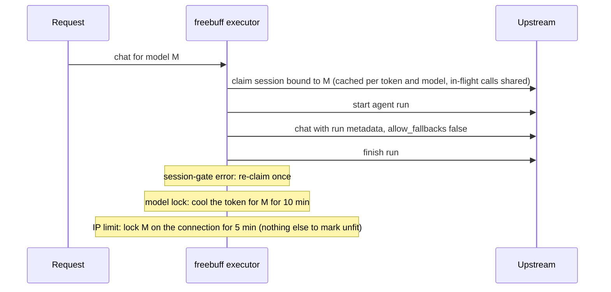

# PRD 08 — Executors (`app/executor/`)

**Status:** partial · **Steps:** 1.8c, 1.10a, 1.10b to 1.10k

Built in 1.8c: `app/executor` with the `Executor` interface (`Execute(ctx, Request) (Response, error)`), the default executor, the URL builders, the retry table and the upstream error parser. It returns the response unread; the pipeline decides stream or buffer. The credential is read from the connection at the last moment and is never stored, logged or put in an error. Not built: a per-provider executor, token refresh on 401/403 (1.9), the `baseUrls` fallback. Everything below the interface is the design step 1.10 completes.

```go
type Executor interface {
    Execute(ctx context.Context, req Request) (Result, error)
}
```

The base behavior covers per-status retry (a rule written without a delay waits 2 s), header merge and the connect timeout. A claude-format transport with no `auth` block sends the key raw in `x-api-key` with `anthropic-version`. The pipeline picks the URL and hands it over in `Request.URL`. The `baseUrls` fallback is loaded and validated but no executor tries the next address yet (divergence 102); credential refresh lives in `app/oauth`. Executors share `cloneHeaders`, `jsonResult` and, for Responses backends, `responses_body.go`; a failed 2xx body counts as a failed attempt, so the account rotates.

| Item | Behavior |
|---|---|
| In-place retries | 502 x3 after 3 s, 503 x3 after 2 s, 504 x2 after 3 s, 429 x0; a provider's registry entry may override. A network error follows the 502 rule |
| Connect timeout | `UPSTREAM_CONNECT_TIMEOUT` (60 s) aborts when response headers do not arrive |
| Header overrides | Merged last, within the header denylist. Settings key `providerOverrides`, `{providerId: {headers}}`, edited at `PUT /api/providers/{id}/overrides` (built in 1.7c): at most 20 headers, a value up to 8192 bytes, names `[A-Za-z0-9-]+`, no `host`, `content-length`, `content-type`, `connection`, `transfer-encoding`, `authorization` or `cookie`, no control character in a value. The write merges one provider's entry in a single transaction |

**Key check (built in 1.7d).** A registry file may carry an `auth` block: `scheme` (`bearer`, `raw` or `query`), the header or parameter `header`, an optional `validateUrl` (default `/models` beside the chat address, and always on the provider's own host), static `headers` (never a credential or framing header) and the `badKey` statuses (default 401, 403). `upstream.Load` refuses anything else. One generic prober reads it; a file with no block, and every OAuth, cookie and AWS provider, answers `test not supported yet`. The block holds how a key is *checked*; the executors in 1.10 add how it is *sent*.

**Default executor.** Used by any provider without a dedicated one. Everything comes from the registry entry: base URL(s), format, URL suffix, auth descriptor (bearer, raw `x-api-key`, or split apiKey/oauth), static headers, quirks, retry table, forced streaming, refresh grant. It also applies the JSON-schema to `json_object` fallback for compatible nodes, strips parameters a provider rejects, and injects reasoning content where required.

### Specialized Executors

Registered by provider id; aliases in parentheses.

| Executor | What it adds |
|---|---|
| antigravity | `v1internal:streamGenerateContent`, function-name sanitizing, thought-signature handling, reset-time parsing |
| gemini-cli | Cloud Code envelope `{project, model, request}`, client headers |
| codex | Body shaped to the Codex backend (allowlisted fields, `system` to `developer`, stored item ids removed, tools flattened and Unicode-property patterns stripped, effort among the model's levels, Lite prefix); workspace and session headers; `/compact` chosen by the route (`Request.Compact` from the path, never executor state), answered with JSON and forwarded to a Responses client as sent; remote images inlined through the `inlineImages` quirk (16 images, 20 MB per request); the first 256 KiB of the stream are read for `server_is_overloaded` and `service_unavailable_error` (same account, the 503 rule), `model_at_capacity` (503 at once so another account serves), and replayed byte for byte when clean. The look ends at the first output delta, at 256 KiB, or when no byte arrives for `STREAM_STALL_TIMEOUT` (D228). An error after real output is never retried. Built in 1.10b; `prompt_cache_key` is always the keyed session (D227), instructions are our own text (D192), the effort comes from the model's `levels` and has no hyphen suffix (D229) |
| github | The pipeline picks the wire format from the model data (`targetFormat` for Claude and Codex models) and the executor picks the address of that format; the GitHub token is exchanged for a Copilot token (one mint per account for any number of requests, kept in the memory-only `connections` cache group and sealed with the account, replaced 5 minutes before expiry, replaced once on a 401, a refused token never sent again); a chat body is fitted to Copilot (text and image parts, `max_completion_tokens`, no `reasoning_effort: none`). Built in 1.10c: the executor sends the minted token, one `x-request-id` per request and the data's fixed identity headers (`copilot-integration-id`, `editor-version`, `editor-plugin-version`, `user-agent`, `openai-intent`, `x-github-api-version`, `x-vscode-user-agent-library-version`, `X-Initiator: user`, `anthropic-version`) on all three endpoints; the chat body fit applies only to `/chat/completions`. The parameter rules (`max_tokens` to `max_completion_tokens` for `gpt-5*` and `o1`, `o3` and `o4`, no `temperature` on `gpt-5.4*`) are data in `params.json` |
| grok-cli | Responses body shaped to the proxy's allowlist, native item ids only, tool outputs without a call dropped; identity and session headers from the account and the derived session; `prompt_cache_key` is always the derived session, never the client's; a bounded per-account turn counter; the agent id is the stored one or derived from the connection, never from the machine |
| kiro | AWS headers, endpoint ordering, event-stream to SSE |
| cursor (`cu`) | Connect protobuf over HTTP/2, agent service for auto/agent models |
| bedrock (`br`), bedrock-xai (`brx`) | SigV4, region validation, event-stream to SSE |
| vertex, vertex-partner | Project-scoped URLs, service-account JWT minting |
| azure | Deployment URL, `api-key` header |
| iflow | Signed headers |
| commandcode | NDJSON to SSE |
| qoder, qoder-cn | Signed URL, envelope unwrapping |
| windsurf | gRPC-web protobuf |
| trae | Two-step session and event stream |
| zed | Short-lived LLM token exchange, NDJSON events |
| grok-cli (`gcli`) | Responses-API proxy with a field allowlist |
| opencode, opencode-go, opencode-zen | Free-tier fingerprint, chat vs responses per model |
| freebuff (`fb`) | Session claim, agent run START/FINISH, metadata, gate handling |
| xiaomi-tokenplan, xiaomi-mimo, mimo-free (`mmf`), minimax-code, kimchi, codebuddy-cn/intl, ollama-local | Small quirks: region or base URL, forced streaming, credit-error remapping, header sets |
| cookie web providers (chatgpt-web, deepseek-web, gemini-web, grok-web, perplexity-web, muse-web, uc-web) | Pasted-cookie auth over a plain HTTP client. Providers that need TLS fingerprinting or a browser are Deferred (PRD 22) |

### Model Thinking Settings

A model entry may carry two settings in the grammar of a name suffix (`none`, `auto`, a level, or a token budget). `defaultThinking` applies only when the request asks for nothing; the order is the model name's suffix, then the client's own field, then this default. `thinking` is fixed by the model id and beats the request and a suffix, which is how variants such as `deepseek-v4-pro-medium` work. Declared `thinkingLevels` decide which levels a DeepSeek-format model passes on as given; a level not declared moves to the nearest declared one, and a model that declares none keeps high and max.

### Codecs

| Codec | Source |
|---|---|
| AWS event streams | Own decoder (prelude and message CRC checked). No AWS SDK: `aws-sdk-go-v2` is not approved or in `go.mod`, and step 1.10 adds it only with a `TASKS.md` gate |
| AWS request signing | Own SigV4 signer, verified against the published test vector. No AWS SDK for the same reason |
| Connect and gRPC-web envelope | A small helper inside the Cursor and Windsurf executors; the Connect library has no standalone envelope API |
| NDJSON | `bufio.Scanner` with a 1 MiB cap |
| Protobuf fields | `google.golang.org/protobuf/encoding/protowire` |

### Kiro Event Stream

Frames are parsed and bounds-checked, then mapped:

| Event | Becomes |
|---|---|
| `assistantResponseEvent` | content (thinking tags removed) |
| `reasoningContentEvent` | `reasoning_content` |
| `codeEvent` | content |
| `toolUseEvent` | buffered and validated tool calls |
| `messageStopEvent`, `metadataEvent` | finish reason |
| `metricsEvent` | usage |
| `meteringEvent` | credits |
| `contextUsageEvent` | context percentage |

### Freebuff



---

## Parity: Executors

| Executor | Status | Step |
|---|---|---|
| default (registry-driven) | done | 1.8, 1.10a |
| azure | done | 1.10a |
| codex (peek, Lite, `/compact`, reset time, images), grok-cli | done | 1.10b |
| grok-cli login and renewal (device flow on the xAI client, profile hook) | done | 1.10d |
| kimi, muse, nous, kilocode (logins, headers, renewal where the provider has one) | done | 1.10d |
| github (Copilot token, chat, messages and Responses addresses) | done | 1.10c |
| codebuddy-cn and codebuddy-intl, minimax-code and minimax-code-global | todo | 1.10f |
| iflow, antigravity, commandcode, gemini-cli, qoder and qoder-cn, kiro, zed, cursor | todo | 1.10 |
| windsurf, trae (reference loads neither, D158) | out | - |
| bedrock and bedrock-xai, opencode (opencode-go, opencode-zen), vertex and vertex-partner | todo | 1.10 |
| freebuff (extended), xiaomi-tokenplan, xiaomi-mimo, mimo-free, kimchi, ollama-local | todo | 1.10 |
| cookie web providers (paste only) | todo | 1.10 |
| devin-cli (spawns a process) | out | - |
| web providers needing a TLS-fingerprint client (checked per provider) | deferred | - |

---

## Parity: Provider Registry

Every provider the references ship, with executor kind, status and delivering step. **State:** step 1.7a built the loader and nine seed files; **1.10a** added the executor framework and 45 more data files (44 providers and `azure`) (the rows marked `done (1.10a)`). Every other row stays `todo` until its sub-step (1.10b to 1.10h). A test in `app/upstream` reads this table: a `done` or `partial` id needs a data file, and no id appears twice.

| Marker | Meaning |
|---|---|
| done | Data file, executor, tests complete |
| partial | Some of the provider is done; the note says which part |
| todo 1.10 | Registry entry and executor in step 1.10 |
| todo 1.11 | Media provider (embeddings, image, audio, video, search, fetch), step 1.11 |
| deferred | Needs something outside v1; reason below |
| out | Not built; reason below |

## API Key Providers (`apikey`)

| Executor | Status | Providers |
|---|---|---|
| default | done (1.10a) | alicode, alicode-intl, alims-intl, alitp-intl, atria, bai, baidu, blackbox, bluesminds, cerebras, chutes, cohere, dahl, featherless, fireworks, glm-cn, hyperbolic, llm7, minimax, minimax-cn, mistral, morph, nebius, perplexity, perplexity-agent, runcrate, sambanova, sensenova, siliconflow, tencent, together, tokenharbor, venice, vercel-ai-gateway, volcengine-ark |
| default | todo 1.10 | tokenrouter (its thinking format needs a writer of its own) |
| default | done | anthropic, deepseek, groq, openai |
| default | todo 1.11 | assemblyai, aws-polly, black-forest-labs, brave-search, cartesia, comfyui, deepgram, elevenlabs, exa, fal-ai, firecrawl, fish-audio, google-pse, huggingface, inworld, jina-ai, jina-reader, linkup, nace, nanobanana, ollama-search, playht, recraft, runwayml, sdwebui, searchapi, selfhosted-embedding, selfhosted-stt, selfhosted-tts, serper, stability-ai, tavily, tinyfish, topaz, v1m, voyage-ai, xquik, youcom |
| specialized | done (1.10a) | azure |
| specialized | todo 1.10 | xiaomi-tokenplan |
| specialized | todo 1.10 | bedrock, ollama-local |
| specialized | todo 1.10 | bedrock-xai, commandcode, mmf, opencode-go, opencode-zen, vertex-partner |
| specialized | todo 1.11 | veoaifree-web |

## Free Providers (`free`)

| Executor | Status | Providers |
|---|---|---|
| specialized | todo 1.10 | freebuff, gemini-cli, kiro, mimo-free, opencode |
| specialized | out | devin-cli |

## Free-Tier Providers (`freeTier`)

| Executor | Status | Providers |
|---|---|---|
| default | done (1.10a) | agnes, api-airforce, bazaarlink, byteplus, cloudflare-ai, kilo-gateway, nvidia, poolside |
| default | done (1.10d) | nous |
| default | todo 1.10 | ollama (its own wire format) |
| default | done | gemini, openrouter |
| default | todo 1.11 | coqui, edge-tts, google-tts, local-device, searxng, tortoise |
| specialized | todo 1.10 | kimchi, vertex |

## OAuth Providers (`oauth`)

| Executor | Status | Providers |
|---|---|---|
| default | done (1.10d) | kilocode, kimi, muse |
| default | done (1.10e) | cline, clinepass, gitlab, xai |
| default | todo 1.10f | glm |
| default | partial (1.9c: a login's headers and address suffix, the computed beta list and the disguise are data and `pipeline`, no executor code) | claude |
| specialized | done (1.10b) | codex, grok-cli |
| specialized | done (1.10c) | github |
| specialized | todo 1.10f | codebuddy-cn, codebuddy-intl, minimax-code, minimax-code-global |
| specialized | todo 1.10 | antigravity, cursor, iflow, qoder, qoder-cn, xiaomi-mimo, zed |
| specialized | out | trae, windsurf |

## Cookie Web Providers (`webCookie`)

| Executor | Status | Providers |
|---|---|---|
| specialized | todo 1.10 | chatgpt-web, deepseek-web, grok-web, perplexity-web |
| specialized | todo 1.11 | uc-web |
| specialized | deferred | gemini-web, muse-web |

Auth: pasted cookie over a plain HTTP client. Browser or TLS-fingerprint clients deferred (PRD 22).

## Notes

- **trae, windsurf out.** Reference ships both disabled: registry imports commented out, neither supports tool calling. Scope cut.
- **devin-cli out.** Spawns a process; only the filter-gated `git clone` may be spawned (`PRD 11`, `PRD 22`).
- **gemini-web, muse-web deferred.** Both drive a browser. chatgpt-web uses only plain HTTP and Sentinel; a Turnstile check returns an error, no browser.
- **uc-web, veoaifree-web: 1.11.** Reference refuses their chat call; they exist for image and video.
- **Media-only ids: 1.11.** huggingface, nace, v1m, xquik, local-device carry no chat model. dahl is a chat provider, 1.10.
- **mmf**: separate registry id the reference routes to the mimo-free executor, listed specialized. Its alias clashes with mimo-free's own; settled when that executor lands.
- **bedrock**: static keys only (access key id, secret, optional session token). Profile mode dropped: the AWS config stack can run external credential commands.
- **Chat plus media** (fireworks, nebius, perplexity, together): chat part 1.10, media blocks 1.11.

---

## Remaining work
**Steps 1.8 (base) and 1.10 (per provider).**

- [x] Executor base: URL, auth block, header order with the overrides last, per-status retry, error parsing (1.8c). The `baseUrls` fallback stays unbuilt (D102)
- [x] 1.10a: `executor.Mux` (an unregistered name fails the call, a node uses `Default`), per-provider `transport` fields (`headers`, `urlSuffix`, `retry`, `quirks`, `reasoningInject`), `{accountId}` in the address (checked against `^[A-Za-z0-9][A-Za-z0-9._-]{0,127}$`, a bad one sends nothing), a model's `upstreamId` on the wire, `azure`, and 45 data files. Param rules for cerebras, mistral, groq, cloudflare-ai and the volcengine kimi cap are in `params.json`; the MiniMax pair drop `output_config`
- [x] 1.10b: the `codex` and `grok-cli` executors on `Default`, shared Responses shaping (`responses_body.go`: field allowlist rebuilt not edited, flat tools, `\p{` patterns stripped), the SSE peek with an idle bound, `/compact`, `Model.lite` and `levels`, the `inlineImages` quirk. Not built: the `web_search` auto-injection, the live-catalog guard (1.10h)
- [x] 1.10c: the `github` executor on `Default`, the Copilot token mint, `responsesUrl` and `messagesUrl` beside `baseUrl` (a model's `targetFormat` now picks the address as well as the codec), the GitHub device login, the `github` param rules
- [x] 1.10d: five data files (kimi, muse, nous, kilocode and an `oauth` block in `grok-cli.json`), all on the default executor; the Nous and Kimi thinking writers and capability rows; four client-id variables (`OAUTH_KIMI_`, `_MUSE_`, `_NOUS_`, `_XAI_CLIENT_ID`; Grok CLI uses the xAI one). Models are the reference's today
- [x] 1.10e: four data files (xai, gitlab, cline, clinepass) on the default executor; the `workos` auth scheme, the `{baseUrl}` address placeholder, the `clineEnvelope` quirk, the Cline identity headers (divergences 165, 166, 247, 248)
- [ ] 1.10f to 1.10k: the rest of the parity table (codebuddy, minimax and glm; the Google family; AWS; signed and session protocols; cookie providers; live-catalog guards and probes)
- [ ] Still missing from the base: `regions` and `defaultRegion`, `baseUrls` fallback (D102), `stallTimeoutMs`/`timeoutMs` per provider, the JSON-schema to `json_object` fallback for compatible nodes. No 1.10a provider needs them; each lands with the first provider that does
- [ ] Live-catalog guards for kiro, codex, cursor, kimchi, qoder: account model list (5-minute cache) before dispatch; unknown model 400; a fetch failure lets the request through
- **Done when:** every provider in the parity table has an executor; each passes its fake-upstream tests; live checks are in `TASKS.md` Open items.

---

## Divergences

Deliberate differences from the references in this area. Numbers are stable and cited from other docs.

| # | What we do differently | Why it is better |
|---|---|---|
| 84, 95 | First 4096 bytes scanned, never logged; fixed message per test outcome | Error bodies carry keys, addresses, prompt fragments |
| 165 | Header functions can never write credential header. `workos` auth scheme adds `workos:` marker to WorkOS JWT, leaves other tokens (ClinePass key) as they are. **Built in 1.10e** (`upstream.WorkOSToken`): the marker goes on every request, not only after a renewal | One place sets credential; data, hooks cannot replace it. The reference computes the marked header and then overwrites it with the stored token, so the marker reaches the provider only on a renewed token |
| 171 | Token dropped after key minted | Nothing uses it again; failing account signs in again; one less long-lived secret on disk |
| 173 | POST body carries them; address must be bare https origin; id, secret bounded, free of control characters; secret sealed with account | Secret in URL lands in logs and history; address with path or credentials cannot redirect exchange |
| 174 | Only provider whose data says `appFromAccount` reads an application from request; any other refuses one | Request cannot swap OAuth application of a provider that has its own |
| 222 | **Retired in 1.9b.** A 401 or 403 on a login's token now renews the token and sends the request once more; a second refusal, and a refusal on an API key, is an account failure (locks it, next account). It was temporary until the refresh landed | The reference refreshes and retries once; so does the pipeline now |
| 176 | Fixed word `router`, as chat headers do (D164) | Host name does not leave the machine |
| 181 | Refused mint: fixed text (401 or 403) to client, nothing GitHub said in logs; server error on mint retryable | Provider text out of answers and logs |
| 98, 99 | "Test not supported yet", nothing written; node's own base URL | Working connection stays green |
| 102 | 429 not retried on same URL; account loop moves on; fallback URLs return with executors **(planned 1.10)** | No pointless repeat |
| 227 | The cache key sent to Codex and to the Grok CLI proxy is always the keyed session (a hash bound to the account), never a `prompt_cache_key` the client chose; with no session the field is removed | One client cannot pick the cache another client's conversation reads |
| 228 | The Codex peek has an idle bound: when no byte arrives for the stall timeout it hands over what it read and the normal stream timers act. The reference waits for output or 256 KiB with no timer | A stalled upstream is not hidden behind the peek |
| 229 | A Codex model id carries no hyphen effort suffix (`gpt-5.3-codex-high`); the level comes from the request (`reasoning`, `(high)`) and the model's `levels`. The reference removes the first match of `-high` anywhere in the name | An id is an exact registry row; no match in the middle of a name |
| 244 | **Retired.** A Kimi request goes to the lane of the client's own format (`transport.lanes`): Claude at `/coding/v1/messages?beta=true` with the token raw in `x-api-key`, OpenAI at `/chat/completions` and Responses at `/responses` with a bearer token; any other client is translated to the Claude lane. As the reference does | Recorded so the number stays citable |
| 234 | A GitHub Copilot model is sent to `/v1/messages` when its name says Claude, and to `/chat/completions` otherwise, as the reference does. The one difference left is `gpt-5.3-codex`, which is listed in the data as a Responses model: the reference reaches `/responses` by remembering a 400 answer for the model in a per-process set, and this router does not learn at run time | The choice survives a restart and costs no failed first request per model after every start (router improvement). Which other `gpt-*` ids need `/responses` is a live-account check |
| 248 | The Cline identity headers use fixed words: `User-Agent: rllmx`, `X-CLIENT-TYPE: router`, `X-PLATFORM: router`, `X-IS-MULTIROOT: false`, with the reference's `HTTP-Referer` and `X-Title`. The product name, the host's operating system and the runtime version are never sent | The reference sends its product name and version, the host platform and the Node version to a third party (improvement; same reason as 164 and 176; unverified against Cline) |
| 236 | **Retired.** The Copilot identity headers go on all three endpoints and the operator's header overrides on the chat address only, as the reference does. The stripping rules for Claude-named models are not built, since those models go to `/v1/messages` where the reference never runs them | Recorded so the number stays citable |
| 164 | Device name fixed word `router`; model is build OS and architecture; stable device id from account's stored data, else generated | Host name identifies operator's machine to third party; upstream does not need it |
| 166 | Only provider whose data sets `clineEnvelope`, only when `success` true, `data` an object; any other body passes unchanged. **Built in 1.10e** (`unwrapEnvelope`, non-stream only) | Unrelated envelope-shaped body not rewritten |
| 175 | Data-named headers on login calls pass same filter as upstream headers; content type, accept, framing, credential headers cannot be set | Data file cannot forge framing or replace credential on a token call |
| 159 | Static keys only (access key id, secret, optional session token); `apiKeyOptionalWith: profile` removed from data **(planned 1.10i)** | `credential_process` runs an arbitrary external command; only filter-gated `git clone` may start (`PRD 11`); AWS config package not approved (scope cut) |
| 160 | gemini-web, muse-web deferred; chatgpt-web answers error to Turnstile demand instead of opening browser **(planned 1.10k)** | No browser in the router (PRD 22) (scope cut) |
| 93, 104 | Registered pasted-credential providers or nodes only; set grows through 1.10, closes when last provider file lands **(1.10)**; restricted key refused on chat (403), sees empty list until key access **(2.2)** | Stopgaps, fail closed (temporary) |
| 158 | Not built, listed `out` in PRD 8; no executor, data file, callback listener | Reference does not serve them either; saves a gRPC-web protobuf protocol and a two-step session (scope cut) |
| 162 | Not read; endpoint, version, deployment from account only | Configuration is product's own variables and settings row, never another program's names (scope cut) |

---

## Findings

**The core follows the reference.** A new executor, a request shape, a header set or a body quirk follows 9router 0.5.112 (`AGENTS.md`, Clean-Room). The router's own rules sit on top and are never traded away for parity: no secret, token, cookie or host name in a log or a URL; the guarded dialer and no redirect on a credential call; a bounded read. A kept difference is a divergence row that says which of the two it is.

`app/upstream` exists since 1.7a with a strict loader (unknown field, duplicate id or alias, unknown category, format or executor, and a file name that differs from its id all fail the load, and an error never repeats file content). `app/executor` does not exist: the interface and the remaining data files land in 1.8 and 1.10.
