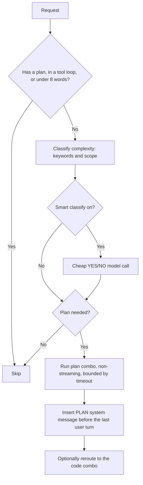

# PRD 11 — Skills, Session & Auto Plan (`app/skill/`, `app/gateway/conversation/`, `app/plan/`)

**Status:** todo · **Steps:** 3.2 to 3.4

Nothing exists yet. Skills are 3.2 and 3.3; Auto Plan is 3.4.

### Skill Layout

A folder under `DATA_DIR/skills/<id>/`; built-in skills ship embedded in the binary.

| File | Content |
|---|---|
| `manifest.json` | id, name, description, hook type, enabled flag (`<id>Enabled`), config schema, routing mode |
| `prompt.txt` or `prompt.md` | The prompt. `{key}` placeholders are filled from the skill's config; remaining values are appended as an "Active Configuration" block |
| `rules.json` | Optional declarative rules |

**Skills Studio** (dashboard page, `/api/skills`) creates, edits and deletes custom skills and toggles built-ins. It writes only the files above. `hook.js` and install, update or uninstall commands in imported skills are ignored and shown as unsupported.

### Update From a Git Repository (`app/git`)

A skill update (`rllmx artisan skills:sync`, or an always-protected dashboard route) is the only place the program starts a process, and only on an admin action: never at start-up, from a client request or from a skill's own content. When `git` is missing or a filter fails, it falls back to the GitHub API over the guarded client (`PRD 14`); a failure never fails a request.

`app/git` is the only code that builds an `exec.Cmd`. A test fails any other non-test file that imports `os/exec`. Every filter passes before a process exists; a failure returns an error and logs at WARN without argument values.

| Filter | Rule |
|---|---|
| Program | `git`, found once with `exec.LookPath` and used by absolute path. No other program is ever started |
| Subcommand | The first argument is `clone`. Any other subcommand is refused until added, with user approval |
| Arguments | An array, never joined, never given to a shell. The fixed set `--depth 1 --single-branch --no-tags --branch <ref>`, then `--`, `<url>`, `<dir>`. `<ref>` matches `^[A-Za-z0-9][A-Za-z0-9._/-]{0,127}$` and holds no `..`. `<url>` is `https`, has no user info, is on the admin's skill-source list and its host passes the SSRF guard. `<dir>` is a new directory inside the clone area under `DATA_DIR` |
| Environment | Only `PATH`, `HOME` set to the clone area, `GIT_TERMINAL_PROMPT=0`, `GIT_CONFIG_NOSYSTEM=1`, `GIT_CONFIG_GLOBAL` at the null device and `GIT_ALLOW_PROTOCOL=https`. No inherited secret, credential helper or git config |
| Limits | 60 s through `CommandContext`, capped output, a clone-size cap checked while running and cut off, one clone at a time |
| After the clone | Only `SKILL.md` text is read. No git command runs inside the clone; nothing from it is executed |

The program, subcommand and flags are one literal in the package. Adding any changes the rule first, with user approval.

### Rules

Each rule has a `stage` (`pre-route` or `pre-request`), a `when` and a `then`:

```json
{
  "stage": "pre-request",
  "when": { "modelRegex": "^claude-", "messageRegex": "(?i)refactor", "header": { "name": "x-client", "regex": "^cli$" } },
  "then": { "injectPrompt": "Prefer small, reviewable diffs.", "rerouteModel": "my-combo", "setHeader": { "name": "x-team", "value": "platform" } }
}
```

| Rule | Detail |
|---|---|
| Match | Every `when` field present must match. RE2 on bounded input (last user message, 64 KB) |
| `setHeader` | Upstream request only. `authorization`, `host`, `cookie` and `content-length` are refused |
| `rerouteModel` | Goes through key access again, so a rule cannot widen a restricted key |

### Routers

| Router | Behavior | Bypass header |
|---|---|---|
| ECC auto router | TF-IDF and cosine similarity over a catalog index (weights: id x5, name x4, keywords x3, triggers x3, description x1). Settings `ecc_auto_skill_routerEnabled`, `...Confidence` (0.35), `...MaxSkills` (1). The catalog is not shipped: `POST /api/skills/sync-ecc` downloads it over HTTPS into `DATA_DIR/skills/ecc-imported/` | `x-9router-skill-router: off` |
| Local skill router | Skills with routing mode `smart` are injected only when their TF-IDF score clears the threshold, at most two per request | `x-9router-local-skill-router: off` |

Matched skills are not stored with the usage row (metadata only); a later phase may add a nullable column.

### Session Id (`app/gateway/conversation/`, built in 1.8c)

`Store.Resolve` returns the id a request belongs to. First match wins; every candidate is trimmed and dropped above 256 characters.

| Order | Source | Returned as |
|---|---|---|
| 1 | Claude Code: `metadata.user_id` as `..._session_<id>` or JSON `session_id`, then `X-Claude-Code-Session-Id` | `claude:<id>` |
| 2 | Antigravity: `request.sessionId`, or the conversation uuid in `requestId` | `antigravity:<id>` |
| 3 | Headers `X-Session-Id`, `Session-Id`, `Session_id`, `X-Amp-Thread-Id`, `X-Client-Request-Id` | as sent |
| 4 | Body fields `prompt_cache_key`, `session_id`, `conversation_id`, plain `metadata.user_id` | as sent |
| 5 | Hash of the first 50 characters of the assistant text (at least 50 needed; 5000 entries) | derived |
| 6 | One id per connection (1000 entries) | made up |

Made-up ids are a random UUID plus the time in milliseconds and expire after two hours. The pipeline holds one store (`Deps.Sessions`, made when none is given) and resolves the id once an account is chosen, because the last fallback is one id per account. Since 1.9c the Claude user id and `x-claude-code-session-id` carry the id without its `claude:` prefix, and Codex's `session_id` carries `Bound`, the keyed hash, never the client's value. The helper names an earlier draft listed here (`ClaudePrefix`, `TrimClaudePrefix`, `UserIDSession`, `IsAnthropicNode`, `SpeaksAnthropic`) were never written: `translate.SessionOf` reads the session out of a user id, and the disguise needs nothing else.

**Session cache** (planned, `app/gateway/conversation/`). In-memory LRU, 2000 entries, 4 hours, keyed by `x-session-id` or `session-id`. On repeat turns a skill already injected becomes a one-line reminder. After an account failover every later turn of that session gets a short continuity notice.

### Auto Plan-Then-Code (`app/plan/`)

Settings: `autoPlanEnabled`, `autoPlanMode`, `autoPlanComboId`, `autoCodeComboId`, `autoPlanComplexityThreshold`, `autoPlanSmartClassify`, `autoPlanMaxTokens`, `autoPlanTimeoutMs`.



An error at any step fails open. Bypass: `x-9router-auto-plan: off`. The outcome is logged at DEBUG; storing it with the usage row is decided in step 3.4.

---

## Parity: Extended Features

| Feature | Reference (extended) | Package | Status | Step |
|---|---|---|---|---|
| Freebuff provider and OAuth device login | `executors/freebuff.js`, `src/lib/oauth/providers/freebuff.js` | `app/llm/executor/freebuff.go`, `app/llm/oauth` | todo | 1.10 |
| Freebuff strict model assignment | `src/sse/services/auth.js` | `app/gateway/account` | todo | 1.10 |
| Health EMA, circuit breaker | `src/lib/routing/health.js` | `app/health` | diverged (breaker used in routing) | 2.5 |
| Model probe | `src/lib/routing/modelProbe.js` | `app/probe` | todo | 2.5 |
| Model ranking, combo suggestion | `src/lib/routing/modelRanking.js`, `/api/combos/suggest` | `app/gateway` | todo | 2.5 |
| Latency SSE | `/api/health/latency-stream` | `app/health` | todo | 2.5 |
| OpenRouter live model sync | `src/app/api/v1/models/route.js` | `app/gateway/catalog` | todo | 2.6 |
| Skills registry (system-prompt hooks) | `src/lib/skillsRegistry.js` | `app/skill` | todo | 3.2 |
| ECC auto skill router | `src/skills/autoRouter.js` | `app/skill` | todo | 3.2 |
| Local skill router | `src/skills/localSkillRouter.js` | `app/skill` | todo | 3.2 |
| Session LRU and continuity notice | `src/lib/session/cache.js` | `app/gateway/conversation` | todo | 3.2 |
| Skills Studio | `src/app/api/skills`, dashboard skills page | `app/skill`, `web` | diverged (declarative rules, no scripts) | 3.3 |
| Auto Plan-Then-Code | `src/lib/autoPlanRouter.js` | `app/plan` | todo | 3.4 |
| Setup wizard | `src/app/setup/page.js` | `web` | todo | 4.1 |
| Proxy-pool fitness | `open-sse/services/proxyPoolFitness.js`, `proxyPoolFitnessRepo.js` | none | out (no proxies) | - |
| Hermes plugin (memory injection, process manager) | `src/lib/plugins/hermes/*` | none | out | - |
| Native autostart | `src/lib/autostart.js` | none | out | - |
| Self-updater, update check | `src/lib/updater`, `updateCheck.js` | none | out | - |
| Headroom auto-setup, watchdog | `src/lib/headroom/*` | none | out | - |

---

## Remaining work
**Steps 3.2 to 3.4.** Nothing built.

- [ ] Skill registry and `<id>Enabled` / `<id>RoutingMode` handling
- [ ] `--skills-from` import in `db:import-config`; `skills:sync` through the `app/git` gate
- [ ] Rule hooks: RE2 on bounded input (last user message, 64 KB); inject, reroute or set a header; deny `authorization`, `host`, `cookie`, `content-length`
- [ ] Skills Studio routes (`/api/skills`)
- [ ] `app/plan`, driven by the `autoPlan*` settings
- **Done when:** the session cache evicts and expires per spec; an imported skill's `hook.js` and install commands are ignored and reported.

---

## Divergences

Deliberate differences from the references in this area. Numbers are stable and cited from other docs.

| # | What we do differently | Why it is better |
|---|---|---|
| 177 | All state per request or in bounded cache keyed by connection and session; compact route sets a flag on request | Reference races: two requests at once can send each other's session id, compact address, turn index |
| 178 | Session value derived from conversation, bound to connection by keyed hash; value client chose never sent | One tenant cannot pick cache key another tenant's conversation uses |
| 179 | Workspace ids, session ids, identity values must match plain token pattern, else left out | Stored value cannot add a header line |
| 180 | Falls back to id derived from provider and connection | Accounts of one router do not look like one machine to the provider |
| 200 | `os/exec` in one package, `git`, running only `git clone --depth 1 --single-branch --no-tags --branch <ref> -- <url> <dir>`; argument array; `https` URL on admin list that passes SSRF guard; minimal environment; timeout; size cap; falls back to GitHub API | Ref or URL injectable into the reference's shell string |
| 3, 11 | No install commands; declarative rules only **(planned 3.3)** | No code execution; only spawned process is allowlisted `git clone` (scope cut) |

---

## Findings

Nothing built. `app/skill`, `app/gateway/conversation` and `app/plan` do not exist.
